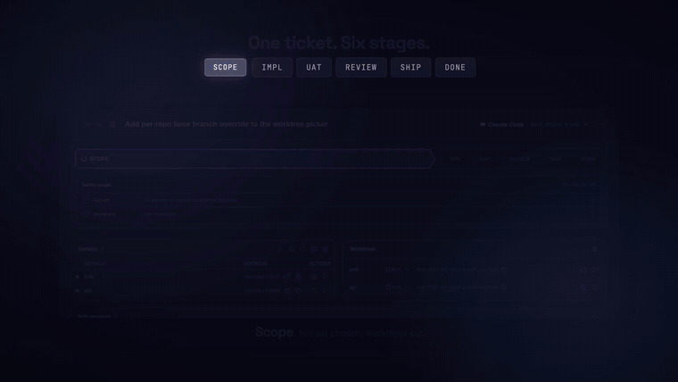
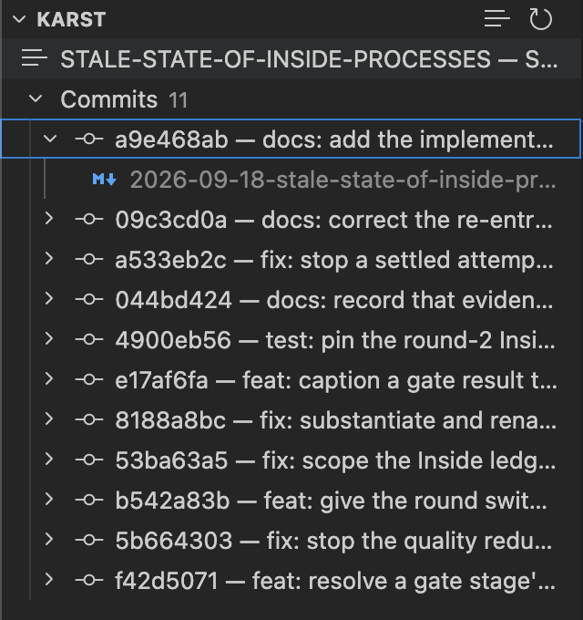
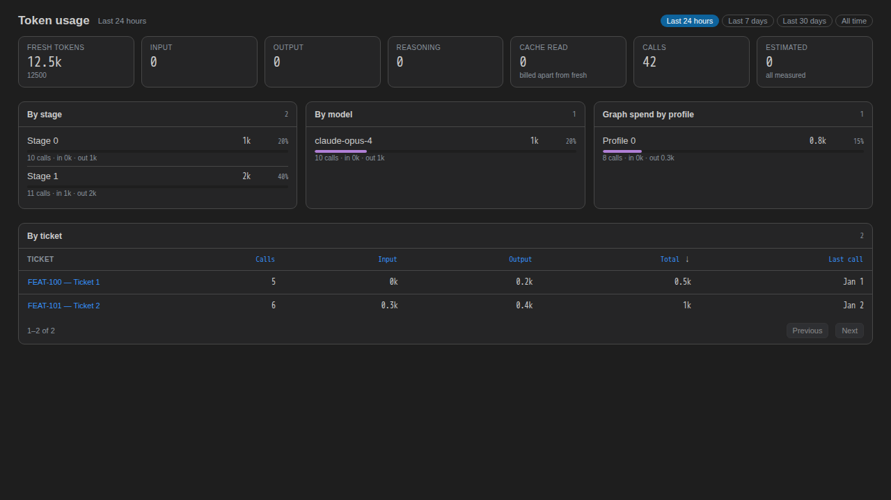
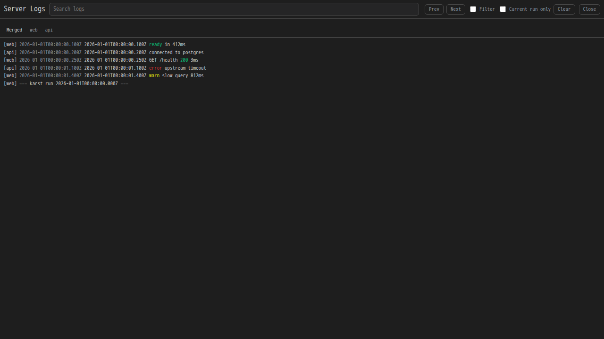
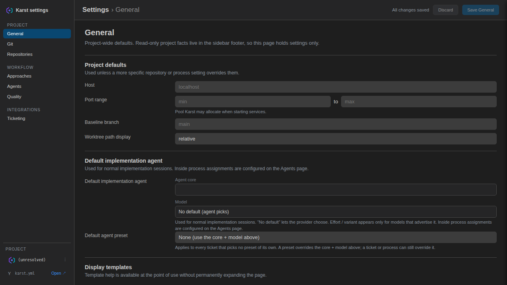

<!--
  Images use absolute raw.githubusercontent URLs on purpose: the VS Code
  Marketplace renders this same file and does NOT resolve relative paths.
-->
<h1 align="center">
  
</h1>

<p align="center">
  <b>The deterministic rail for AI-agent tickets across your multi-repo stack.</b><br>
  A VS Code extension that drives a ticket through six stages, spins up the real
  services it touches, and advances only on a deterministic verdict.
</p>

<p align="center">
  <a href="https://github.com/AndrewHaluza/karst/actions/workflows/ci.yml"></a>
  <a href="LICENSE"></a>
  <a href="package.json"></a>
</p>


<p align="center">
  
</p>

<p align="center">
  <sub>One ticket through the pipeline. Gates fail, fixes retry, merge blocks — the rail <i>is</i> the state.</sub>
  <br>
  <sub>That's the rail. <a href="https://github.com/AndrewHaluza/karst/blob/main/media/karst-film.mp4">The full film</a> shows where the tickets, the agents and the stack come from.</sub>
</p>

<p align="center">
  
  <b>→</b>
  
  <b>→</b>
  
  <b>→</b>
  
  <b>→</b>
  
  <b>→</b>
  
</p>

> **Status:** measured at 1.0.0 — 10,115 unit tests across 541 suites, 36 e2e,
> 774 visual regression checks over 85 baselines, 83% line coverage. The CI
> badge above is the live one; these are a snapshot. In active use as the
> rail running its own development.

---

## Quick start

You need an agent CLI (`claude`, `codex`, `antigravity` or `opencode`) that
is already logged in, plus `git` and `gh`.

1. Install the Karst extension in VS Code.
2. Copy [`karst.example.yml`](./karst.example.yml) to `.karst/karst.yml` in your workspace.
3. Set `repoPath` for each repository in your stack.
4. Run **Karst: Getting Started** from the Command Palette to check the setup.
5. Run **Karst: New Ticket**, then pick the hot repos and confirm the scope.

Karst then drives the ticket. It stops at the points that need you, and the
ticket shows as *Needs you* in the sidebar.

---

## Why Karst

Working several tickets at once across separate repos (backend, frontend,
contracts, …) is hard to keep straight: which servers are running on which
ports, which worktrees have changes, and — the sharpest pain — **what stage
each ticket is actually at**. Karst makes all of that a glance, and moves each
ticket through a repeatable pipeline where the agent does only the parts that
need judgment.

Three rules make it trustworthy:

- **Deterministic verdicts.** A stage advances on exit codes and merged PRs —
  never on an agent's *looks good*. The one exception is explicit, argv-narrowed
  done markers.
- **The agent is the scarce resource.** Everything a script can do (worktrees,
  ports, git, test suites, PR boilerplate) a script does. The agent writes code,
  answers scoping questions, and produces review findings.
- **State is a fact, not a guess.** SQLite is the single source of truth; every
  view re-renders from it, and a crash never loses a ticket's stage.

---

## The surfaces

<table>
  <tr valign="top">
    <td width="50%" align="center">
      
      <br><sub><b>Source Control</b> — each ticket is a real SCM provider with its own selector, diffed against the recorded base, not HEAD.</sub>
    </td>
    <td width="50%" align="center">
      
      <br><sub><b>Usage</b> — per-ticket, per-callsite token spend. No prompt or completion text is stored.</sub>
    </td>
  </tr>
  <tr valign="top">
    <td width="50%" align="center">
      
      <br><sub><b>Server logs</b> — the stack Karst spun for this ticket, live and addressable.</sub>
    </td>
    <td width="50%" align="center">
      
      <br><sub><b>Settings</b> — the manifest as a form. Tab-scoped save; secrets go to the OS keychain.</sub>
    </td>
  </tr>
</table>

---

## What it does

Around the pipeline:

- **Four agent cores, one seam** — `claude`, `codex`, `antigravity` and
  `opencode` behind a single adapter. Interactive sessions run in real VS Code
  terminals; headless stage work spawns bounded (15-minute backstop, killable,
  capped output). Transient CLI failures are classified, retried, and fall back
  to another model rather than failing the stage. A fifth core plugs into the
  same seam ([guide](./docs/guides/adding-agent-core.md)).
- **"Needs you" is a live signal** — agent hooks post liveness
  (`running` / `waiting` / `idle` / `none`) to a local endpoint; a pending
  permission ask, a confirm stage, or a waiting-to-merge PR turns the ticket
  amber everywhere at once.
- **Review feedback closes the loop** — comments on an open PR ingest into a
  reconciling table, and unresolved items become a repeatable fix round.
- **Ticket diffs in Source Control** — each ticket's changes appear as a real
  SCM provider with a ticket selector, diffed against the recorded base rather
  than HEAD.
- **Token usage tracked at the seam** — every AI call is instrumented once:
  per-ticket, per-callsite spend with provider totals and a usage dashboard. No
  prompt or completion text is ever stored.
- **Prompt-injection-hardened CLI** — the agent reads ticket content it did not
  author, so the agent-facing `karst` CLI narrows every argv and parses each
  verb in its own path: a forged `stage ship pass` is refused by construction.
  Secrets live in the OS keychain, never in the manifest.
- **Crash-proof by design** — stages, worktrees, servers and PRs are re-derived
  on boot; servers survive extension reloads and are re-adopted by pid identity;
  stale or orphaned processes are reaped safely.

---

## How it works

Six stages, plus a `fix` return channel. Each stage advances on a verdict Karst
can prove, never on an agent's self-report:

| Stage | What happens | What advances it |
| --- | --- | --- |
| **Scope** | Pick the hot repos; worktrees are cut off a freshly pulled base | Your confirm |
| **Implement** | The agent session runs in a real terminal | An argv-narrowed done marker |
| **UAT** | Static gates run, then the tester agent inspects | Exit codes + observations at your blocking severity |
| **Review** | Static gates run, then the reviewer agent files findings | Exit codes + findings at your blocking severity |
| **Fix** | A UAT or review failure returns here; the agent fixes | A fix pass, which re-enters UAT |
| **Ship** | PRs open; the merge gate holds on conflict | A merged PR |
| **Done** | Worktrees and servers reaped | — |

```
scope ─▶ impl ─▶ uat ─▶ review ─▶ ship ─▶ done
                 │        │
                 └──▶ fix ─┘   (fail → fix; fix pass → uat)
```

- **Tickets** come from the ticket form (`ticketing.provider: manual`, the
  default) or from ClickUp (`clickup`). The ClickUp token stays in the OS keychain.
- **Scope** is a preview. Nothing is created until you confirm. Then Karst cuts
  one worktree per hot repo off a freshly pulled base branch.
- **Spin** starts the services for the ticket on their own ports. Repos that are
  not hot run as a shared baseline. `dependsOn` sets the start order, and each
  service gets its peers' real URLs in env.
- **Implement** runs the agent in a real terminal in the worktree. The agent
  marks the stage done through the `karst` CLI; the end of a session is never a verdict.
- **UAT** runs the `test` script or your `uat.gates`, then the tester agent
  inspects the running stack. **Review** runs lint, typecheck, build and format
  gates, then the reviewer agent files findings. A finding or observation at or
  above `blockingSeverity` (default `high`) sends the ticket to `fix`.
- **Fix** always re-enters UAT, because a fix is unvalidated code.
  `maxFixAttempts` limits the rounds.
- **Ship** opens one PR per hot repo with `gh`. **Karst never merges on its own**:
  a merge needs your Merge click or a merge on GitHub. A conflict produces a
  conflict brief for a human rebase. A ticket with no diff goes straight to `done`.

The full rules are in [`docs/arch/stages-and-gates.md`](./docs/arch/stages-and-gates.md).

---

## Approaches

An **approach** is a development methodology the ticket form offers — Research →
Plan → Implement, Get Shit Done, Spec Kit, TDD, or one you write yourself. It
decides how the implement stage is actually conducted.

Approaches are **agent-agnostic**. A package is fetched structure-preserving,
classified by well-known layout, and materialized into each agent's native
format at launch — so a Claude session gets real dispatchable agents,
slash-commands and skills, not one flattened prompt.

```
.claude/agents/…    → agents/
.claude/commands/…  → commands/
skills/<name>/…     → skills/<name>/     (a skill IS its folder)
```

### Installing one

Declare it under `approaches:` in the manifest. A `source` fetches the package;
omit `source` for a hand-authored approach that needs no fetch.

<details>
<summary>Example: Research → Plan → Implement from a git source</summary>

```yaml
approaches:
  - id: rpi
    label: "Research → Plan → Implement"
    description: "Scope unclear; API/contract undefined — discover before coding."
    entrypoint: research            # bare name — no .md
    source:
      type: git
      repo: shanraisshan/claude-code-best-practice
      ref: main
      include:                      # fetch only what you want
        - development-workflows/rpi/.claude/agents
        - development-workflows/rpi/.claude/commands/rpi
    workflow:                       # phases in order
      - { name: describe }
      - { name: research,   command: /rpi:research }
      - { name: plan,       command: /rpi:plan }
      - { name: implement,  command: /rpi:implement }
```

</details>

An `npm` source takes `package`, `command` and `collect` globs instead of
`repo`/`ref`/`include`.

Two install-time rules exist to make failure loud rather than late:

- **`entrypoint` must resolve** against what was actually collected — a skill
  folder, an agent/command basename, or a flat prompt. If it doesn't, install
  fails.
- **An approach that collects nothing installable is rejected** at install, not
  discovered empty at launch.

Every `command` named in `workflow` must likewise resolve to a fetched
`commands/<name>.md`.

Scope `include` narrowly. Pointing at a repository root usually drags in demo
commands that pollute the materialized plugin.

### Built-in: Dynamic Graph (experimental)

> **Experimental — under active development.** Interfaces, config and behaviour
> are expected to change. Prefer a conventional approach for work you care
> about.

Karst ships one built-in approach that does not hand implementation to a single
long session. A planner agent decomposes the ticket into a DAG of work nodes,
and the runtime executes them concurrently under `graph.limits.maxParallel`,
with lease-based resource arbitration, dependency gating, replanning, and
reattach after a host crash. A node that cannot start reports why —
`dependency-waiting`, `resource-conflict`, `parallel-slot-busy` — rather than
stalling silently.

Design notes: [`docs/issues/graph-run-reliability.md`](./docs/issues/graph-run-reliability.md).

---

## Configuration

One manifest at `.karst/karst.yml` (overridable via `karst.manifestPath`)
describes the whole stack. Every key is validated at load; unknown or malformed
values are rejected naming the field. Copy
[`karst.example.yml`](./karst.example.yml) to get started.

```yaml
repositories:
  backend:
    repoPath: /abs/path/to/backend
    signals: [api, endpoint, backend, database]   # route tickets to this repo
    scope: api                                    # conventional-commit scope
    service:
      start: node server.mjs
      health: http://{host}:{port}/health
      ports:
        - { name: port, env: PORT, default: 8000 }
```

A **repository** is the primary entity — a git repo Karst can worktree, scope,
classify and ship. A **service** is an optional relation on it: how to *run* the
repo. Two entries may share a `repoPath` (a monorepo with several processes);
they resolve to one worktree.

Gates, per-repository overrides, conventions and the placeholder transform
grammar are documented in full at
[`docs/arch/manifest-and-settings.md`](./docs/arch/manifest-and-settings.md)
and [`docs/arch/worktrees-and-servers.md`](./docs/arch/worktrees-and-servers.md).
Two rules worth knowing up front:

- Per-repository `gates` **replace** the global list for that repo, never add
  to it.
- Absent `gates`, a probe discovers known scripts (`test` for UAT;
  `lint`/`typecheck`/`build`/`format:check` for review). A repo with no such
  script is *no question asked* — never a pass.

`Karst: Settings` edits the manifest with **tab-scoped saves**: each tab's
fields are the whole write, merged onto the manifest as it is on disk right now
and validated as the merged result.

---

## Running real services

Several tickets can run their own copy of the stack at the same time. The sharp
edges are handled with these rules:

- **Ports** come in contiguous blocks, persist per ticket, and are never double-booked across IDE windows.
- **Health checks** carry a per-instance token, so a pass against another worktree's server fails at once.
- **A stranger's process is never killed.** Karst reclaims a port only when it can prove that it owns the listener.
- **Containers** are removed by name, not by pid. **Teardown** undoes only what that spin did.

The reasons for each rule are in [`docs/guides/spinning-the-stack.md`](./docs/guides/spinning-the-stack.md).

---

## Karst vs autonomous agent platforms

Karst is a standalone VS Code extension for one engineer who runs agents against
their own multi-repo checkout. It is not a meta-agent org.

<details>
<summary>Comparison with hosted multi-agent orchestration (as a category)</summary>

Karst is not a meta-agent org and doesn't integrate with one. It's a
standalone VS Code extension for one engineer running agents against their
own multi-repo checkout. The table below describes how Karst itself behaves;
the right column is a generalization about hosted multi-agent orchestration
tools as a category, not a claim about any specific named product.

|                       | Karst                                            | Hosted multi-agent orchestration (typical)     |
| --------------------- | ------------------------------------------------ | ----------------------------------------------- |
| Who decides done      | Exit codes and merged PRs, not an agent's verdict | Often an agent (or a peer agent) judges completion |
| Real services         | Spins up the actual stack for the ticket          | Often simulated, mocked, or skipped             |
| Multi-repo state      | SQLite tracks stage/worktree/PR per ticket, per repo | Often single-repo or ephemeral session state |
| Where it runs         | Locally, in your VS Code, on your checkout        | Often hosted, sometimes as multi-agent fleets   |
| Human role            | Reviews gates and PRs at defined checkpoints      | Varies; ranges from close review to fleet-level delegation |

If you want a fleet of agents managing agents, that's a different category of
tool. Karst is for the one engineer who wants the agent to write the code and
a script to decide everything else.

</details>

---

## Architecture

All logic is **host-agnostic**. It takes injected interfaces (`PanelHost`,
`TerminalHost`, `GhRunner`, `GateRunner`, `AgentAdapter`, …), runs under Vitest
with fakes, and never imports `vscode` at runtime. `src/extension.ts` binds
those interfaces to the real VS Code host.

The binding references are in [`docs/arch/`](./docs/arch/). The list of documents
is in [CONTRIBUTING.md](CONTRIBUTING.md#3-architecture-invariants). The generated
module map is [`docs/arch/system-map.md`](./docs/arch/system-map.md).

---

## Development

```bash
npm install
npm run typecheck    # tsc --noEmit
npm run test:unit         # fast unit suite — excludes *.integration/*.e2e test files
npm run test:integration  # integration + e2e suites (*.integration.test.*, *.e2e.test.*)
npm run test:visual       # Playwright sweep over every webview
npm run build        # clean → bundle → copy assets → verify
```

Press **F5** to launch an Extension Development Host with Karst loaded.
`better-sqlite3` is a native addon whose ABI must match its runtime — Electron
for F5, Node for tests — and the right binary is restored automatically by each
of those commands. A `NODE_MODULE_VERSION` mismatch is fixed with
`npm run rebuild:electron` / `npm run rebuild:node`; the reasoning is in
[`docs/arch/ABI.md`](./docs/arch/ABI.md).

**[CONTRIBUTING.md](CONTRIBUTING.md) is the rest**: the conventions, the
invariants that reject otherwise-good code, the remaining suites, and the
signed CLA that every contribution requires.

---

## Licence

Karst is **source-available, not OSI-approved open source.** It uses the
[Business Source License 1.1](LICENSE). In short: **use it at work freely;
don't resell it.** You can read, fork, modify and run Karst for any internal
purpose, commercial work included. Offering Karst or a derivative to third
parties needs a licence. The [Additional Use Grant](LICENSE) is the authority.

**Each version becomes Apache 2.0 automatically** on its Change Date, at the
latest four years after its release. This term is written into `LICENSE` and
cannot be revoked. If BUSL blocks something you want to do,
[get in touch](TRADEMARK.md#requests).

- **Trademark:** the Karst™ name and logo are covered by [TRADEMARK.md](TRADEMARK.md).
- **Contributing:** contributions need a signed [CLA](CLA.md). You keep your copyright.
- **Third-party software:** see [THIRD_PARTY_NOTICES.md](THIRD_PARTY_NOTICES.md). All are MIT.
