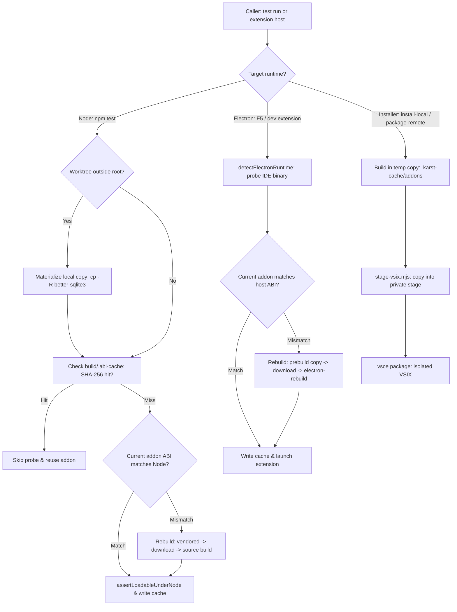

<!-- AGENT INSTRUCTIONS:
This file uses an agent-optimized block format. DO NOT read this file entirely.
1. TABLE OF CONTENTS: Run this to list all available keys:
  grep -F "## [@" docs/arch/ABI.md

2. EXTRACT A RULE: Run this to read a specific block (Example for ID 'arch:ABI-01'):
  awk "/^## \[@arch:ABI-01\]/,/END_DOC_BLOCK: \[@arch:ABI-01\]/" docs/arch/ABI.md
-->
# Native ABI split (better-sqlite3)

Native addon; ABI must match the runtime: **Electron** for extension hosts (F5 dev and packaged VSIX), **Node** for tests and CLI scripts. Related: `docs/arch/store-and-schema.md` (the SQLite store that loads better-sqlite3), `docs/arch/cli.md` (the CLI that avoids better-sqlite3 using `node:sqlite`), `docs/arch/worktrees-and-servers.md` (worktree checkouts sharing or isolating dependencies).

## [@arch:ABI-00] Overview
covers: scripts/rebuild-better-sqlite3.mjs, scripts/install-local.sh, scripts/package-remote.sh, scripts/stage-vsix.mjs, src/store/db.ts

### Purpose
The native `better-sqlite3` addon requires an exact Application Binary Interface (ABI) match for the executing runtime, differing between test execution (Node.js) and extension hosts (VS Code / Cursor Electron). This file governs runtime ABI detection, verified rebuilds and content-hash caching, isolated staging for VSIX packages, and worktree dependency isolation so concurrent tests and host processes never conflict or flip shared binaries.

### Connections
- in: @arch:DOC-01 — architecture doc template and overview rules.
- in: @arch:ST-00, @arch:SQLITE — SQLite registry (`src/store/db.ts`) loads `better-sqlite3` for persistent storage and migrations.
- in: @arch:WT-00, @arch:ENTRIES — ticket worktree checkouts share or isolate `node_modules` dependencies.
- in: @arch:GATE-CAPABILITY — native build toolchain prerequisites verified before compiling from source.
- out: @arch:CLI-00, @arch:CLI-05 — CLI commands intentionally avoid `better-sqlite3` by using built-in `node:sqlite` to eliminate ABI churn.
- out: @arch:MAP-00, @arch:MAP-01 — native addon management and storage engine participate in core system architecture.

### Flow

### Tradeoffs
| Chosen | Rejected | Why |
|---|---|---|
| Probe binary directly via `require` in child process | Trusting exit code 0 from `npm rebuild` or `prebuild-install` | Tools can exit 0 without modifying the destination or delivering the required ABI. |
| Fast-path with SHA-256 content hash in `build/.abi-cache` | File mtime caching or unconditional `node -e` probe spawning | Hash detects external rebuilds and fresh copies without incurring child process spawn overhead on every test run. |
| Worktree materializes local `node_modules/better-sqlite3` copy | Sharing single `better-sqlite3` install across checkouts | Worktree test runs would flip the shared addon ABI out from under concurrent extension hosts or packaging scripts. |
| Package VSIX from isolated stage directory (`.karst-cache/stage-<name>/`) | Packaging directly from workspace root | Packaging takes ~1 minute; concurrent test runs could flip the addon during the packaging window. |
| Detect Electron ABI dynamically via embedded IDE binary | Hardcoding Electron version from `package.json` build dependencies | VS Code and Cursor embed their own runtime versions and ABIs, which may diverge from build-time dependencies. |

### Fallbacks
| Trigger | Behaviour | Recovery |
|---|---|---|
| Worktree resolves `better-sqlite3` outside checkout | Copies package locally to `<worktree>/node_modules/better-sqlite3` | Local rebuild proceeds without mutating main checkout's addon |
| Missing vendored prebuild in `bin/` | Queries GitHub releases via `prebuild-install` download | Delivers precompiled binary without requiring a local C++ compiler |
| Missing or failed prebuild download | Falls back to local source build (`electron-rebuild` or `npm rebuild`) | Compiles native addon locally from source |
| Missing C++ build tools (Python/compiler) during source build | Emits diagnosis via `buildToolsRepair` and exits with code 127 | Actionable repair instructions instead of cryptic node-gyp compilation failures |
| Packaged VSIX addon ABI mismatch detected by installer | Aborts installation immediately (`unzip -p` verification) | Prevents silent extension activation failures inside target IDE |
| Corrupt or missing `build/.abi-cache` | Swallows read/write error and invokes live probe | Seamless degradation to full binary verification |

### Rules
@arch:ABI-01 · @arch:ABI-02 · @arch:ABI-03
END_DOC_BLOCK: [@arch:ABI-00]

## [@arch:ABI-01] The addon is shared across checkouts; the installers build private copies
covers: scripts/install-local.sh, scripts/package-remote.sh, scripts/stage-vsix.mjs#placeAddon

better-sqlite3's addon in `node_modules/better-sqlite3/build/Release` is a single
shared file that any `npm run test:unit` (main checkout or ANY worktree — a
worktree with no node_modules of its own resolves the main checkout's
better-sqlite3) flips back to the Node ABI via `pretest:unit`/`rebuild:node`.

`install-local.sh` and `package-remote.sh` no longer read or write that shared
file. Each builds its addon in a TEMP copy of the package (prebuild-install, with
an electron-rebuild fallback), verifies its ABI (for the local, same-platform
case), caches it under `.karst-cache/addons/` keyed by bsqlite version + ABI +
platform/arch, and hands it to `scripts/stage-vsix.mjs`. The helper runs one
fresh `npm run build`, copies only the shipped files into a private
`.karst-cache/stage-<name>/`, places the addon there, and lets `vsce` package the
stage — so a concurrent `npm test` can no longer flip the addon during the
~1-minute packaging window. `install-local.sh` then re-probes the addon extracted
from the finished vsix (`unzip -p …`) and refuses to install on a mismatch:
there is no retry loop and no in-place zip patch, because the packaged addon was
never the shared one to begin with. `package-remote.sh` builds a foreign
(linux-x64) addon that this machine cannot ABI-probe, so it pins the artifact by
prebuild-install's ABI-bearing cache tag and a vsix-vs-fetched shasum instead.
END_DOC_BLOCK: [@arch:ABI-01]

## [@arch:ABI-02] rebuild-better-sqlite3.mjs delivers VERIFIED addons only
covers: scripts/rebuild-better-sqlite3.mjs#ensureAddonFor, scripts/rebuild-better-sqlite3.mjs#addonAbi, scripts/rebuild-better-sqlite3.mjs#assertLoadableUnderNode

It probes the actual file after every path (vendored copy, prebuild-install download — which can exit 0 with the destination untouched — or source build), removing a stale addon before any download so a leftover wrong-ABI binary never reads as a delivery, and fast-paths when the addon already matches so `npm run test:unit`'s pretest stops churning the shared file. The fast path is backed by a `build/.abi-cache` (JSON: target ABI + runtime version + SHA-256 of the addon) written only after a fully-verified build: node mode skips the `node -e` probe spawn entirely when the addon on disk is byte-identical to the one last verified — the hash, not an mtime, so a fresh `cp -R` materialize or an external addon flip (another target's `rebuild:electron`) invalidates it and falls back to the probe, which stays the source of truth.
END_DOC_BLOCK: [@arch:ABI-02]

## [@arch:ABI-03] Worktree isolation
covers: scripts/rebuild-better-sqlite3.mjs#materializeLocalCopyIfNeeded

When its `better-sqlite3` resolves OUTSIDE the current checkout (a worktree without its own node_modules walking up to the main checkout's), it first `cp -R`s the package into the worktree's own `node_modules/better-sqlite3`, then rebuilds THAT copy — so a worktree agent's `npm run test:unit` never flips the main checkout's addon out from under the installer, and the main checkout never materializes (its resolution is local). prebuild-install is still resolved from the original install (the copy doesn't carry it), but downloads into the copy.
END_DOC_BLOCK: [@arch:ABI-03]
