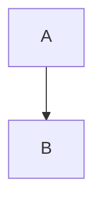

<!-- AGENT INSTRUCTIONS:
This file uses an agent-optimized block format. DO NOT read this file entirely.
1. TABLE OF CONTENTS: Run this to list all available keys:
  grep -F "## [@" docs/arch/README.md

2. EXTRACT A RULE: Run this to read a specific block (Example for ID 'arch:DOC-01'):
  awk "/^## \[@arch:DOC-01\]/,/END_DOC_BLOCK: \[@arch:DOC-01\]/" docs/arch/README.md
-->

# Arch docs — the template

## [@arch:DOC-01] Arch doc template
covers: scripts/docsKeys.mjs

`docs/arch/` holds current design rules only; dated incidents and measurements live in `docs/issues/`. Every file here has exactly one overview block, `## [@arch:<PREFIX>-00] Overview`, whose prefix is fixed by this table:

| File | Prefix | File | Prefix |
|---|---|---|---|
| ABI.md | ABI | manifest-and-settings.md | MS |
| approaches.md | APP | prompt-metrics.md | PM |
| agent-cores.md | AC | stages-and-gates.md | SG |
| cli.md | CLI | store-and-schema.md | ST |
| debug-logging.md | DBG | worktrees-and-servers.md | WT |
| diagnostics.md | DIAG | uat-host.md | UATHOST |
| github-and-merge.md | GH | adr-impl-exit-condition.md | ADR |
| ids.md | IDS | system-map.md | MAP |

`model-store-workflow-layering.md` was folded into `system-map.md` (@arch:MAP-03).

- **covers:** optional first line after the heading: `covers: <item>, <item>`, repo-relative. Grammar: DOC-02.
- **Required `### ` sections, in order:** Purpose, Connections, Flow. **Optional, after them:** State, Tradeoffs, Fallbacks, Rules.
  - Purpose: 1–3 sentences. Connections: `- in:` / `- out:` bullets naming other `@arch:` keys. Tradeoffs: a chosen|rejected|why table. Fallbacks: a trigger|behaviour|recovery table. Rules: a ` · `-separated list of the file's rule keys (replaces any Invariants section).
- **Flow** is a single `mermaid` fence (flowchart or sequenceDiagram) and is the LAST fence in the block. Only a trailing `<!-- GENERATED:end -->` comment may follow it; notes go above it.
- **Rule blocks** stay one statement: no `### ` sections, no diagram; `covers:` is optional.
- `MAX_BLOCK_BYTES` (6400) caps every hand-written block; `docs:check` WARNS above 90% of it and fails above it. A block holding a `GENERATED:start` marker has its own cap (`GENERATED_MAX_BLOCK_BYTES`, 12000). If a -00 block would exceed the cap, shorten the prose — never split into sidecar blocks. Any other block: split it. Keep the original key on the core rule, move rationale/history into a new `@arch:<NS>-NN` block (next free number; suffixed keys like `UAT-OBS-RUNS` are fine for unnumbered families) that opens with `Split out of \`arch:<KEY>\`.`, and end the original with `Continued in \`arch:<NEW>\` (…)`.
- `npm run -s docs:mermaid` parses every `mermaid` fence with `mermaid.parse()` under jsdom (mermaid 11.17.2, pinned in devDependencies); a fence that does not parse fails CI.

~~~md
## [@arch:PREFIX-00] Overview
covers: src/example.ts, src/**/*.ts

### Purpose
What this file governs, in 1–3 sentences.

### Connections
- in: @arch:KEY
- out: @arch:KEY

### Flow

<!-- GENERATED:end -->
END_DOC_BLOCK: [@arch:PREFIX-00]
~~~
END_DOC_BLOCK: [@arch:DOC-01]

## [@arch:DOC-02] `covers:` syntax

A `covers:` line sits on the line immediately after a block heading and lists repo-relative items separated by `, `:

- a **glob** — `src/extension/**/*.ts`, matched with Node's `globSync`; must match at least one file;
- a **`path#symbol`** — `src/model/entityId.ts#formatId`; the file must exist and declare the symbol.

The symbol is a `function`/`const`/`let`/`class`/`interface`/`type`/`enum` declaration, or a `name(` class method. Its end line is the brace that closes the first `{` at or after the declaration (string- and comment-naive). `symbolRange(text, name)` implements this and is reused by the W4 PR gate. `lint` fails a glob that matches nothing, a missing file, or an unknown symbol; `covers --check` fails when `docs/COVERS.json` is stale.
END_DOC_BLOCK: [@arch:DOC-02]

## [@arch:DOC-03] Docs gate (PR check)

`docs-gate` (`.github/workflows/ci.yml`, `scripts/docsGate.mjs`) runs on pull requests and re-runs when the PR body is edited. It diffs `origin/$BASE_REF...HEAD` (`-U0`) and checks each changed hunk against `docs/COVERS.json`.

- **BLOCK** (exit 1): a hunk overlaps a `path#symbol` range (`symbolRange`) on the base or head side of the file. A symbol missing on both sides is an error (`covers stale`).
- **WARN**: a changed file matches a glob item. Never fails.
- **skip**: files in `HUB_EXCLUDE` (`src/extension.ts`, `src/**/index.ts`).
- **Pass** — either: write `@arch:KEY` in the PR description, or edit that key's block (`## [@arch:KEY]` … `END_DOC_BLOCK`) in the same diff. Citing any one of the keys covering a hunk passes it.

The PR body is read from the `PR_BODY` env var and treated as text only. `PR_BODY` is the only waiver (cite `@arch:KEY`); there is no marker. The BLOCK line names the symbol, the covering key, the block's `file:line` and the rerun command. The gate reads COMMITTED changes only, so commit the block edit before rerunning. UAT runs it as a `docs-gate` command gate (`npm run -s docs:gate`; `BASE_REF` defaults to `develop`, `origin/<base>` is used when present, else the local branch) with an empty body.
END_DOC_BLOCK: [@arch:DOC-03]
