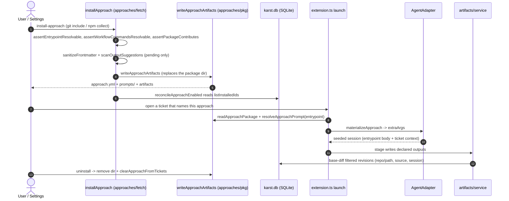

<!-- AGENT INSTRUCTIONS:
This file uses an agent-optimized block format. DO NOT read this file entirely.
1. TABLE OF CONTENTS: Run this to list all available keys:
  grep -F "## [@" docs/arch/approaches.md

2. EXTRACT A RULE: Run this to read a specific block (Example for ID 'arch:APP-01'):
  awk "/^## \[@arch:APP-01\]/,/END_DOC_BLOCK: \[@arch:APP-01\]/" docs/arch/approaches.md
-->
# Approach packages: lifecycle (install → launch → uninstall)

Karst's approach/agent-package system: the invoking agent's workflow is driven by a configured "approach" (a sourced package of prompts/artifacts) plus an agent adapter that translates it to a concrete agent CLI. This file covers the package lifecycle; the adapter seam that consumes it lives in CLAUDE.md's architecture section.

## [@arch:APP-00] Overview
covers: src/approaches/**, src/artifacts/**, src/workflow/artifacts/**, src/workflow/review/**, src/extension/artifactCaptureWiring.ts, src/extension/ops/storedArtifactOps.ts, src/ui/dashboard/storedArtifacts.ts, src/ui/settings/app/sections/PendingOutputs.tsx, src/agents/skillBlockingDirective.test.ts

### Purpose
How an approach — a sourced package of prompts, agents, skills and commands — is fetched into a neutral on-disk package, installed/reinstalled/uninstalled, resolved and materialized into an agent launch, and how the files it declares are captured per ticket. Karst owns the neutral package and the lifecycle state; an `AgentAdapter` is the only place an agent-specific format exists.

### Connections
- in: @arch:DOC-01 — the overview and rule-block template this file follows.
- in: @arch:REPO, @arch:FIELDCHK — `approaches:` entries in `karst.yml` (source, entrypoint, workflow, outputs, checks) are the manifest input a package installs from.
- in: @arch:STAGEMACH, @arch:PROFILE — the driven stage supplies the instructions an approach body executes under; the process prompt layers over it.
- in: @arch:AC-08 — the adapter seam consumes the neutral package at launch and is the only agent-format boundary.
- out: @arch:AC-18, @arch:AC-24 — generated-vs-copied launch artifacts and the guide pointer ride the materialized package.
- out: @arch:APP-09, @arch:APP-11, @arch:SHELF — captured outputs land in the per-ticket artifact store and are read back by the dashboard.
- out: @arch:APP-12, @arch:REVIEW — conformance and alignment grade the intent/spec/plan artifacts an approach writes.
- out: @arch:WT-REMOVE — a finishing ticket's final sweep captures outputs before the worktree goes away.

### Flow

### Tradeoffs
| Chosen | Rejected | Why |
|---|---|---|
| Neutral package on disk; the adapter materializes the launch format | Storing one agent's format (e.g. `.claude-plugin`) at install | Agent formats are agent-specific; the adapter is the only place that knows one, so every core launches from the same package. |
| Replace the package dir on reinstall | Overlay the new files onto the old install | Leftovers are not inert — `materializeApproach` copies a skill's whole folder into the launch plugin, so a stale sibling still reaches the agent. |
| Run the install guards before the write | Validate after writing | A rejected install must never destroy the working package it would have replaced. |
| Keep scan suggestions as `pendingOutputs` in `approach.yml` | Write `outputs:` into `karst.yml` at scan time | A suggestion is not a decision; only accepting it in Settings writes the manifest. |
| Point `enabled` at disk after every install/uninstall attempt | Set it from the attempt's outcome | A transient fetch error that left the package intact changes nothing; a source that can never produce a package retires itself. |
| Sanitize permission frontmatter at install | Trust fetched bodies and let the agent's own settings govern | Karst's `--settings` is the sole permission authority; a body must never grant bypass on its own. |
| Watch literal output prefixes and filter against the base commit | Watch the worktree root and capture every changed file | A root watch costs one inotify watch per directory (including `node_modules`), and files identical to base are not outputs. |

### Fallbacks
| Trigger | Behaviour | Recovery |
|---|---|---|
| Entrypoint is missing or unresolvable | `resolveApproachPrompt` returns null instead of throwing | The launch proceeds as a bare session. |
| Source collects nothing and declares no workflow | `assertPackageContributes` rejects the install before any write | Fix the source/entrypoint; the installed package is untouched. |
| Manifest fails to parse | Settings works from the last good in-memory copy and never rewrites the file | The user fixes `karst.yml`; an enable/disable cannot overwrite it. |
| `materializeApproach` throws | Launch degrades to no extra args and no owned paths | The session still opens, without the approach's agents/skills/commands. |
| Watcher fails (ENOSPC/EMFILE) | Logs the error code and closes the handle | The 10 s `syncWatchers` reconcile re-arms it; the post-edit hook and final sweep still capture. |
| Base commit unresolvable during a capture pass | Fail closed — nothing is captured | Once the base resolves, the next sweep captures the files. |

### Rules
@arch:APP-01 · @arch:APP-02 · @arch:APP-03 · @arch:APP-04 · @arch:APP-05 · @arch:APP-06 · @arch:APP-07 · @arch:APP-08 · @arch:APP-09 · @arch:APP-10 · @arch:APP-11 · @arch:APP-12
END_DOC_BLOCK: [@arch:APP-00]

## [@arch:APP-01] Approach packages are agent-agnostic; only the AgentAdapter translates to a concrete agent's format
covers: src/approaches/classify.ts#classifyPath, src/approaches/fetch.ts#installApproach

Install (`approaches/fetch.ts`) fetches STRUCTURE-PRESERVING into a neutral typed package: `classifyPath` (`approaches/classify.ts`) maps `.claude/agents`→`agents/`, `.claude/commands`→`commands/`, `skills/<name>`→`skills/<name>/` (a skill IS its folder), all recorded as `ApproachArtifact {kind,relPath}` in `approach.yml` (`approaches/pkg.ts`). Unclassified paths fall back to the legacy flat `prompts/` bucket (basenames). NO "plugin" concept lives in install/manifest. At launch, `AgentAdapter.materializeApproach` (optional) turns the neutral package into agent-specific launch `extraArgs` — `ClaudeAdapter` builds a `.claude-plugin` dir + returns `--plugin-dir` (the ONLY place the plugin format exists). Absent method → bare launch.

Git installs may authenticate: `installApproach` takes an optional `githubToken` (resolved by `approaches/githubAuth.ts`: silent VS Code session → `gh auth token` → `GH_TOKEN` → `GITHUB_TOKEN`) and sends `Authorization: Bearer` ONLY to `api.github.com`, never to `download_url` hosts. The token is never logged, put in an error message, or written to `approach.yml`. An exhausted-quota 403/429 names the GitHub rate limit, its reset time and the sign-in fix; a tokenless 404 hints that a private repo needs auth.
END_DOC_BLOCK: [@arch:APP-01]

## [@arch:APP-02] Approach `entrypoint` is a BARE name
covers: src/approaches/resolve.ts#resolveApproachPrompt

No `.md`. It MUST resolve against what was collected — a skill folder name, an agent/command file basename, OR a flat prompt basename — or install fails (`assertEntrypointResolvable`, checks `resolvableNames`). Dangling = loud install failure, never a silent bare launch. `resolveApproachPrompt` (`approaches/resolve.ts`) reads `prompts/<entrypoint>.md` first (flat/back-compat), then — when no flat prompt exists — resolves the bare name against the package's collected artifact inventory and reads the listed `skills/<entrypoint>/SKILL.md`; an entrypoint that resolved to an agent/command basename is never answered with a same-named skill's body, and a package whose inventory lists no skill returns null.
END_DOC_BLOCK: [@arch:APP-02]

## [@arch:APP-03] A sourced install must CONTRIBUTE something
covers: src/approaches/fetch.ts#assertPackageContributes

`assertPackageContributes`, in `assembleAndWrite` alongside the entrypoint/workflow guards: reject at install if it collected no prompts AND no artifacts AND declares no `workflow`. Without this a misconfigured approach (e.g. `gsd` with `collect: []`, no `entrypoint`) installs "clean" then only fails at launch via the soft `extension.ts` "produced no method prompt or loadable artifacts" warning — the failure must surface where the manifest is entered. `@opengsd/gsd-core` is a Claude-Code PLUGIN (skills/agents/commands live in the tree), so it belongs on a `git` source that fetches them, NOT an `npm` source whose bin scaffolds nothing into the temp cwd.
END_DOC_BLOCK: [@arch:APP-03]

## [@arch:APP-04] An approach's `enabled` flag is SLAVED to what is on disk, and uninstall owns three things
covers: src/approaches/pkg.ts#uninstallApproach

`enabled: true` with no installed package is the state `setApproachEnabled` already refuses to create ("Install X before enabling it") — but only on the enable path, so install/uninstall drifted the manifest away from disk in both directions. `reconcileApproachEnabled` (`ui/settings/actions.ts`) now points the flag at `listInstalledIds()` after EVERY install or uninstall attempt: it reads disk rather than assuming the attempt's outcome, so a source that can never produce a package (`gsd`'s npm `collect: []`) retires itself on the failure, while a transient fetch error that left the old package intact correctly changes nothing. Uninstall removes the package dir, **every ticket reference** (`clearApproachFromTickets`, project-scoped — the DB is shared by every window) and the flag; deleting the manifest ENTRY stays a separate deliberate act (the drawer's Delete, which requires an uninstall first). Leaving the ticket references was what made the launch warning outlive the uninstall: `toApproachRows` DROPS sourced-but-uninstalled approaches, so the stale value was not even offered as an option the user could change (869eckp0x). A manifest that failed to load is NEVER rewritten — `loadState` falls back to an in-memory copy on a parse error, and overlaying a flag onto that writes the fallback over the user's file.
END_DOC_BLOCK: [@arch:APP-04]

## [@arch:APP-05] `writeApproachArtifacts` REPLACES the package dir; it never overlays
covers: src/approaches/pkg.ts#writeApproachArtifacts

A reinstall must land the source's current contents and nothing else. Overlaying kept every file a previous install fetched and this one did not, and those leftovers are not inert — `materializeApproach` copies a skill's whole FOLDER into the launch plugin, so a stale sibling still reached the agent. The install guards (`assertEntrypointResolvable`/`assertWorkflowCommandsResolvable`/`assertPackageContributes`) all run BEFORE the write, so a rejected install never destroys the working package it would have replaced. `approaches/lifecycle.test.ts` pins the whole install→uninstall→reinstall cycle end to end, including that N cycles converge to the same bytes as one.
END_DOC_BLOCK: [@arch:APP-05]

## [@arch:APP-06] Untrusted-source hardening
covers: src/approaches/sanitize.ts#sanitizeFrontmatter

`sanitizeFrontmatter` (`approaches/sanitize.ts`) strips dangerous permission frontmatter (`permissionMode: bypassPermissions`, `allowed-tools`, `dangerously-*`) from EVERY fetched body at install (in `assembleAndWrite`) so materialization can't silently grant bypass — karst's own `--settings` stays the sole permission authority.
END_DOC_BLOCK: [@arch:APP-06]
## [@arch:APP-07] An approach body may NEVER block on the user inside a driven stage
covers: src/agents/skillBlockingDirective.test.ts
An approach body executes as the instructions of a karst-driven stage. The marker contract
(`renderDoneMarkerInstruction`, AGENT_GUIDE rule 3) refuses the done marker while the agent is
waiting on the user — and an agent-advanced stage such as `impl` has no gate that can fail it.
So a body carrying a "stop and wait for user approval" directive deadlocks: the agent correctly
withholds the marker, nothing else moves the stage, and the ticket parks forever.

**The gates are the approval.** A phase-validation step is self-validated against its checklist
and recorded (see `karst-rpi-implement` Step 5); anything genuinely undecidable is recorded as an
open question and left to fail a gate, where the block is visible in karst. Enforced by
`src/agents/skillBlockingDirective.test.ts`, which scans every packaged skill body for
stop-and-wait-for-user directives.
END_DOC_BLOCK: [@arch:APP-07]

## [@arch:APP-08] `outputs:` is where an approach writes; NOT `artifacts:`
covers: src/approaches/outputs.ts#validateOutputs, src/approaches/outputs.ts#effectiveOutputs
`ApproachDef.outputs` / `approach.yml outputs` = `{ glob, kind }[]` (kinds: plan|research|spec|review|meta|script|other), validated at load by `validateOutputs` (`src/approaches/outputs.ts`; repo-relative, no `..`/empty segments, literal prefix passes `normalizeGraphPath`). `artifacts:` stays the agent/skill/command inventory. An approach with no outputs falls back to `DEFAULT_OUTPUTS` (superpowers, speckit, gsd, rpi — rpi verified from its fetched commands). `effectiveOutputs(manifest)` = union over enabled approaches, tagged `approachId`. Karst never moves, filters or redirects these files.
END_DOC_BLOCK: [@arch:APP-08]

## [@arch:APP-09] Output capture: watcher + base-diff filter + final sweep
covers: src/artifacts/service.ts#createArtifactCaptureService, src/artifacts/watcher.ts#watchPrefixes, src/artifacts/baseDiff.ts#listBaseChanges
`src/artifacts/service.ts` (bound in `src/extension/artifactCaptureWiring.ts`) copies a ticket's outputs into its hidden store (T2). Capture = per-worktree debounced (1s) `fs.watch` over the LITERAL PREFIX DIRS of the `effectiveOutputs` union (`watcher.ts`) + a FINAL SWEEP. The watched set is the literal prefix of each glob (the segments before the first glob char), duplicates and nested prefixes removed — `docs/a/**` watches `docs/a`, `rpi/*/research/**` watches `rpi`. The worktree ROOT is never watched: on Linux a recursive root watch takes one inotify watch per directory, `node_modules` included. A glob with no literal prefix (`**/*.md`) is not watched (one warning per glob); the hook and sweep paths still capture those files. A prefix dir that does not exist yet is skipped and added by the 10 s `syncWatchers` reconcile once it appears; the set is recomputed every sync (the manifest outputs can change). Worktrees of a `done` or archived ticket are dropped from the set, so their watches close. `nodeFsWatch`'s `error` listener logs the code (`inotify limit reached` for ENOSPC/EMFILE) and closes the handle; the next sync re-arms it. `onChange` rebuilds paths relative to the worktree (`<prefix>/<name>`), so `matchOutput` is unchanged. A pass lists `git diff --name-status` vs the merge-base of HEAD with the newer of `<base>` / `origin/<base>` (descendant by `--is-ancestor`; one missing → the other; stale local base never re-adds landed files) plus untracked files (`baseDiff.ts`), keeps glob matches (`globMatch.ts`), commits each through the store queue under `<repoBasename>/<relPath>`. **The base filter is the invariant:** files identical to the base commit are never captured, an unresolvable base captures NOTHING (fail closed). Tags (`tags.ts`): a `running` implementation run = active session → `source=watcher` + session/stage/latest phase; none → `source=manual-edit`. Final sweep runs BEFORE removal: `archiveWorktree`/`archiveInactiveWorktrees` `beforeRemove`, `deleteTicketPermanently` `sweepWorktree` (+ `sweepTicket` graph mirror first), and session close (`SessionEnd` → `captureTicket`, watchers kept; the run is already closed there so a late flush is tagged `manual-edit`). Ticket delete asks keep or purge; purge skips the sweep. Graph mirror (`graphMirror.ts`) commits `approach_artifact_instances` as repo `graph`, `source=graph`, skipping any row with non-null `sensitivity`. **Agent post-edit hook (T4, `hookEdit.ts`):** Claude's `PostToolUse` is already a `type:http` hook on the karst endpoint; `parseHookPayload` lifts `tool_input.file_path` (Write/Edit/MultiEdit only; content is never carried) and `captureEdit` maps it onto one of the ticket's worktrees (lexical resolve; anything outside every worktree is rejected), then runs the normal base-diff capture limited to that one path, tagged `source=agent-hook` + the run (else provider) session. The hook only notifies: karst re-reads the file itself, and the store's same-content no-op dedups against the watcher and sweeps. Bodies over `MAX_HOOK_BODY_BYTES` are declined by the endpoint; the watcher covers those. Other cores: codex has `PostToolUse` but its edit tool (`apply_patch`) carries a patch, not a verified single `file_path`, so it is not wired; opencode and antigravity expose no `PostToolUse` equivalent (see `HOOK-CONTRACT`). The watcher covers all three. A freshly cut worktree torn down by spin cancel holds no outputs, so `spin.ts` teardown does not sweep. Debug lines use the `[artifacts]` prefix via the injected callback.
END_DOC_BLOCK: [@arch:APP-09]

## [@arch:APP-10] Install-time output scan is PENDING until the user accepts in Settings
covers: src/approaches/outputScan.ts#scanOutputSuggestions, src/approaches/pendingOutputs.ts#withAcceptedOutputs
After fetch/classify, `assembleAndWrite` (`approaches/fetch.ts`) runs `scanOutputSuggestions` (`approaches/outputScan.ts`) over the sanitized `.md` bodies: a line needs a write verb (save/write/create/output/…) next to a repo-relative path; placeholders (`<x>`, `{x}`, `[x]`, `YYYY-MM-DD`) become `*`, a trailing filename is dropped, the dir becomes `<dir>/**`, kind is guessed from path words (≤12 suggestions). Globs already declared on the def or in `DEFAULT_OUTPUTS` are dropped. The result is stored as `pendingOutputs` in the package's `approach.yml` — **never in karst.yml; the scan writes no manifest.** Settings → Approaches (`PendingOutputs.tsx`) lists them with accept/edit/reject; the built-in default entry shows as pre-accepted (already in force, not rewritten). Only the `resolve-pending-outputs` message writes: `withAcceptedOutputs` (`approaches/pendingOutputs.ts`) validates the accepted entries and merges them onto the approach's `outputs:` (seeding from the defaults table so the first accept does not drop them); `clearPendingOutputs` runs only after that write succeeded, and a reject (empty list) just clears. Reinstall replaces the package dir, so a re-scan re-offers suggestions.
END_DOC_BLOCK: [@arch:APP-10]

## [@arch:APP-11] Dashboard Artifacts view reads the T2 store; the webview names store paths and shas only
covers: src/ui/dashboard/storedArtifacts.ts#buildStoredArtifacts, src/extension/ops/storedArtifactOps.ts#makeStoredArtifactsLoader
The ticket dashboard's "Captured artifacts" panel and its Artifacts view (`artView === 'stored'`, `webview.html`) render `state.storedArtifacts`, a `StoredArtifactsView` (`ui/dashboard/storedArtifacts.ts`) overlaid by the supplemental loaders (`SupplementalLoaders.pushStoredArtifacts`, async git, re-pushed only when the JSON changed) from `makeStoredArtifactsLoader` (`extension/ops/storedArtifactOps.ts`). Rows group kind → approach from the latest revision's trailers (`unknown` last); each row carries repo/path, approach, source, revision count, last time and a capped (50) history. The empty state names the `effectiveOutputs` globs, and skipped files (size/secret) come from `listSkips` with their reason code. **Actions carry a store path (`<repo>/<relPath>`) and full git shas, never a filesystem path** (`messages.ts`: `stored-artifact-open|diff|live|reveal|purge`); `storedArtifactOps.ts` re-resolves every path against `listArtifacts` and every sha against `history` before touching anything. Revisions and diffs open through the `karst-artifact:` content-provider scheme (`storedArtifactBinding.ts`), which VS Code treats as read-only. "Open live file" resolves inside the matching worktree and refuses a path that escapes it. "Reveal folder" calls `store.materializeView` (rebuilds `<ticket store>/view/` read-only, `0o444` files in `0o555` dirs, refreshed on every call) then `revealFileInOS`; `purgeArtifacts`/`purgeStale` unlock `view/` before removing. Purge asks a modal confirm host-side. The sidebar peek's count chip reads `ArtifactCountCache` (`artifacts/countCache.ts`): synchronous `get` from memory, a 5 s TTL background `store.countArtifacts` (one `ls-tree`), `onChange` repaints the sidebar. The dashboard store handle is built per ticket, so its queue is separate from the capture service's; a purge racing a capture can lose the capture, not corrupt the repo.
END_DOC_BLOCK: [@arch:APP-11]

## [@arch:APP-12] Reviewer conformance: artifact chain intent → spec → plan
covers: src/workflow/artifacts/alignment.ts#runAlignment, src/workflow/review/conformance.ts#buildConformanceBlock
Chain = `tickets.intent` (root, always) → latest `spec` → latest `plan` artifacts of the per-ticket store (kind read from the newest revision's `kind` trailer; `history()` is NEWEST-FIRST, so `[0]` is the latest). Missing links collapse: a plan's parent is the spec if present, else the intent. `approaches[].checks: [intent-spec|spec-plan|intent-plan]` (`approaches/checks.ts`; absent → `BUILT_IN_CHECKS`, speckit/superpowers = `spec-plan`) names edges the approach verifies itself; karst skips them. **Edge alignment is WARN-only and never blocks:** `artifacts/capture.ts` fires `onRevision` after each committed revision → `workflow/artifacts/alignmentTrigger.ts` (60 s debounce, one in-flight run per ticket, skips unchanged parent+child fingerprints after a successful run) → `alignment.ts` (one headless call, empty cwd, call site `artifact-alignment`, the `review` process's model/effort, NOT its instructions) → `alignmentRecord.ts` commits a `review`-kind report at `_karst/alignment/<edge>.md` and posts one mailbox message when a finding is medium+. Only a SUCCESSFUL `intent-spec` run writes the `specfp`/`intentfp`/`mediumplus` trailers (trailer keys are `\w+`: no hyphens); a failed run writes none, so it never verifies the edge. **Review is ONE merged pass** (`review/findingsLane.ts`): `review/artifactsLoader.ts` builds `ReviewArtifacts` (intent + leaf; the spec too when a plan exists and intent→spec is neither self-checked nor cleanly aligned for the current fingerprints) and `review/conformance.ts` renders a fenced, 40 000-char-budgeted DATA block plus severity rules AFTER the scope block — custom reviewer instructions replace only the role/strategy lines, never this block. A missing intent/spec requirement is ALWAYS `high`; plan deviation, out-of-plan work and code issues are graded by impact. The UAT tester never receives spec/plan. **Multi-repo:** file-less findings carrying a `requirement` key are held, then `review/requirements.ts` reconciles after all targets: voters are targets the HOST confirms (`git diff --quiet` on `scopeDiffRange` exits 1, readable output, no wrong-checkout claim, not the empty-diff observation); any uncertainty makes a non-voter, which never cancels a gap; a kept finding is forced `high` and attributed to the first sorted reporter. The probe runs only when a requirement finding is pending.
END_DOC_BLOCK: [@arch:APP-12]
