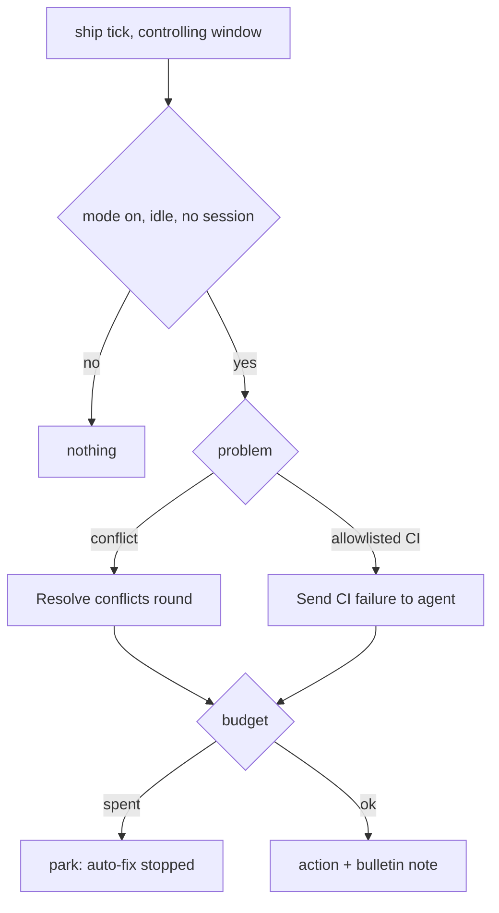

<!-- AGENT INSTRUCTIONS:
This file uses an agent-optimized block format. DO NOT read this file entirely.
1. TABLE OF CONTENTS: Run this to list all available keys:
  grep -F "## [@" docs/arch/autopilot.md

2. EXTRACT A RULE: Run this to read a specific block (Example for ID 'arch:AP-00'):
  awk "/^## \[@arch:AP-00\]/,/END_DOC_BLOCK: \[@arch:AP-00\]/" docs/arch/autopilot.md
-->
# Autopilot (auto-fix at ship)

Autopilot runs the same host actions a user clicks at the ship stage. It does not add a new action. Related: `docs/arch/stages-and-gates.md`, `docs/arch/github-and-merge.md`, `docs/arch/manifest-and-settings.md`.

## [@arch:AP-00] Overview
covers: src/extension/ops/autopilotOps.ts, src/extension/ops/autopilotCommandOps.ts, src/extension/ops/autopilotWiring.ts, src/extension/autopilotBinding.ts, src/store/autopilot.ts, src/manifest/autopilot.ts

### Purpose
Fix a merge conflict or an allowlisted CI failure on an open PR without a click. Each (PR, kind) has a retry budget. When the budget is spent, the ticket parks with `auto-fix stopped: <kind> <n>/<max>`.

### Connections
- in: @arch:CONCURRENCY, @arch:FIELDCHK, @arch:SCHEMA-CHECK (schema v100)
- out: `resolveConflictRound` (conflictResolveOps), `sendCiFailureAction` (ciActionsWiring)

### Flow

### Rules
- Mode: manifest `autopilot.enabled` (default false). A per-ticket override `inherit|on|off` is stored in `autopilot_tickets`. A sub-task inherits the effective mode of its parent.
- Conflicts use Resolve conflicts only. Rebase on base, Integrate, Overwrite remote and Merge to base are never automatic.
- CI uses Send CI failure to agent. An empty, unknown or renamed check asks. A gh failure parks and does not move the ticket.
- Budget: `autopilot_budgets` keeps attempts, signature and extra attempts. A new signature (base head SHA, or the failing check names) resets the counter. Approve one more adds one extra attempt and does not reset.
- A round never starts while a session runs, while the ship saga runs, for a paused ticket, for a closed PR, or when the sub-task concurrency limit (@arch:CONCURRENCY) is full.
- Sandbox: only the window that controls the ticket arms a round (AC-37). A read-only sandbox, a setup failure (AC-47) or a dirty or diverged clone (AC-46) parks at once as `auto-fix paused: sandbox <reason>`. It uses no attempt and is not retried. Autopilot never takes the host fallback (AC-31).
- A park writes the ship block with kind `awaiting-merge` and the reason (amber Needs you). The dashboard banner shows it. A sent round, an approval, an override change or a tick with no problem left clears it. A spent budget on one repo does not stop auto-fix for another conflicted PR of the ticket. A refused CI hand-off does not count as sent: the attempt is given back and autopilot pauses with a visible reason, because the ticket already moved to Implement. A CI round checks the sandbox placement and the clone sync before the hand-off, so a sandbox blocker parks the ticket in ship. Commands: `karst.autopilot.setOverride`, `.approveOne`, `.stop`.
- Two windows share one database: the controller holds a short lease (`claim_owner`, `claim_until`). A sent round has a cooldown, and the lease lasts through it. One sweep runs at a time. Autopilot shows no toast, also for the commands: action text goes to the debug log.
- Every action and fallback writes a bulletin note. The debug line starts with `[ship] autopilot`. There is no toast.
END_DOC_BLOCK: [@arch:AP-00]
