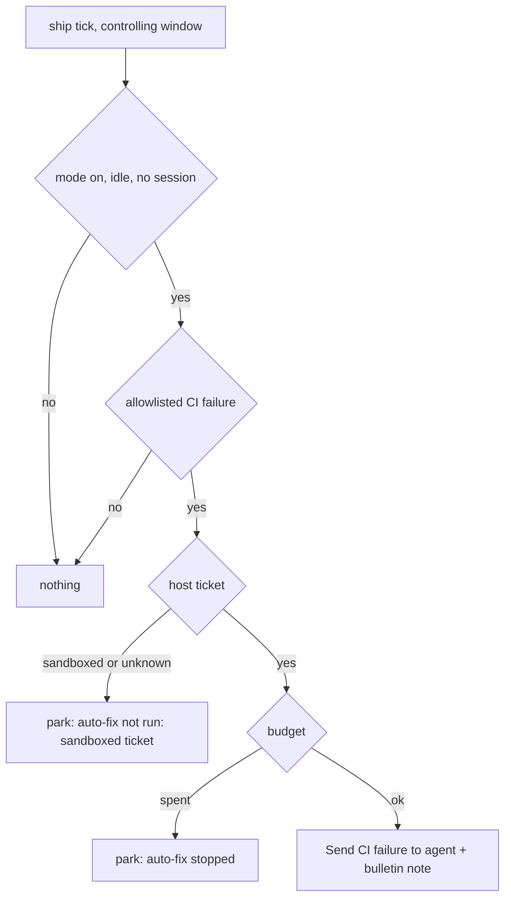

<!-- AGENT INSTRUCTIONS:
This file uses an agent-optimized block format. DO NOT read this file entirely.
1. TABLE OF CONTENTS: Run this to list all available keys:
  grep -F "## [@" docs/arch/autopilot.md

2. EXTRACT A RULE: Run this to read a specific block (Example for ID 'arch:AP-00'):
  awk "/^## \[@arch:AP-00\]/,/END_DOC_BLOCK: \[@arch:AP-00\]/" docs/arch/autopilot.md
-->
# Autopilot (auto-fix at ship)

Autopilot runs the same host actions a user clicks at the ship stage. It does not add a new action. Related: `docs/arch/stages-and-gates.md`, `docs/arch/github-and-merge.md`, `docs/arch/manifest-and-settings.md`.

## [@arch:AP-00] Overview
covers: src/extension/ops/autopilotOps.ts, src/extension/ops/autopilotCommandOps.ts, src/extension/ops/autopilotWiring.ts, src/extension/autopilotBinding.ts, src/store/autopilot.ts, src/manifest/autopilot.ts

### Purpose
Fix an allowlisted CI failure on an open PR of a host ticket without a click. Each (PR, kind) has a retry budget. When the budget is spent, the ticket parks with `auto-fix stopped: <kind> <n>/<max>`. Conflict rounds are not in scope (D479). Sandbox behavior is not in scope (D482).

### Connections
- in: @arch:CONCURRENCY, @arch:FIELDCHK, @arch:SCHEMA-CHECK (schema v100)
- out: `sendCiFailureAction` (ciActionsWiring)

### Flow

### Rules
- Mode: manifest `autopilot: { enabled, ci: { policy, maxAttempts, checks } }` (default off). There is no `conflicts` key: the loader rejects it. A per-ticket override `inherit|on|off` is stored in `autopilot_tickets`. A sub-task inherits the effective mode of its parent.
- CI uses Send CI failure to agent. A check that is not on the allowlist parks. A gh failure parks and does not move the ticket. An unknown or pending CI status is never a pass. A closed PR is never fixed.
- A sandboxed ticket, or a ticket with an unknown placement, gets no round. When an allowlisted check fails on it, it parks with `auto-fix not run: sandboxed ticket`, writes a bulletin note and uses no attempt.
- Budget: `autopilot_budgets` keeps attempts, signature and extra attempts. A new signature (the failing check names) resets the counter. Approve one more adds one extra attempt and does not reset.
- A round never starts while a session runs, while the ship saga runs, for a paused ticket, for a closed PR, or when the sub-task concurrency limit (@arch:CONCURRENCY) is full. A round counts against the limit. A sub-task in the ship stage holds no slot.
- Session owner: `autopilot_tickets.session_owner` names the window that holds the session. The window writes it when it opens a session, and it clears it when the session closes. A window that does not hold the session starts a round only when the store names no owner and the agent is not active. When the agent is `running` or `waiting` and no window is named, the owner is not known: no round starts and a debug line says so. `agent_state` `idle` alone does not prove that no window holds a session, because a closed terminal also sets it.
- A park writes the ship block with kind `awaiting-merge` and the reason (amber Needs you). The dashboard banner shows it. A sent round, an approval, an override change or a tick with no problem left clears it. A refused CI hand-off does not count as sent: the attempt is given back and autopilot pauses with a visible reason, because the ticket already moved to Implement. A launch that is queued for memory or cancelled is not a failed launch. Commands: `karst.autopilot.setOverride`, `.approveOne`, `.stop`.
- Stop now ends the session only in the window that holds it. In another window it sets the stop flag and says that the stop did not reach the session.
- Two windows share one database: the controller holds a short lease (`claim_owner`, `claim_until`). A sent round has a cooldown, and the lease lasts through it. One sweep runs at a time.
- Every action and fallback writes a bulletin note. The note title is one line, the text has no control character, and both fit the note limits. The debug line starts with `[ship] autopilot`. There is no toast, also for the commands: action text goes to the debug log.
END_DOC_BLOCK: [@arch:AP-00]
