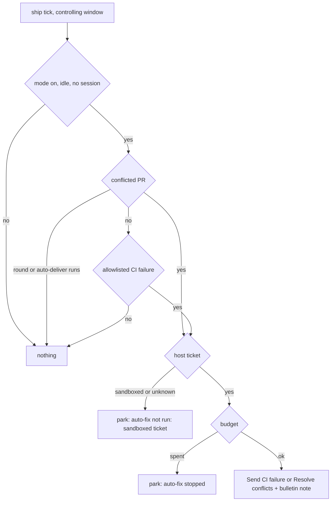

<!-- AGENT INSTRUCTIONS:
This file uses an agent-optimized block format. DO NOT read this file entirely.
1. TABLE OF CONTENTS: Run this to list all available keys:
  grep -F "## [@" docs/arch/autopilot.md

2. EXTRACT A RULE: Run this to read a specific block (Example for ID 'arch:AP-00'):
  awk "/^## \[@arch:AP-00\]/,/END_DOC_BLOCK: \[@arch:AP-00\]/" docs/arch/autopilot.md
-->
# Autopilot (auto-fix at ship)

Autopilot runs the same host actions a user clicks at the ship stage. It does not add a new action. Related: `docs/arch/stages-and-gates.md`, `docs/arch/github-and-merge.md`, `docs/arch/manifest-and-settings.md`.

## [@arch:AP-00] Overview
covers: src/extension/ops/autopilotOps.ts, src/extension/ops/autopilotCommandOps.ts, src/extension/ops/autopilotWiring.ts, src/extension/autopilotBinding.ts, src/store/autopilot.ts, src/manifest/autopilot.ts

### Purpose
Fix an allowlisted CI failure or a merge conflict on an open PR of a host ticket without a click. Each (PR, kind) has a retry budget. When the budget is spent, the ticket parks with `auto-fix stopped: <kind> <n>/<max>`. Sandbox behavior is not in scope (D482).

### Connections
- in: @arch:CONCURRENCY, @arch:FIELDCHK, @arch:SCHEMA-CHECK (schema v100)
- out: `sendCiFailureAction` (ciActionsWiring), `resolveConflictRound` (conflictResolveOps)

### Flow

### Rules
- Mode: manifest `autopilot: { enabled, ci: { policy, maxAttempts, checks }, conflicts: { policy, maxRounds } }` (default off; `maxRounds` defaults to 2). A per-ticket override `inherit|on|off` is stored in `autopilot_tickets`. A sub-task inherits the effective mode of its parent.
- Conflict rounds (T996) are in `@arch:AP-01`.
- CI uses Send CI failure to agent. A check that is not on the allowlist parks. A gh failure parks and does not move the ticket. An unknown or pending CI status is never a pass. A closed PR is never fixed.
- A ticket is a host ticket only when its recorded placement is `host`. A sandbox placement, a missing placement and an unlisted sandbox get no round.
- A ticket that ran an implementation graph gets no round: it parks with `auto-fix not run: graph ticket`. A live session that runs, or waits on a prompt or a question, also blocks a round. A closing window releases its `session_owner` rows.
- A rollup with pending checks is not read: its failing list is partial, so the ticket waits. The allowlist covers every failing PR, because the action sends them all. Each failing PR spends its own attempt. A spent budget on any of them parks the round and gives back the attempts taken first.
- If the stored failing list is cut short (`failed` is larger than the list), the ticket parks with `auto-fix not run: the list of failing ci checks is cut short`.
- A sandboxed ticket, or a ticket with an unknown placement, gets no round. When an allowlisted check fails on it, it parks with `auto-fix not run: sandboxed ticket`, writes a bulletin note and uses no attempt.
- When a ticket ships again, the stored CI rollup and merge block of its open PRs are cleared, because they belong to the old head. A window that restores its sessions at start publishes them to `session_owner` again. Sub-tasks armed in one sweep count once against the concurrency limit.
- Budget: `autopilot_budgets` keeps attempts, signature and extra attempts. A new signature (the failing check names) resets the counter. Approve one more adds one extra attempt and does not reset.
- A round never starts while a session runs, while the ship saga runs, for a paused ticket, for a closed PR, or when the sub-task concurrency limit (@arch:CONCURRENCY) is full. A round counts against the limit. A sub-task in the ship stage holds a slot while its agent runs or while a sent conflict round has not ended (`autopilot_tickets.conflict_round_at` is set and under 30 minutes old; delivery, a drop, a park, a pause, off mode or "Stop now" clears or frees it, and the PR is open). The slot never reads the stored merge check: a probe of the local merge commit reads clean while the delivery runs. A round that does not deliver parks the ticket (`auto-fix stopped: conflict round did not deliver`), so a stale CI rollup of the old head starts no CI round. The park holds on every tick until a person acts or every PR is proven clean. Only a round the engine sent (`conflict_round_at`) can stall; a manual Resolve conflicts round is never dropped. The budget is checked before the slot wait; `HOLDS_SLOT_SQL` is the one rule for the autostart picker and the autopilot check.
- Session owner: `autopilot_tickets.session_owner` names the window that holds the session. The window writes it when it opens a session, and it clears it when the session closes. A window that does not hold the session starts a round only when the store names no owner and the agent is not active. When the agent is `running` or `waiting` and no window is named, the owner is not known: no round starts and a debug line says so. `agent_state` `idle` alone does not prove that no window holds a session, because a closed terminal also sets it.
- A park writes the ship block with kind `awaiting-merge` and the reason (amber Needs you). The dashboard banner shows it. A sent round, an approval, an override change or a tick with no problem left clears it. A refused CI hand-off does not count as sent: the attempt is given back and autopilot pauses with a visible reason, because the ticket already moved to Implement. A launch that is queued for memory or cancelled is not a failed launch. Commands: `karst.autopilot.setOverride`, `.approveOne`, `.stop`.
- Stop now ends the session only in the window that holds it. In another window it sets the stop flag and says that the stop did not reach the session.
- Two windows share one database: the controller holds a short lease (`claim_owner`, `claim_until`). A sent round has a cooldown, and the lease lasts through it. One sweep runs at a time.
- Every action and fallback writes a bulletin note. The note title is one line, the text has no control character, and both fit the note limits. The debug line starts with `[ship] autopilot`. There is no toast, also for the commands: action text goes to the debug log.
END_DOC_BLOCK: [@arch:AP-00]

## [@arch:AP-01] Conflict rounds
covers: src/extension/ops/autopilotOps.ts, src/extension/ops/autoDeliverOps.ts, src/extension/ops/conflictResolveOps.ts, src/store/autostart.ts

### Purpose
Fix a merge conflict on an open PR of a host ticket without a click. The budget, park and note rules of `@arch:AP-00` apply.

### Connections
- in: @arch:AP-00, @arch:CONCURRENCY
- out: `resolveConflictRound` (conflictResolveOps), `isAutoDelivering`, `isConflictRoundStalled` (autoDeliverOps)

### Rules
- Conflicts (T996): a conflicted open PR runs `resolveConflictRound`, the same path as the Resolve conflicts click. Karst delivers the resolved merge behind the gates (arch:AC-39). A rebase on base stays a manual click. A conflict round comes before a CI round. Policy `ask` and a conflict with an unknown base head (`baseSha` is null) start no round; that conflict does not block the CI path.
- Conflict budget: per (PR, `conflicts`). The signature is the base head SHA: a new base head resets the counter. A spent repo is skipped while another conflicted PR of the ticket has attempts. The ticket parks with `auto-fix stopped: conflicts <n>/<max>` only when every conflicted PR is spent. A failed round gives its attempt back.
- No second conflict round starts while the first round is armed or its auto-deliver runs (`conflictRoundActive`: the in-memory round and `isAutoDelivering`). The stored merge check stays `conflicted` until the next probe, so a cooldown alone is not enough. A sent conflict round clears the stored CI rollup and merge block of that PR, so a rollup of the old head starts no CI round. A round armed for more than 5 minutes with no agent and no delivery never delivered: the engine drops it, writes a note, and the next attempt spends the budget.
END_DOC_BLOCK: [@arch:AP-01]

## [@arch:AP-02] Autopilot UI
covers: src/model/inside/autofix.ts, src/ui/dashboard/app/AutofixParts.tsx, src/ui/settings/app/sections/AutopilotSection.tsx

### Purpose
Show the auto-fix state and the controls. The UI adds no new engine rule.

### Connections
- in: @arch:AP-00, @arch:SAVE, @arch:BLOCKED, @arch:GH-04, @arch:GH-08
- out: messages `autopilot-override`, `autopilot-approve-one`, `autopilot-stop`, `autopilot-retry`

### Rules
- Settings: the Autopilot page owns the one manifest key `autopilot`. Save and Discard apply to this tab only. Push diverged is read-only text, and Merge to base has no control.
- Ship panel: there is no new step row. `autofixRow` words the state on the Merge row. A running round shows a step line and the actions Stop after this round and Stop now.
- The banner for an auto-fix park uses the `awaiting-merge` block. It has no new blocker kind. A spent budget has one primary, Approve 1 more. A gh failure or a sandbox pause has one primary, Retry, and never a run-on-host action. A sandbox pause also offers Open sync diff. The gh failure is the engine park `auto-fix stopped: ci could not run (...)`. Retry runs `karst.autopilot.retry`: it clears the pause, the stop reason and the park block, and posts no note. The Approve action names the repo of the kind in the park reason; it stays off when no PR resolves.
- The override control sends `autopilot-override` and settles through the pending marker.
- Unknown CI status reads "Auto-fix waits; not counted as pass". The host reads `unknownCi` from the stored PR rollups with the engine rule (missing, unknown or pending checks on an open PR). A CI round runs in Implement, because the action sends the ticket back, and the engine writes no marker for it. The host reads it from its effects: the ticket is out of ship, no park is on record, the latest Autopilot note is the `ci round n/m` note, not counting `Autopilot: stopped after this round` because that round still runs (a manual send-back leaves none), and a CI budget with attempts holds the signature of the checks that still fail. Its step is the agent step. A pending check reads as unknown CI, because the engine waits on both.
- The banner "Attempt history" lists the `Autopilot: <kind> round n/m` notes of the parked kind, oldest first. The park reason comes from the ship block or the ticket `pausedReason` only. `stoppedReason` outlives the park, so it is never a source. The running row names a repo only when one conflicts budget exists, because the engine stores the arm time and not the repo. The row marks a step as the first step, because the engine writes no step signal. A graph-ticket park (`auto-fix not run: graph ticket`) has no Retry, because a retry parks again. A sandbox park keeps ONE Retry, as the ticket requires. That Retry can park the ticket again until the person fixes the sandbox; the engine writes no other sandbox reason to tell the cases apart. The unknown-CI message is added after the Merge row conflict sentence; every other auto-fix state replaces the detail. The engine gh park reads "Auto-fix paused: could not read CI (gh: <error>)" on the row. The engine writes no `sandbox read-only`, `setup failed` or `clone dirty` reason, so only the sandbox ticket park and a reason that contains "sandbox" render as a sandbox pause. The sandbox sync diff shows when the reason contains the word "sandbox"; the engine writes `auto-fix not run: sandboxed ticket` and the `session did not start (<reason>)` pause.
END_DOC_BLOCK: [@arch:AP-02]
