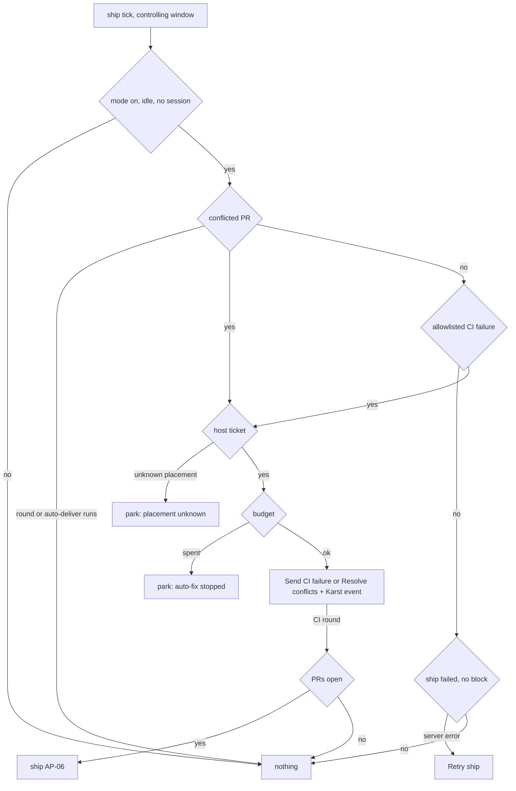

<!-- AGENT INSTRUCTIONS:
This file uses an agent-optimized block format. DO NOT read this file entirely.
1. TABLE OF CONTENTS: Run this to list all available keys:
  grep -F "## [@" docs/arch/autopilot.md

2. EXTRACT A RULE: Run this to read a specific block (Example for ID 'arch:AP-00'):
  awk "/^## \[@arch:AP-00\]/,/END_DOC_BLOCK: \[@arch:AP-00\]/" docs/arch/autopilot.md
-->
# Autopilot (auto-fix at ship)

Autopilot runs the same host actions a user clicks at the ship stage. It does not add a new action. Related: `docs/arch/stages-and-gates.md`, `docs/arch/github-and-merge.md`, `docs/arch/manifest-and-settings.md`.

## [@arch:AP-00] Overview
covers: src/extension/ops/autopilotOps.ts, src/extension/ops/autopilotNoChange.ts, src/extension/ops/autopilotCommandOps.ts, src/extension/ops/autopilotWiring.ts, src/extension/autopilotBinding.ts, src/store/autopilot.ts, src/manifest/autopilot.ts

### Purpose
Fix an allowlisted CI failure or a merge conflict on an open PR of a ticket without a click. Each (PR, kind) has a retry budget. When the budget is spent, the ticket parks with `auto-fix stopped: <kind> <n>/<max>`. Sandbox rules are in `@arch:AP-04`. A CI failure that the base branch shares gets no round: see `@arch:AP-12`.

### Connections
- in: @arch:CONCURRENCY, @arch:FIELDCHK, @arch:SCHEMA-CHECK (schema v100)
- out: `sendCiFailureAction` (ciActionsWiring), `resolveConflictRound` (conflictResolveOps), `gateFailureOutcome` (@arch:AP-06)

### Flow

### Rules
- Mode: manifest `autopilot: { enabled, ci: { policy, maxAttempts, checks }, conflicts: { policy, maxRounds } }` (default off; `maxRounds` defaults to 2). A per-ticket override `inherit|on|off` is stored in `autopilot_tickets`. A sub-task inherits the effective mode of its parent.
- Conflict rounds (T996): `@arch:AP-01`, `@arch:AP-10`. Re-ship (T1095): `@arch:AP-06`.
- A sandboxed ticket gets the same rounds, with fail-closed rules: see `@arch:AP-04`. Only the window that controls the ticket starts a round (`@arch:AC-37`).
- CI uses Send CI failure to agent. A failing check that is not on the allowlist parks, unless it is known optional (`@arch:AP-07`). A gh failure parks and does not move the ticket. An unknown or pending CI status is never a pass. A closed PR is never fixed.
- Transient CI re-run (T1019): one `gh run rerun --failed` per (ticket, repo, run, check) for a network failure, before the allowlist decision. Rules in `@arch:AP-03`.
- Stale generated file (T1081): a host ticket gets ONE Rebase on base and regenerate, with no confirm and no attempt, before the transient re-run. Rules in `@arch:AP-05`.
- CI round with no commit (D564): a failure on the recorded head re-runs the failed jobs once, then parks. Rules in `@arch:AP-03`.
- The placement comes from the recorded backend: `host` runs on the host, any other backend runs in its sandbox (`@arch:AC-43`). An unknown placement gets no round and no attempt: it parks with `auto-fix not run: placement unknown` and a Karst event.
- An active graph run parks the ticket: `auto-fix not run: graph ticket` (`@arch:AP-08`). A live session that runs, or waits on a prompt or a question, also blocks a round.
- A rollup with pending checks is not read: its failing list is partial, so the ticket waits. The allowlist covers every failing PR, because the action sends them all. Each failing PR spends its own attempt. A spent budget on any of them parks the round and gives back the attempts taken first.
- A cut-short failing list (`failed` is larger than the list) parks: `auto-fix not run: the list of failing ci checks is cut short`.
- When a ticket ships again, the stored CI rollup and merge block of its open PRs are cleared, because they belong to the old head. A window that restores its sessions at start publishes them to `session_owner` again.
- Budget: `autopilot_budgets` keeps attempts, signature and extra attempts. A new signature (the failing check names) resets the counter. Approve one more adds one extra attempt and does not reset.
- A round never starts while a session runs, while the ship saga runs, for a paused ticket, for a closed PR, or when the sub-task concurrency limit (@arch:CONCURRENCY) is full. A round counts against the limit. A sub-task in the ship stage holds a slot while its agent runs or while a sent conflict round has not ended (`autopilot_tickets.conflict_round_at` is set and under 30 minutes old; delivery, a drop, a park, a pause, off mode or "Stop now" clears or frees it, and the PR is open). A round that does not deliver parks the ticket (`auto-fix stopped: conflict round did not deliver`), so a stale CI rollup of the old head starts no CI round. The park holds on every tick until a person acts or every PR is proven clean. Only a round the engine sent (`conflict_round_at`) can stall; a manual Resolve conflicts round is never dropped. The budget is checked before the slot wait; `HOLDS_SLOT_SQL` is the one rule for the autostart picker and the autopilot check.
- A park writes the ship block with kind `awaiting-merge` and the reason (amber Needs you). The dashboard banner shows it. A sent round, an approval, an override change or a tick with no problem left clears it. A refused CI hand-off does not count as sent: the attempt is given back and autopilot pauses with a visible reason, because the ticket already moved to Implement. A set to the mode that is already stored is no change: it writes no note, clears no park and drops no conflict round, and only Retry or Approve 1 more clears a park without a mode change. Commands: `karst.autopilot.setOverride`, `.approveOne`, `.stop`.
- Stop now ends the session only in the window that holds it. In another window it sets the stop flag and says that the stop did not reach the session.
- Ship retry after a GitHub server error (T1362), with a backoff and a bound: `@arch:AP-11`.
- Every action and fallback records a Karst event (`@arch:EVENTS`), not a bulletin note. The title is one line and both fields fit the event limits. The debug line starts with `[ship] autopilot`. There is no toast: action text goes to the debug log.

A stop records its head (`stopped_head_sha`, v120; the no-change park writes the CI head). A stop about an older head is history: the autopilot line adds `(autopilot stopped at <sha7>; the head moved since)`, and `karst blocked` appends ` at <sha7>`. Only a person clears a stop.

END_DOC_BLOCK: [@arch:AP-00]

## [@arch:AP-01] Conflict rounds
covers: src/extension/ops/autopilotOps.ts, src/extension/ops/autoDeliverOps.ts, src/extension/ops/autopilotRefusal.ts, src/extension/ops/conflictResumeOps.ts, src/extension/ops/conflictResolveOps.ts, src/extension/ops/shipGatesOps.ts, src/extension/ops/ciActionsWiring.ts#deliverToPrAction, src/extension/ops/ciActionsWiring.ts#autoDeliverAction, src/store/autostart.ts, src/store/deliverRuns.ts, src/store/deliverFacts.ts

### Purpose
Fix a merge conflict on an open PR of a ticket without a click. The budget, park and note rules of `@arch:AP-00` apply.

### Connections
- in: @arch:AP-00, @arch:CONCURRENCY
- out: `resolveConflictRound` (conflictResolveOps), `isAutoDelivering`, `isConflictRoundStalled` (autoDeliverOps)

### Rules
- Conflicts (T996): a conflicted open PR runs `resolveConflictRound`, the same path as the Resolve conflicts click. Karst delivers the resolved merge behind the gates (arch:AC-39). A rebase on base stays a manual click. A conflict round comes before a CI round. Policy `ask` and a conflict with an unknown base head (`baseSha` is null) start no round; that conflict does not block the CI path.
- Conflict budget: per (PR, `conflicts`). The signature is the base head SHA: a new base head resets the counter. A spent repo is skipped while another conflicted PR of the ticket has attempts. The ticket parks with `auto-fix stopped: conflicts <n>/<max>` only when every conflicted PR is spent. A failed round gives its attempt back.
- No second conflict round starts while the first round is armed or its auto-deliver runs (`conflictRoundActive`: the in-memory round and `isAutoDelivering`). The stored merge check stays `conflicted` until the next probe, so a cooldown alone is not enough. A sent conflict round clears the stored CI rollup and merge block of that PR, so a rollup of the old head starts no CI round. A round whose brief was received (the agent read it, or a launch seed carried it) for more than 5 minutes with NO AGENT and NO DELIVERY never delivered: the engine drops it, writes a note, and the next attempt spends the budget. The park is `auto-fix stopped: conflict round did not deliver`, and it holds on every tick until a person acts or every PR is proven clean. The delivery part of the clock counts from the LATER of the receipt and the end of the last auto-deliver of the round (`ConflictRounds.deliveredAt`, `markDelivered` in the auto-deliver's `finally`): the ship gates can run longer than the stall time, so a push refused one tick after a 25-minute gate run is not a round that never delivered (T1315). A round with no receipt is not dropped: the brief reaches a live session as a stored `conflict` delivery and a pointer, and `fixDeliverySweep` re-sends it: `@arch:AP-10`.
- Environment re-run on the ship path (T1315): the auto-deliver's `runGates` returns a `ShipGateReport` (the first failure, and every failed gate with its repo, output and summary). When EVERY failed gate carries an environment signature (`@arch:GATE-ENV-RERUN`), the host re-runs ONLY those gates once in the repos that failed, on the same abort signal and with the same take-over rule, and a pass continues to the base check and the push. A real failure, a mixed one, or a run whose later repo never gated is refused with no re-run: a real failure is never retried. The re-run writes one `[ship]` line naming the gates and their reasons.
- Round end from observed state (T1287): an armed round, manual or engine, ends when the stored merge check of `round.repo` names no conflict and the stored PR head of that repo contains `round.baseSha` (and no auto-deliver runs). `conflictRoundEnded` reads the PR head (`prs.head_oid`) and the ancestry in the repo's worktree, so a clean check of a merge that exists only locally never ends it (`@arch:GH-03`). The engine disarms it with one debug line `[ship] autopilot ticket <key>: the conflict round ended, the PR is no longer conflicted`, and the same tick may start the CI round. A karst push that delivers the merge ends it too (`endConflictRoundOnDeliver`): a manual Deliver after a refused auto-deliver (`beginManualPush`, then the ship `deliverToOpenPr` push) disarms it once the delivery lands, as a take-over does during the gate phase. A refused auto-deliver of a merge that PASSED `verifyMergeResolved` does not wait for a retry (the agent is already idle, so no Stop/session.idle comes): it parks the base-moved block and its round repairs it, `@arch:AP-14`. A merge the agent left unfinished keeps the stall path and its text. While a round blocks autopilot it says so with one debug line per armed state (`no round, a conflict round is armed or its resolved merge is being delivered`), not one line per tick.
- A push that ship refused (T1379): `deliverToPr` records the newest `ship_runs` id just before `runShip` and reads a run NEWER than that mark immediately after it returns, before the re-probe (a second ship run may record a newer row during the probe). Ship parks or fails WITHOUT throwing, and a ship that parks before its saga opens a run leaves the earlier passed row in place, so only a run newer than the mark that ended `passed` is a delivery; anything else is a refusal: the click reports `Push refused: <reason>` (the ship stage block reason, else `the ship run failed`), and `deliverToPrAction` disarms no conflict round and starts no post-deliver follow-up (no `endConflictRoundOnDeliver`, no `supersedeRerun`, no after-take-over re-run).
END_DOC_BLOCK: [@arch:AP-01]

## [@arch:AP-02] Autopilot UI
covers: src/model/inside/autofix.ts, src/model/inside/deliver.ts, src/ui/dashboard/app/AutofixParts.tsx, src/model/inside/shipDeliver.ts, src/ui/settings/app/sections/AutopilotSection.tsx

### Purpose
Show the auto-fix state and the controls. The UI adds no new engine rule.

### Connections
- in: @arch:AP-00, @arch:SAVE, @arch:BLOCKED, @arch:GH-04, @arch:GH-08
- out: messages `autopilot-override`, `autopilot-approve-one`, `autopilot-stop`, `autopilot-retry`

### Rules
- Settings: the Autopilot page owns the one manifest key `autopilot`. Save and Discard apply to this tab only. Push diverged is read-only text, and Merge to base has no control. A Save the host refuses reports the fault as the action `error`, not as a `validation` verdict, so the page reads the same slot the banner does (the verdict first, then the action error): an out-of-range limit shows on its own input line and the banner stays silent.
- Ship panel: Auto-fix is its own Inside process row, id `autofix`, after `pr` and before `merge`. This reverses the T1004 decision "no new step row". The prototype `docs/ui/prototypes/autopilot-inapp-v2.html` is no longer the reference for the ship panel; `docs/ui/prototypes/inside-cleanup.html` (C2, C3, C4) is. The row shows only when Autopilot is effective for the ticket AND a round is active, a park exists, or the history has at least one attempt. The `unknown` CI state also gets the row. Earlier attempts alone give a quiet `history` row (status `note`, "n earlier attempts") that lists them and states no result. The stage-menu item `Stop auto-fix now…` is offered only while the row exists and a round runs, so the menu needs `roundRunning` AND effective autopilot, and the stop confirm closes when that offer ends. `roundRunning` alone means a round is live, whatever the override: Merge all stays disabled while it runs. The row has an AI mark, and no agent identity, no Σ pill and no duration. The Merge row states only merge facts ("waits on 1 conflict and CI", count 0/2) and keeps its per-PR sub-rows. The body lists one row per finished attempt ("attempt n" and the time of its Autopilot note; "still fails" shows only on a spent park), then the steps the host can prove: CI round at Implement `fetch CI log` (pass) and `agent fix` (run); CI round at UAT or Review `fetch CI log` (pass), `agent fix` (pass), `gates run again` (run, detail `UAT` or `Review`) and `re-ship` with detail `to <repo> #<pr>` (pending); conflict round one `agent resolving` (run). The host reads the step from `stage_current`. The `re-ship` row is the only pending row: the host proves it from `ci_round_at` and the @arch:AP-06 conditions, and when the mark is gone (a pause, a Stop, a click) it reads `ship` with detail `waits for Confirm`. There are no other pending rows and no step times, because the engine writes no step signal. The round stays live (Stop, Merge all off) at UAT and Review; `Last round` sits on `gates run again`, and the stop confirm says the round stops and no re-ship follows. The running step holds `Last round` (`autopilot-stop-after`). `Stop auto-fix now…` is an item of the stage menu; it opens an inline alertdialog under the Auto-fix row, and its `Stop now` button posts `autopilot-stop` with mode `now`. A spent budget gives the waiting status with one fail row per attempt. The footer, the `Autopilot: …` lines and the "Autopilot never merges" line are removed. The Deliver push is part of the `push` row (T1403): one row per pre-push gate (see `arch:AP-13`).
- The banner for an auto-fix park uses the `awaiting-merge` block. It has no new blocker kind. A spent budget has one primary, `+1 attempt` or `+1 round`, with a secondary `Send back…` or `Resolve by hand…`; each button has an icon and its aria-label starts with the visible label. A gh failure or a sandbox pause has one primary, Retry, and never a run-on-host action. A sandbox pause also offers Sync diff. The gh failure is the engine park `auto-fix stopped: ci could not run (...)`. Retry runs `karst.autopilot.retry`: it clears the pause, the stop reason and the park block, and posts no note. The Approve action names the repo of the kind in the park reason; it stays off when no PR resolves.
- The override control is one chip, "Auto-fix on · default ▾" (a ticket override shows a blue dot and no "· default"). Its menu offers Use project default (with "Settings › Autopilot: on|off"), On for this ticket and Off for this ticket, with a check on the current one. It works by mouse and keyboard, sends `autopilot-override` and settles through the pending marker. In the Inside header the chip is its OWN grid track, and the ⋯ menu takes one more, so neither can wrap the clock onto a second row or overlap the title at any tier (UI-R43).
- Unknown CI status, the pending CI list and the read of a CI round from its effects are in `arch:AP-09`.
- The banner "Attempt history" lists the `Autopilot: <kind> round n/m` notes of the parked kind, oldest first. The park reason comes from the ship block or the ticket `pausedReason` only. `stoppedReason` outlives the park, so it is never a source. The running row names a repo only when one conflicts budget exists, because the engine stores the arm time and not the repo. The row marks a step as the first step, because the engine writes no step signal. A graph-ticket park has a Retry for when the run closes (`@arch:AP-08`). A placement-unknown park has a Retry only once a placement is recorded (T1286); while it is still unrecorded it keeps none, because a retry would park again. A sandbox park keeps ONE Retry, as the ticket requires. That Retry can park the ticket again until the person fixes the sandbox; the engine writes no other sandbox reason to tell the cases apart. The Auto-fix row carries every auto-fix message; the Merge row never does. The engine gh park reads "paused: could not read CI (gh: <error>)" on the row. The engine writes no `sandbox read-only`, `setup failed` or `clone dirty` reason, so only the sandbox ticket park and a reason that contains "sandbox" render as a sandbox pause. The sandbox sync diff shows when the reason contains the word "sandbox"; the engine writes `auto-fix not run: sandboxed ticket` and the `session did not start (<reason>)` pause.
END_DOC_BLOCK: [@arch:AP-02]

## [@arch:AP-03] Transient CI re-run
covers: src/extension/ops/autopilotRerun.ts, src/extension/ops/autopilotNoChange.ts, src/workflow/transientCi.ts, src/integrations/ciRerun.ts, src/store/autopilot.ts

When every check of the open PRs has finished and a check failed, the engine reads the tail of the log of each failed job (`gh api .../actions/jobs/<id>/logs`, bounded, read as text, never evaluated). A failure is transient only when a step-level line (`##[error]`, an npm, prebuild-install, gyp or curl line, or an apt `E: ` line) matches the closed list `TRANSIENT_CI_PATTERNS` (`workflow/transientCi.ts`); test output never matches. A transient check gets ONE `gh run rerun <run> --failed` per (ticket, repo, run, check), before the allowlist decision. A run id names one head, so a new push gets a new re-run. The marker is the row in `autopilot_reruns` (v106), written before gh runs, so a reload or a second window never re-runs again. The re-run uses no attempt. It forgets the stored rollup of that PR, so the ticket waits until the next probe reads the newest run per check (D281). A fresh marker also holds the ticket for `RERUN_SETTLE_MS`, in case gh still shows the old attempt. One Karst event names the check, the 9-character sha and the pattern. If the check fails again, today's rules apply: an allowlisted check gets a CI round, any other check parks, and the park reason ends with `(re-run once after a network error and it failed again)`. A gh failure while it reads a log or starts the re-run parks with `auto-fix stopped: ci could not run (...)`. A sandboxed ticket, a graph ticket and a status check without a job url keep today's rules. A marker with pattern `stale-generated:<command>` (a rebase round, `@arch:AP-05`) is not a network re-run: this step skips it.

Rule (D564): when a CI round is sent, the engine records the head SHA of the failing run in `autopilot_budgets.round_head_sha` (v115). A later tick, before the allowlist decision, compares the head SHA of the failing run with it. When they are equal, the round made no commit and CI cannot change. The engine then re-runs the failed jobs ONCE, with no attempt, through an `autopilot_reruns` marker with pattern `no-change`, and records one Karst event. When the check fails again on the same head, the ticket parks with `auto-fix stopped: ci round made no change` and the round keeps its attempt. When a network re-run already used the same run, the engine does not re-run it again: it parks at once after the settle time. A new head SHA clears this state. Approve 1 more clears the recorded head SHA. A gh failure parks with `auto-fix stopped: ci could not run (...)` and removes the marker, so a Retry re-runs. Approve 1 more clears the recorded head SHA of every CI budget of the ticket. A base-red marker (`base-red:` or `base-red-wait:`, `@arch:AP-12`) is not a network re-run: the transient and no-change steps skip it.

END_DOC_BLOCK: [@arch:AP-03]

## [@arch:AP-04] Sandboxed tickets
covers: src/extension/ops/autopilotOps.ts, src/extension/autopilotBinding.ts, src/extension/ops/sandboxLaunchFailureOps.ts, src/extension/ops/sandboxLaunchOps.ts

### Rules
- A sandboxed ticket gets the same CI rounds and conflict rounds. A conflict round uses Resolve conflicts only, never Rebase on base. Autopilot never runs a round on the host when the sandbox cannot run it (`@arch:AC-31`): the launch is `failClosed`, and `failClosed` is checked before `hasSandbox`.
- A sandbox environment blocker is not an agent failure. It is a read-only sandbox, a dependency setup failure (`@arch:AC-47`), or a dirty or diverged clone at the pre-round sync (`@arch:AC-46`). The check runs before the hand-off, so the ticket parks in ship and does not move to Implement. The park reason is `auto-fix paused: sandbox <reason>`. It uses no attempt, it is not retried, and it is stored as a paused state apart from a spent budget.
- A session that dies after launch reports through `onSandboxLaunchFailed`. The failure counts only within 2 minutes of the sent round; a later launch failure leaves the round alone. The round is not counted as sent: the attempt returns, a conflict round is dropped, and the ticket pauses with `auto-fix paused: <kind> session died after launch`. A launch queued for host memory (`@arch:AC-49`) is not a failure and does not pause.
- Session owner: `autopilot_tickets.session_owner` names the window that holds the session. The window writes it when it opens a session, and it clears it when the session closes. A window that does not hold the session starts a round only when the store names no owner and the agent is not active. When the agent is `running` or `waiting` and no window is named, the owner is not known: no round starts and a debug line says so. `agent_state` `idle` alone does not prove that no window holds a session, because a closed terminal also sets it.
- Two windows share one database: the controller holds a short lease (`claim_owner`, `claim_until`). A sent round has a cooldown, and the lease lasts through it. One sweep runs at a time.
END_DOC_BLOCK: [@arch:AP-04]

## [@arch:AP-05] Stale generated file
covers: src/extension/ops/autopilotStaleRebase.ts, src/workflow/staleGeneratedCi.ts, src/extension/ops/ciActionsWiring.ts, src/extension/ops/rebaseOnBaseOps.ts

CI on a pull request checks the merge of the PR head with the CURRENT base. When another PR lands first, a generated file can be stale only in that merge, and the job fails with `<path> is stale: run <command>`. The engine reads the log of each failed job (same bounded read as `@arch:AP-03`, read as text, never evaluated). A job is a stale-generated failure only when every step-level error line is such a stale line, each `<command>` is an entry of that repository's `ship.regenerate` list, and no tool error or test failure line is present (`classifyStaleGeneratedLog`, a closed regex in `workflow/staleGeneratedCi.ts`). When EVERY failing check of the open PRs is a stale-generated failure and the ticket is a host ticket, the engine runs Rebase on base (`rebaseOnBaseAction` with `auto`) once per repo, with no confirm prompt: host rebase onto `origin/<base>`, `ship.regenerate`, lease push, clear the rollup, re-probe. All refusals of that op stand (agent turn active, unsynced sandbox, conflict with abort, rejected lease). The autopilot call does not need the stored probe to say `behind` (a failing check hides it): it rebases every open PR of the named repos, and when the rebase and the generators change nothing it pushes nothing and counts as stopped, so today's rules apply. The marker is the row in `autopilot_reruns` with pattern `stale-generated:<command>`, written before the rebase. The rebase holds the ticket lease for a whole round (as a CI round does) and gives the short sweep lease back when it ends, so a second window starts no CI round meanwhile. A rebase uses no attempt. One Karst event names the check, the 9-character sha and the command. A check with a marker on the SAME run waits only when the rebase pushed: the next probe re-reads the run that the push replaced, so the engine does not count it as a new failure. A rebase that stopped pushed nothing and no new run comes, so the engine tags its marker `(stopped)` and does not wait on it: that check takes today's rules. The wait also ends `STALE_WAIT_MS` (10 minutes) after the marker, so a reload or crash between the marker and the result does not hold the ticket for ever. A check with a marker on an EARLIER run failed again on a new run, so it gets today's rules: an allowlisted check gets a CI round, any other check parks, and the park reason ends with `(rebased once for a stale generated file and it failed again)`. A rebase that stops (conflict, lease, busy) gives today's rules too. A sandboxed ticket (Rebase on base never runs in a sandbox round, `@arch:AP-04`), a graph ticket, a check without a job url, and a failure with any other error line keep today's rules. A `docs:schema` failure is not in `ship.regenerate` today, so it keeps today's rules. The base-red step (`@arch:AP-12`) runs before this step.

END_DOC_BLOCK: [@arch:AP-05]

## [@arch:AP-06] Re-ship after a CI round
covers: src/extension/ops/autoReship.ts, src/store/autopilot.ts, src/extension/ops/autopilotOps.ts#runBaseMovedRound, src/extension/ops/ciFailureOps.ts#sendCiFailureToAgent, src/extension/ops/baseMovedFailureOps.ts#sendGateFailureToAgent, src/workflow/baseMovedFailure.ts#deliverRunFailureState

Rule (T1095, see `@arch:AP-00`):

a sent CI round sets `autopilot_tickets.ci_round_at` (v118). When the driver then stops at `ship-confirm`, `autoReship` runs ship without the Confirm click ONLY if the mark is set, the effective mode is on, the ticket is not paused and has no stop flag, paused or stopped reason, no block or running ship is on the ship stage, this window controls the ticket (`@arch:AC-37`), and every repo that ship would push has an open PR (a merged PR is not open; a repo that the preview shows as skipped keeps the click; the same facts as `@arch:SHIP-PREVIEW`: a repo with files to commit or a branch change and no PR keeps the click; an untouched repo does not). A first ship always keeps the click. The mark is taken by one UPDATE before ship starts, so one round gives one re-ship; a click, a park, a ticket pause, an autopilot pause, an override change, off mode and Stop (now or after the round) clear it. The ship runs the normal ship saga with no forced option: it delivers to an open PR by the rule the preview mirrors (`hasCompletedShipRun`). So the pre-push base check (`@arch:SHIP-CI-ACTIONS`) and every ship guard apply. The loop stays bounded by the per-(PR, kind) budget and the no-change park (D564). One Karst event `Autopilot: re-shipped after ci round <n>/<max>`; the debug lines start with `[ship] autopilot`.

**Manual send (T1212).** A person's Send CI failure to agent or Send gate failure to agent click (`@arch:SHIP-CI-ACTIONS`) sets the same mark with `autopilot_tickets.ci_round_manual = 1` (v129), after the send-back and before the driver runs. `autoReship` then re-ships at `ship-confirm` under every condition above except two: Autopilot mode need not be on, and the Autopilot stop flag, paused reason and stopped reason do not apply (a ticket pause still voids the mark). A manual send takes no attempt of the per-(PR, kind) budget. The same open-PR rule holds, so a first ship keeps the click. One Karst event `Re-shipped after CI fix (manual send)`. An Autopilot round overwrites the source with `autopilot`; every clear rule (click, park, pause, Stop, override change) clears a manual mark too.

**Base-moved round (T1129).** A ship park with the block kind `base-moved-failed` (@arch:GATE-BASE-MOVED) whose newest base-moved run failed reads like a red CI rollup. `runBaseMovedRound` (`autopilotOps.ts`) starts one CI round through the same budget (`takeAutopilotAttempt`, kind `ci`) and the same mark `ci_round_at`, by Send gate failure to agent (@arch:SHIP-CI-ACTIONS), so `autoReship` re-ships after the round. Each failed repo's own head goes to `autopilot_budgets.round_head_sha` (the run's head when a gate result names none). A second failure on the same failed-repo head parks with `auto-fix stopped: base-moved round made no change`, and the block stays in place. The ask policy parks the round as it parks a CI round. A run with no gate that exited non-zero (a refused gate) starts no round, because there is nothing to fix.

**Refused merge round (T1381).** An auto-deliver refusal whose deliver run has a gate that exited non-zero starts the same CI round; the store state, recovery and guard rules are `@arch:AP-14`.

END_DOC_BLOCK: [@arch:AP-06]

## [@arch:AP-14] A refused resolved merge reuses the base-moved block (T1381)
covers: src/extension/ops/autopilotOps.ts#autopilotTick, src/extension/ops/autopilotOps.ts#runBaseMovedRound, src/workflow/baseMovedFailure.ts#deliverRunFailureState, src/workflow/baseMovedFailure.ts#shipGateFailureState, src/workflow/baseMovedFailure.ts#latestBlockRunState, src/workflow/baseMovedFailure.ts#latestBaseMovedFailedGates, src/extension/ops/autoDeliverOps.ts#autoDeliverAfterConflict, src/extension/ops/autopilotOps.ts#parkRefusedMerge

Split out of `arch:AP-06` (T1381).

### Rules
- An auto-deliver refusal of a verified resolved merge whose deliver run has a gate that exited non-zero parks the SAME block the ship base check uses: `autopilotTick` clears a stale stop reason, disarms the conflict round, writes `blockedKind 'base-moved-failed'` with the failure's reason (`deliverRunFailureState`, the run and base ref/sha the refusal recorded), posts one event for the visible block change, and delegates to `runBaseMovedRound` in the same tick WITH that specific failure state. The round hands the SAME state to `sendGateFailure` (`sendGateFailureToAgent`'s optional `state`), so neither the round nor the send ever re-reads a newer run. The block runs before `resumeStep` and `runRound`, so the refused merge is never re-delivered while it holds, and it survives a reload, a lease loss or a concurrency wait because it is store state on the ship row.
- The base-moved round then applies every `@arch:AP-00`/`@arch:AP-06` rule: the `ci` budget and policy, `placementOf` (a graph ticket parks), `sandboxGate`, the per-failed-repo no-change guard on `round_head_sha` (a second run at the same failed-repo head parks `auto-fix stopped: base-moved round made no change`), `ci_round_at` -> `autoReship`, and the note `Autopilot: ci round <n>/<max>`. It sends through the normal `sendGateFailure` seam: there is no separate refusal seam.
- `shipGateFailureState` reads the newest `deliver_runs` row of kind `auto` or `base-moved`, whichever is newer: the refused run is a deliver run of the auto-deliver, not only a `base-moved` check. `baseMovedFailureState` (the ship's own park) and `latestBaseMovedFailedGates` (its remedy) keep the newest `base-moved` run only, so neither reads an unrelated auto-deliver run.
- The round head is per FAILED-GATE repo: a ship gate run opens with the FIRST planned repo's head, so recording that for every repo would compare a later repo's fix against another repo's head.
- A refusal with no failed gate, no readable run or no `sendGateFailure` seam keeps the T1315 fallback park (`refusedMergeReason`/`refusedMergeBody`): the merge commit is ready in the worktree and the manual Deliver pushes it.
- The block is cleared by the paths that already clear it: `sendBackToImplement` (the fix session), `enterShipFixRound` (a graph fix round), and `resolveShipLanding` (a reship or a manual Deliver). A shipped ticket (ship row `passed`) whose block names a PASSED run gets the normal awaiting-merge block back instead of stranding; a running or stopped run, another unavailable reason, or an unshipped (`pending`) row leaves the block in place. `settleShipGate` also accepts the block for a `passed` ship row, so an already-shipped ticket whose PRs merged or were dismissed elsewhere still settles to `done`; a `pending` row never settles.
END_DOC_BLOCK: [@arch:AP-14]

## [@arch:AP-07] Optional failing checks
covers: src/extension/ops/autopilotOps.ts, src/model/prChecks.ts, src/workflow/ciFailure.ts

Rule (see `@arch:AP-00`):

a failing check is known optional only when the stored rollup has the required split (`gh pr checks --required`), that split counts 0 required pending, and the check has `required === false`. A null or absent flag, or no split, is unknown: the old rules apply (unknown is never a pass).

- A cut-short failing list still parks.
- The allowlist park reads only the failing checks that are not known optional.
- Every failure known optional and all on the allowlist: a CI round starts as usual.
- Every failure known optional and one off the allowlist: no round and no park. A stale `auto-fix` block clears, and one note is written per signature.
- Mixed with a required failure: the allowlist test covers the required and unknown ones. The round still sends all failures.
- `provenClean` counts a rollup with only known optional failures and 0 pending as passing.
- The ship ticket reading `CI running` (`@arch:BLOCKED`) uses the same `required === false` flag, but with the opposite split: it needs `required.pending > 0`.

END_DOC_BLOCK: [@arch:AP-07]

## [@arch:AP-08] Graph tickets: CI and gate rounds
covers: src/workflow/shipFixRound.ts, src/extension/ops/ciFailureOps.ts#takesFixRoute

Decision (T1158): a CI round or a base-moved gate round on a graph ticket at ship enters a fix-stage session. It does not send the ticket back to Implement, and it does not replan the graph.

Rules:
- The route applies when the ticket is at `ship` and its approach runs a graph (`implRunsGraph`). Send CI failure and Send gate failure then call `enterShipFixRound`. This is the same for a click and for an autopilot round.
- `enterShipFixRound` runs ONE transaction. It sets `ship` to failed with the failure text, opens a ship recovery round (`source_process_id` `ci`, `trigger_kind` `ci-failure`), sets `fix` to running and moves the ticket to `fix`. It clears an old stop or pause of the ticket.
- The driver then resumes the round in a plain fix session in the ticket worktree. The fix brief quotes the failure and names the log. The closed graph run stays closed, and no new planner starts.
- A refusal (not at ship, ship running, a PR landed, a ship round active, the round cap spent) throws `ship fix round refused: ticket <id> (<reason>)` and changes no row.
- The cap is the ship round cap (`capForGate('ship')`), the same cap as PR feedback. The autopilot budget, attempts and sandbox rules (`@arch:AP-04`) do not change.
- After the fix, the ticket goes through UAT and Review again. The PRs stay open, and `autoReship` (`@arch:AP-06`) can ship again.
- Only an ACTIVE graph run (`nudgeSurface` is `no-op`) parks a round: the run owns the sessions. The park has a Retry, to use when the run closes. A placement-unknown park has none while no placement is recorded; once one is recorded (a graph run records the host placement when it starts, or the startup backfill does, T1286) it shows the Retry, so a ticket parked before that fix continues without a manual conflict resolve.
- A conflict round keeps the ticket at ship. It gets a plain session and needs no fix route.

Why: a send-back to Implement opens impl again, and the session launch at impl starts a NEW graph run (a full planner run). A plain impl session also cannot pass the graph marker guard. The fix stage is not graph-driven.

Rejected: a graph replan for each round (too expensive for a small CI fix), and a send-back to Implement (it starts a new graph run).

Limit: the driver launches the fix session, not autopilot. So the autopilot launch check (`takeLaunch`) does not see a failed fix-session launch.

END_DOC_BLOCK: [@arch:AP-08]

## [@arch:AP-09] Autopilot UI: CI waits and the CI round read
covers: src/ui/dashboard/stateAutofix.ts, src/model/inside/autofix.ts

Split out of `arch:AP-02`.

- Unknown CI status reads "Auto-fix waits; not counted as pass". The host reads `unknownCi` from the stored PR rollups with the engine rule (missing, unknown or pending checks on an open PR). A CI round runs in Implement, because the action sends the ticket back, and the engine writes no marker for it. The host reads it from its effects: the ticket is out of ship, no park is on record, the latest Autopilot note is the `ci round n/m` note, not counting `Autopilot: stopped after this round` because that round still runs (a manual send-back leaves none), and a CI budget with attempts holds the signature of the checks that still fail. Its step follows `stage_current` (@arch:AP-02 Ship panel rule). The host splits the waiting PRs in two lists. `pendingCi` holds an open PR whose rollup parses and has pending checks, and the row reads "CI running for repo #n (4 of 14 pending). Auto-fix waits." (several PRs: labels only, no count). `unknownCi` holds a missing, unparseable or unknown rollup, and the row keeps "CI status unknown". Unknown wins over pending, and the pending labels follow as "; CI running for …". The engine rule does not change: both lists mean the engine waits and neither counts as a pass, so `unknownCi` stays true in the PR panel input. Every repo label on the row shows the manifest name, and an unknown path stays raw. The banner actions and the PR panel's running round keep the repo path, because both match by path.
END_DOC_BLOCK: [@arch:AP-09]

## [@arch:AP-10] Conflict brief delivery
covers: src/extension/ops/conflictDeliveryOps.ts, src/workflow/conflictSession.ts

Split out of `arch:AP-01`.

### Rules
- Delivery (T1225): a conflict round, from the Autopilot engine or from a Resolve conflicts click, goes through `makeConflictDelivery` (conflictDeliveryOps). A LIVE non-graph session (host or sandbox) gets the brief as a stored `fix_deliveries` row of `kind='conflict'` (with its `repo`) and ONE fixed pointer line through the per-core route of `@arch:MAILBOX-WAKE` (`karst: conflict brief #<id> ready - run node <cli> fix-brief --ack …`; the conflict pointer names no done marker). The agent's `fix-brief --ack` read is the receipt (`read_at`, `delivered_via='pointer'`). A closed session is seeded with the full brief by `launches.open`, and the seed row is stored already read (`delivered_via='seed'`): the launch seed is its own receipt. A live session that no route can reach falls back to the seed. A graph ticket keeps its direct route (nudge a live session, else open one). Each kind supersedes only its own kind.
- Timers: `fixDeliverySweep` owns them for a conflict row, with no new timer logic (60 s armed fallback, one typed re-send at 5 min, needs-you at 15 min). A conflict row is live while the merge check of its repo is still `conflicted`, at any stage (a fix row lives only at `fix`). A round with no receipt is never parked and never dropped by the stall rule. A conflict row unread for 15 minutes with no live session raises Needs you once. A row whose round ended (a `clean` check) is closed.
- Stall clock (T1225, T1315): `isConflictRoundStalled` starts the clock at the LATER of the receipt (`read_at` of the latest conflict row of the round repo) and the end of the last auto-deliver of the round (`ConflictRounds.deliveredAt`), not at `armedAt`. No receipt: not stalled. The full rule, and the park of a refused verified merge, are `@arch:AP-01`. This replaces the T1222 blind re-send and its `no-turn` park case.
- Reload (T1162): the armed round and the auto-deliver live in memory, but `conflict_round_at` is in the store. A window reload kills the gate run (the boot sweep closes its `deliver_runs` row as `stopped`) and the session. When no round is armed in memory, the engine calls `resumeFinishedMerge` (conflictResumeOps) before it reads the stall: if the worktree HEAD is not the stored PR head (`prs.head_oid`) and `verifyMergeResolved` passes against the stored merge check (`baseSha`, files), it re-arms the round and starts `autoDeliverAfterConflict` (gates, base-moved check, push) with NO new round and NO attempt. It writes the note `Autopilot: resumed the auto-deliver after a reload` and a `[ship] autopilot` debug line. The stopped run stays `stopped`; the new run is a new `deliver_runs` row of kind `auto`. Without `conflict_round_at` (a hand merge, "push pending"), a clean check of the local head is delivered the same way only while GitHub reports the PR `dirty`; an ordinary unpushed commit is never delivered. A refused merge parks `base-moved-failed` before `resumeStep`; only `autoReship` re-delivers it after the agent's gate fix round (`@arch:AP-06`, `@arch:AP-14`). The resume stores the slot for a hand merge too, so a failed deliver stalls and parks. A stored round arms only its conflicted repo. An unknown PR head waits for the next probe. A stored round whose merge is not finished (or that has no local merge) is dropped and parks with `auto-fix stopped: conflict round did not deliver`.
- Proven clean (`provenClean`): every open PR has a clean merge check, a passing CI rollup, a local head equal to the stored PR head and no GitHub merge block `dirty` (`@arch:GH-03`: a clean check of a merge that exists only locally is not proof). Only then does a `did not deliver` park lift itself.
- A `conflicted` merge check of another head than the local HEAD is stale (from before a merge commit): it starts no round, and no CI round, until the next probe.
- Auto-deliver record and take-over re-run (T1018, D540): `@arch:AP-13`.
END_DOC_BLOCK: [@arch:AP-10]

## [@arch:AP-13] Auto-deliver record and take-over re-run (T1018, D540)
covers: src/extension/ops/autoDeliverOps.ts#rerunSkippedGates, src/extension/ops/ciActionsWiring.ts#deliverToPrAction, src/extension/ops/shipGatesOps.ts, src/store/deliverRuns.ts, src/store/shipRuns.ts

Split out of `arch:AP-10`.

### Rules
- Auto-deliver record (T1018): `autoDeliverAfterConflict` opens a `deliver_runs` row BEFORE the first ship gate and appends one `deliver_gate_results` row per gate, each with the head SHA (`store/deliverRuns.ts`). These tables are separate from `gate_runs`: a ship-stage `gate_runs` row would feed the verdict readers. The ship gates cut the UI gates (`visual`, `layout`) by the same rule as UAT: when the merged diff against the base has no UI path, they do not run, and each is recorded as skipped (`exit_code` NULL, summary `no UI change`). An unreadable diff or an unknown base keeps every gate. A failure stays on record until a later pass of that gate on a newer head or a user dismiss. A manual Deliver to PR takes over (`takeOverAutoDeliver`): it aborts the gate run, disarms the round, marks the run `taken-over`, writes one bulletin note, and pushes once through the normal path. The auto-deliver does not push after a takeover. After that push succeeds, `rerunSkippedGates` (D540) runs exactly the gates in `takenOver.skipped` on the pushed head, in the background, through `runShipGates` (same UI-path cut as above) in the ticket worktree. It records a new `deliver_runs` row of `kind` `after-take-over` with one `deliver_gate_results` row per gate and the head SHA, and it records one Karst event when it ends (`passed`, `failed: <gates>` or `superseded by a newer push`). It does not start while an agent turn is active, a push is in flight, an auto-deliver runs or another re-run runs, and the log says so. A manual Deliver that pushes a new head supersedes it (`supersedeRerun`), and a new auto-deliver supersedes it too: the re-run aborts and is recorded as superseded, never `failed`. A Deliver click that pushes nothing does not abort it. A refused re-run tells the user through an info message, not only the log. When the gates cannot be resolved, the note names the reason and reads the head from git. The re-run reads its own run by id (`getDeliverRun`), and an after-take-over run does not set `roundActive`: its head is already on the PR. A failure keeps the rules above and shows on the Push row through `DeliverFacts` (the Push row holds the Deliver push since T1403: one row per pre-push gate with its status, time and duration; a base check leads with a `Check before push` phase row; the live line names the manifest repository; `running.afterTakeOver` words the progress line; the Deliver hint reads "Deliver stops these gates and pushes; if the base moved since the merge, the gates run on the new merge first."). While a gate run is the one in progress, `merge: clean` is the LOCAL merge commit and is not on the PR yet.
END_DOC_BLOCK: [@arch:AP-13]

## [@arch:AP-11] Ship retry after a GitHub server error
covers: src/extension/ops/autopilotShipRetry.ts#shipRetryDecision, src/extension/ops/autopilotShipRetry.ts#isHostTicket, src/extension/ops/shipRetryOps.ts, src/extension/ops/autopilotOps.ts, src/extension/autopilotBinding.ts, src/store/shipRuns.ts#listShipRuns, src/store/shipRuns.ts#listShipRepoSteps, src/store/shipRuns.ts#newestPushIntentHead, src/store/shipRuns.ts#hasAttendedShipRun, src/store/karstEvents.ts#hasTicketEvent

Split out of `arch:AP-00` (T1362).

### Rules
- A ship stage that is `failed` with no block is one more state Autopilot works: a person already answered Confirm ship (or Retry ship), so Autopilot repeats the SAME ship instead of waiting for another click. Everything else keeps `@arch:AP-00`: a foreign block, a first ship with no confirm (`@arch:AP-06`), and a running ship (busy).
- All of these hold: effective Autopilot mode on; the ticket is not paused and has no stop flag, paused or stopped reason; this window `controls()` the ticket (`@arch:AC-37`); the host is not draining; no session runs; the ship stage is `failed` with no block; a person's run (`ship_runs.unattended = 0`) exists in the history (run ids are monotonic, so it is at or before the newest failed run); EVERY failed `ship_repo_steps` row of that newest run is a `push` or `pr` step whose `detail` matches `isGitHubServerError` (D838); and nothing new would be published.
- A HOST ticket only, checked BEFORE the decision: a sandboxed ticket's ship first pulls the sandbox into the worktree (`assertInSync`), so an unattended retry would publish commits no person confirmed, and it must neither read git every tick nor write a stop it never acted on. The click stays the way to ship it; an unknown placement does not retry either.
- Nothing new: the repos `planRetryShip` names are exactly the repos that failed in that newest run (a repo whose latest failure is another kind keeps the click); for each, `git status --porcelain -uall` exits 0 and is empty, and the worktree HEAD equals the `localHead` of the newest `push` intent of `ship_operation_intents` (whatever its status). The head comes from `intent_json` (the exact intended effect), and from `pre_state_json` only for a row that never got its intent: a base-moved rebase keeps the OLD head in the pre-state. These reads run only when a retry is due, never on a wait or a park, so a 2 s tick does not poll git. An unreadable state (no worktree, a failed git, no push intent) does not retry.
- Budget: count the consecutive newest runs of the ticket that failed only on server errors (a passed run or another failure stops the count). Retry n (1-based) waits `AUTO_SHIP_RETRY_DELAYS_MS[n-1]` (2, 5, 10, 20, 30 minutes) after the `ended_at` of the newest failed run. After 5 retries the engine stops: it writes NO block (the failed stage keeps its Retry ship) and records ONE Karst event `auto-fix stopped: GitHub server error, ship retried 5/5`, whose body carries the failed `ship run <id>`. The dedupe reads the stored event, so a reload writes no duplicate. A person's Retry ship or Ship click is a run like any other: it does NOT reset a series of server-error failures (the bound holds). Only a run that did not fail with server errors stops the count.
- The retry runs the Retry ship path `runShipSaga(ticketId, false, { repos })` (never `unattended`), so `@arch:SHIP-RESUME`'s crash-loop and delivery rules are unchanged, and a push that GitHub already accepted is a no-op or the lease case of `@arch:GH-08`. The stage reads `running` while it runs, so a second tick returns busy; the binding also holds the ticket lease for a whole round while the retry runs (`@arch:AC-37`), so another window starts no second one. The seams exist only after activation finished wiring the ship saga: a sweep that fires during activation reads "no retry" and never touches a binding the host has not initialized.
- The decision awaits git and the placement. Right before the retry runs, the engine re-reads the state it decided about: Autopilot is still effective for the ticket, no session runs, the host is not draining, the ticket is still at ship and not paused, Autopilot has no stop flag, pause or stop reason, the ship stage is still `failed` and unblocked, and no newer ship run exists. Any difference writes nothing (one debug line), so a person's Ship click, a merge, a pause or a newer run is never raced.
- A retry that cannot start is `busy`, with no event: either the host drains or another window holds the lease. It is retried on a later tick.
- A retry whose saga throws BEFORE opening its run leaves the same failed run, so the run history could never bound the 2 s tick. The engine pauses: NO block (the failed stage keeps its Retry ship), one Karst event `auto-fix stopped: ship retry could not run (<reason>)`, and the retry is not repeated until a person starts the ship and sets the mode again. A throw AFTER the run opened is an ordinary failed run and the budget bounds it.
- One Karst event per retry `Autopilot: retried ship after a GitHub server error (<n>/5)` and one per stop (`@arch:EVENTS`). Debug lines start with `[ship] autopilot`; a wait is announced once per armed wait, not once per tick.
- Out of scope: a first ship with no confirm, any other failure kind, UI changes (the rail keeps Retry ship) and manifest fields (the delays and the bound are constants).
END_DOC_BLOCK: [@arch:AP-11]

## [@arch:AP-12] Base red: a CI failure that develop shares
covers: src/extension/ops/autopilotBaseRed.ts, src/workflow/baseRedCi.ts, src/integrations/ciRerun.ts#makeBaseRedSeams, src/store/autopilot.ts#baseRedRuns, src/store/autopilot.ts#markBaseRedWait, src/extension/ops/autopilotOps.ts

A PR check can fail on a test that also fails on the base branch. Then the failure is not the ticket's, and an agent round or a re-run of the PR jobs cannot fix it (T1376). The base-red step runs FIRST in the CI step order, before the stale step (`@arch:AP-05`). It has the same eligibility: a host ticket only, never a graph ticket or a sandboxed ticket (`@arch:AP-04`), and every failing check needs a job url and a known PR base.

1. **Classify.** The engine reads the job log of each failing check (bounded, read as text, never evaluated) and extracts the failing test ids with a closed set of patterns (`extractFailingTestIds`): visual-sweep-gate `- <project> <file>::<title>` lines, the playwright failure list `<n>) [<project>] › <file>:<l>:<c> › … › <title>`, and vitest `FAIL <file> > <name>` lines. Each id is normalized (no ANSI, timing, tags or diff tail). The per-test `✘` line is not read, because a flaky test shows it and then passes. An empty set gives today's rules.
2. **Prove.** gh lists at most 20 completed push runs of the same workflow on the PR base. The engine reads the job of the same name in at most 5 failed runs, newest first. A check is base red when one such run failed with ids that hold EVERY id of the PR check. The ids of a develop job are memoized, because a completed run does not change. The binding keeps one memo for its life (`createBaseRedMemo`), so a red develop is not read again on each sweep.
3. **Act.** N is the newest completed develop run. N is green only with conclusion `success` and red only with `failure` and ids that hold every PR id; any other conclusion (for example `cancelled`) gives today's rules. When any failing check is not base red, or any N is green and already in the PR head (GitHub compare `ahead` or `identical`), the step gives today's rules. Else, when any N is still red with the same ids, the ticket waits: no round, no park, no attempt, and an existing park stays. One event `Autopilot: waiting for a green <base>: <check> fails there too` is written per (ticket, check, develop run). Else every N is green and not in the PR head: Rebase on base runs once per repo (the held `rebaseOnBaseAction`, no confirm prompt), and one event per check reads `Autopilot: rebased on base: <check> failed on <base> too (<sha>) and <base> is green at <sha>`. It uses no attempt and re-runs no PR job.

The rebase marker is the `autopilot_reruns` row of the PR run with pattern `base-red:<base>`, written before the rebase. A marker on the current run waits by `STALE_WAIT_MS`; a rebase that pushed nothing is tagged `(stopped)`. A marker on an earlier run means the check failed again after the rebase: it gets today's rules, and a park reason ends with `(rebased once because <base> was red and it failed again)`. A wait row is keyed by the develop run (pattern `base-red-wait:<pr run>`), so it never takes the key of the rebase marker. The wait ends `BASE_RED_WAIT_MS` (24 hours) after the first wait row of the PR run, or of the newest develop run when a new PR run fails on a develop run that is still red; then today's rules apply. A gh error is never read as base red: it gives today's rules.

END_DOC_BLOCK: [@arch:AP-12]
