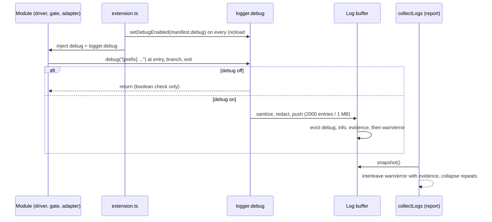

<!-- AGENT INSTRUCTIONS:
This file uses an agent-optimized block format. DO NOT read this file entirely.
1. TABLE OF CONTENTS: Run this to list all available keys:
  grep -F "## [@" docs/arch/debug-logging.md

2. EXTRACT A RULE: Run this to read a specific block (Example for ID 'arch:DBG-01'):
  awk "/^## \[@arch:DBG-01\]/,/END_DOC_BLOCK: \[@arch:DBG-01\]/" docs/arch/debug-logging.md
-->
# Debug logging

Binding reference for `logger.debug()` and the injected `debug` callbacks. `CLAUDE.md` points here; this file carries the rules and the inventory.

## [@arch:DBG-00] Overview
, src/agent/instrumentedAdapter.ts#instrumentAdapter, src/diagnostics/logEvidence.ts, src/diagnostics/collectMetadata.ts

### Purpose
How debug output is produced, gated, retained and reported. Host-agnostic modules emit `debug(...)` through injected callbacks; one logger gates it, and a bounded buffer keeps ticket evidence for issue reports.

### Connections
- in: @arch:MAP-00 — the host-agnostic layering that forces `debug` to be injected.
- in: @arch:AC-08 — adapters get debug by construction via `instrumentAdapter`.
- out: @arch:DIAG-02 — reports read the same buffer through `collectLogs`; reporting never reaches back.

### Flow

### Tradeoffs
| Chosen | Rejected | Why |
|---|---|---|
| Injected `debug` callback | Importing the global logger | Keeps vscode-free modules testable with fakes. |
| Level- and evidence-aware eviction | Plain FIFO | A debug flood must not push gate/runtime evidence out. |

### Fallbacks
| Trigger | Behaviour | Recovery |
|---|---|---|
| Debug disabled | `debug()` is a no-op | Toggle Settings → General; applied on next manifest load. |
| Buffer cap reached | Lowest-priority resident evicted | Report carries `omitted` / `omittedByClass` counts. |

### Rules
@arch:DBG-01 · @arch:DBG-02 · @arch:DBG-03
END_DOC_BLOCK: [@arch:DBG-00]

## [@arch:DBG-01] Injected callbacks
covers: src/agent/instrumentedAdapter.ts#instrumentAdapter

Host-agnostic modules receive `debug` as an INJECTED callback, never by importing the logger. `extension.ts` binds every one of these to `logger.debug`:

- `StageDriverDeps.debug`
- `DriveTicketDeps.debug`
- `RunUatOpts.debug` / `RunReviewOpts.debug`
- `RunGatesOptions.onDebug` / `RunCommandOptions.onDebug` (gate processes)
- `RunHeadlessOpts.debug` (adapters) — injected ONCE by `instrumentAdapter`'s `InstrumentOptions.debug`, so a fifth core gets debug logging by construction
- `HeadlessSpawnOptions.onDebug`
- `SpinOptions.debug`
- `StartHotOpts.debug`
- `ReapOptions.debug`

A new debug call site must stay behind the injected callback — never call a global logger from a vscode-free module.
END_DOC_BLOCK: [@arch:DBG-01]

## [@arch:DBG-02] Gate and retention
covers: src/logging/logger.ts#makeBoundedLogBuffer, src/logging/logger.ts#makeLogger, src/diagnostics/collectMetadata.ts

`logger.debug()` (`src/logging/logger.ts`) is a NO-OP unless `setDebugEnabled(true)` was called. The manifest's `debug: true` drives it, toggleable from Settings → General and re-applied on every manifest (re)load by `extension.ts`'s `applyManifestDebug`. When off, a `debug()` call is a boolean check and a return. When on, entries go to the Karst output channel AND the diagnostic buffer, through the same sanitize/redaction pipeline as info/warn/error, so reports capture them. Debug mode also raises the buffer's retention to 2000 entries / 1 MB via `setDebugRetention`.

Retention is **level-aware and evidence-aware** (the one vocabulary lives in `src/diagnostics/logEvidence.ts`, shared with the report): when a capture crosses the entry-count or byte cap, the buffer evicts a plain `debug` line first, then a plain `info` line, then a ticket-evidence line (a DBG-03 prefix — `[runtime]`/`[gate]`/`[stage]`/`[stage-log]`/`[merge]`/`[hot]`/`[hotSet]`/`[staged]`/`[agent:*]`/`[process]`), and `warn`/`error` last. A freshly captured `warn`/`error` or evidence line is never the one dropped — it displaces the oldest lowest-priority resident, so neither a `[driver]` debug flood nor a buffer saturated with ordinary `info` (or with a repeating warning) can push the runtime/gate evidence out (it is emitted at `debug`); a freshly captured plain `info`/`debug` may itself be dropped when the buffer is full of higher-priority lines. `snapshot()` stays chronological. At report time `collectLogs` (`src/diagnostics/collectMetadata.ts`) selects within the row/byte caps by INTERLEAVING warn/error with prefix evidence (any `logEvidence` prefix), newest first inside each, so neither can spend the whole cap before the other; a ticket-named line with no evidence prefix (e.g. `[driver] … T<id>`) ranks BELOW that prefix evidence, so a same-ticket `[driver]` flood cannot push the `[gate]`/`[runtime]`/`[stage]` lines out; the remaining noise follows, newest first, and the output is emitted in chronological order. `reason` names the dominant omission cause — the cap that actually bound, or `age` when the age window dropped at least as much. Consecutive repeats collapse into one entry suffixed `(repeated N× from <t0> to <t1>)` (never across a classification boundary, so a ticket-named line is not folded into another ticket's group), and the dropped entries are counted per class under the additive `omittedByClass` (`warnError`/`ticket`/`other`/`age`) beside `omitted`.
END_DOC_BLOCK: [@arch:DBG-02]

## [@arch:DBG-03] Authoring rules

- **Every new stage runner, gate, or agent adapter MUST emit `debug(...)` via the injected callback at** entry (what is attempted), each decision branch (which path), and exit (the outcome).
- **Prefixes are load-bearing for filtering**: `[driver]` (stage driver), `[gate]` (gate run/runList + uat/review stages), `[agent:<name>]` (claude/codex/opencode/antigravity adapters), `[runtime]` (spin/supervisor/worktreeServers), `[merge]` (mergeGate), `[process]` (process-assignment seam: profile body overlaid as a process's instructions). Not exhaustive (e.g. `[dashboard]`); reuse an existing prefix before adding one.
- **Never log** secrets, tokens, full prompts (redact to `<prompt:<n> chars>`), or repository contents. Bound untrusted agent stdout/stderr first (`headlessPreview`, 500 chars; gate output: length only).
- **A new `catch {}` in workflow/runtime** that is a decision point MUST be preceded by a `debug` line; blocks and parks name their `blocker`/`reason`.
END_DOC_BLOCK: [@arch:DBG-03]
