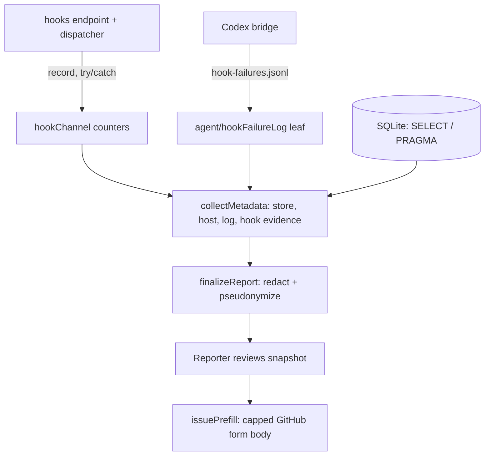

<!-- AGENT INSTRUCTIONS:
This file uses an agent-optimized block format. DO NOT read this file entirely.
1. TABLE OF CONTENTS: Run this to list all available keys:
  grep -F "## [@" docs/arch/diagnostics.md

2. EXTRACT A RULE: Run this to read a specific block (Example for ID 'arch:DIAG-00'):
  awk "/^## \[@arch:DIAG-00\]/,/END_DOC_BLOCK: \[@arch:DIAG-00\]/" docs/arch/diagnostics.md
-->
# Diagnostics and issue reporting

Reporting observes the system; it never reaches back into it. Related: `docs/arch/agent-cores.md` (the hook channel the counters describe).

## [@arch:DIAG-00] Overview
covers: src/diagnostics/**/*.ts, src/agent/hookFailureLog.ts

### Purpose
Issue reporting collects operational evidence (store, host, logs, hook counters) into a redacted, reviewed snapshot that prefills a GitHub issue. It only observes: nothing in it writes to, spawns from, or calls into the running system.

### Connections
- in: @arch:AC-08 — the hook channel and Codex bridge whose counters and failure log the report reads.
- in: @arch:ST-00 — registry tables (`token_usage`, `interactive_usage_samples`, `session_launch_intents`) read with `SELECT`/`PRAGMA` only.
- in: @arch:DBG-01 — debug logs feed `logEvidence.ts`.
- out: @arch:MAP-00 — diagnostics is a leaf of the system map.

### Flow

### Tradeoffs
| Chosen | Rejected | Why |
|---|---|---|
| Hooks import diagnostics counters; shared code in a `node:fs`-only leaf | Diagnostics importing hooks | Reporting must not pull the system it describes into its import graph. |
| Prefill from the finalized snapshot | Prefill from the draft | Only reviewed, sensitive-value-checked bytes may leave. |
| Cores merged from append-only evidence | `tickets.session_provider` | Last-writer-wins loses a core switched mid-session. |

### Fallbacks
| Trigger | Behaviour | Recovery |
|---|---|---|
| Counter recording throws | Swallowed at the call site | Endpoint still answers 2xx fast. |
| Hook body over 1 MiB | Declined (204 / exit 0), counted | Report shows `too-large` / `input-too-large`. |
| Launch-time endpoint URL dead after reload | Bridge falls back to `current-endpoint` | Silent; only the last failure is logged. |

### Rules
@arch:DIAG-02 · @arch:DIAG-03 · @arch:DIAG-04 · @arch:DIAG-05
END_DOC_BLOCK: [@arch:DIAG-00]

## [@arch:DIAG-02] Issue reporting OBSERVES; it never reaches back into the system it describes

`diagnostics/nonInterference.test.ts` walks the reachable import graph from every reporting entry point and fails on `child_process`/`node:http`/`node:net`, on `src/workflow/`, `src/hooks/`, the launch adapters (including `agent/opencode.ts`) and `agent/settings.ts`, and on any write SQL inside `src/diagnostics/`. So the dependency direction is fixed: `hooks/` imports `diagnostics/hookChannel.ts` (the counters), never the reverse, and anything both sides need lives in a leaf module (`agent/hookFailureLog.ts`) that imports only `node:fs` and `node:path`. Registry reads are `SELECT` or a bare `PRAGMA <name>`; the read-only assertion in `collectMetadata.test.ts` allows exactly those two shapes. `SCHEMA_VERSION` lives in the dependency-free `store/schemaVersion.ts`, not `store/migrations.ts` (the migrator itself, which carries real write SQL) — so `hostEvidence.ts` reading it for the registry section never drags the migrator into the reachable graph.
END_DOC_BLOCK: [@arch:DIAG-02]

## [@arch:DIAG-03] A hook failure has two halves and the report carries both
covers: src/diagnostics/hookChannel.ts#normalizeHookEventName, src/agent/hookFailureLog.ts#writeCurrentEndpoint, src/agent/hookFailureLog.ts#bridgeOutcomeDetail

`diagnostics/hookChannel.ts` counts what the endpoint saw (`accepted`/`not-found`/`bad-request`/`too-large`/`timeout`/`dispatch-failed`) and what the dispatcher did (`applied`/`unknown-worktree`/`stale-generation`/`no-signal`); the Codex bridge's own `hook-failures.jsonl` supplies why the process exited. The bridge's outcomes carry a bounded detail suffix — `http-error:404`, `request-error:ECONNREFUSED` — so the report names the status or connection code, not just the exit code; readers fold the suffix onto its closed base for counting (`bridgeOutcomeDetail` re-validates the suffix against a bounded charset, else the record is `unknown`). **A revived session's hooks rebind to the live endpoint.** A VS Code reload rebinds an ephemeral port, so the extension writes its current URL to `<configDir>/codex/current-endpoint` on every activation (`writeCurrentEndpoint`), and the bridge prefers its launch-time URL while it answers and falls back to that file when it is gone — the switch is silent, only the final candidate's failure is logged, and the launch-time `karstLaunch` generation is carried onto the rebound URL so the endpoint's generation barrier still admits the session; argv-first ordering keeps a second window's activation from stealing another window's hooks. Both sides are counted under CLOSED vocabularies — a hook event name is agent-authored, so it is normalized (`normalizeHookEventName`) before it can become a key, and an unrecognized bridge outcome is counted as `unknown` rather than carried through. Recording is wrapped in `try/catch` at every call site: a counter defect may never turn the endpoint's fast 2xx into a stalled agent. **An oversized hook body is a normal event, never a fault of the sender.** Tool results ride hook payloads, so a body over the 1 MiB ingest cap (`MAX_HOOK_BODY_BYTES`, mirrored in the Codex bridge) is DECLINED, not errored: the endpoint answers 204 and drains the remainder, the bridge exits 0; both sides still count the decline (`too-large` / `input-too-large`) for the report. The ticket API keeps its own 64 KiB cap; ticket bodies are small.
END_DOC_BLOCK: [@arch:DIAG-03]

## [@arch:DIAG-04] The GitHub handoff form is prefilled from the FINALIZED snapshot, never the draft
covers: src/diagnostics/storeEvidence.ts#readCoreUsage, src/diagnostics/issuePrefill.ts#coreLines

`diagnostics/issuePrefill.ts` reads back the bytes the reporter already reviewed and that `finalizeReport` proved carry no sensitive value; the optional session context is never read. It is operational metadata only — editor fork and version, platform/arch, Node/Electron/ABI (the native `better-sqlite3` addon loads by ABI), the registry's `user_version` beside `SCHEMA_VERSION`, resolved provider/model, and the hook counters. Every cell is pipe-stripped, whitespace-collapsed and length-capped, and the whole body is capped at `MAX_PREFILL_BODY_CHARS`. **The report's `cores` section is the whole history of agent cores used on a ticket** — headless calls (`token_usage`), interactive usage (`interactive_usage_samples`), and confirmed sessions (`session_launch_intents`) merged per provider by `readCoreUsage` (`diagnostics/storeEvidence.ts`) — read from append-only evidence, so a core switched mid-session still reports its rows; it never relies on the last-writer-wins `tickets.session_provider`. `NULL`-provider rows are bucketed as `unknown`, never dropped. `coreLines` (`issuePrefill.ts`) renders the summary/prefill line, `buildReviewSummary` shows it in the review popup, and DISCLOSURE names the evidence.
END_DOC_BLOCK: [@arch:DIAG-04]

## [@arch:DIAG-05] Planning agents are invisible to metering and the resource monitor

A planning-session terminal (`extension/ops/planningOps.ts`) carries no ticket id, so it is NOT token-metered (no `token_usage` rows, nothing on the usage view) and NOT registered with the resource monitor. A report taken while one runs shows neither its tokens nor its process; that absence is expected, not a capture bug.
END_DOC_BLOCK: [@arch:DIAG-05]
