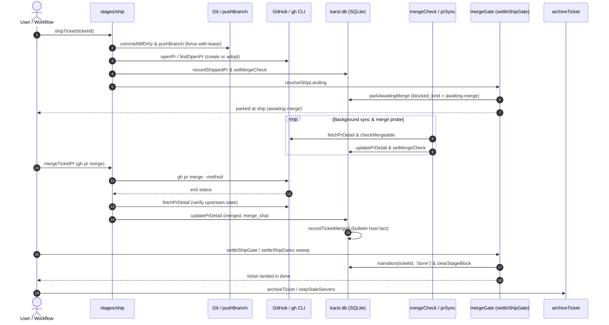

<!-- AGENT INSTRUCTIONS:
This file uses an agent-optimized block format. DO NOT read this file entirely.
1. TABLE OF CONTENTS: Run this to list all available keys:
  grep -F "## [@" docs/arch/github-and-merge.md

2. EXTRACT A RULE: Run this to read a specific block (Example for ID 'arch:GH-02'):
  awk "/^## \[@arch:GH-02\]/,/END_DOC_BLOCK: \[@arch:GH-02\]/" docs/arch/github-and-merge.md
-->
# GitHub: PRs, merge probes, and the merge action

Everything karst believes about a PR is re-probed state, never assumed. Related: `docs/arch/stages-and-gates.md` (the ship gate that reads this state), `docs/arch/worktrees-and-servers.md` (the branch the PR is opened from).

## [@arch:GH-00] Overview
covers: src/integrations/github*.ts, src/integrations/prChecks.ts, src/integrations/git.ts, src/store/prs.ts, src/store/mergeChecks.ts, src/store/prFeedback.ts, src/store/shipRuns.ts, src/workflow/merge*.ts, src/workflow/stages/ship*.ts, src/workflow/pr*.ts, src/workflow/dismissPr.ts, src/workflow/mergedNothingNew.ts

### Purpose
The GitHub integration governs pull request lifecycle management, mergeability probes, and the merge gate that advances tickets from ship to done. Everything karst tracks about a PR is re-probed state, treating GitHub as upstream truth while SQLite owns local tracking, merge verification, and auditability. Landing a PR is never assumed from exit codes and remains a verified, human-gated transition.

### Connections
- in: @arch:DOC-01 — architecture doc template and overview rules.
- in: @arch:STAGEMACH, @arch:DONE, @arch:BLOCKED — ship stage execution, awaiting-merge gate blocking, and transition to done.
- in: @arch:WT-00, @arch:BASE-PER, @arch:RENDERERS — worktree branches, base references, and convention templates feed branch pushes and PR creation.
- in: @arch:SHIP-EXCLUDE, @arch:ROOT-GEN — exclusion rules protect working trees from staging karst scaffolding before push.
- out: @arch:ST-00, @arch:SQLITE — PR metadata (prs), merge check verdicts (merge_checks), and ship evidence (ship_runs) persisted in SQLite.
- out: @arch:MAP-00, @arch:MAP-01 — integration and workflow execution layers in the system architecture topology.
- out: @arch:BULLETIN — merge events record trusted host-fact bulletin notes and stamp ticket agent notes (recordTicketMerged).
- out: @arch:CLI-03 — CLI commands and context queries read current PR status and merge verdicts.
- out: @arch:WT-REMOVE — advancing to done unlocks ticket archiving and worktree server reaping.

### Flow

### Tradeoffs
| Chosen | Rejected | Why |
|---|---|---|
| Verify PR state by re-probing (`fetchPrDetail`) after `gh pr merge` | Trusting `gh` exit code | `gh` can succeed on queued merges or fail on concurrent/retried merges; only re-probed upstream state is reliable evidence. |
| Read-filtered merge checks via `PR_NOT_MERGED` | Deleting stale check rows on merge transition | Transition hooks miss rows already stranded in user databases; read filtering recomputes dynamically from re-probed `prs.status`. |
| Separate `dismissed_at` column for closed PRs | Overwriting `status` or force-advancing the ticket | `prSync` periodically overwrites `status` with upstream state; explicit dismissal records human acknowledgement without falsely claiming the PR merged. |
| Explicit merge method (`--merge`, `--squash`, `--rebase`) | Defaulting to bare `gh pr merge` | Bare command prompts on an interactive TTY that does not exist in webview context; explicit flags avoid hangs. |
| Single path formatter (`repoDisplayPath` + `PathContext`) | Ad-hoc local formatting across panels and CLI | Uniform path representation prevents confusion across webviews, CLI status lines, and multi-repo tickets. |

### Fallbacks
| Trigger | Behaviour | Recovery |
|---|---|---|
| `gh` command missing or not installed (`ENOENT`) | Translates spawn failure via `renderMissingDependency(GH_DEPENDENCY)` | Displays clear install guidance rather than opaque system error. |
| `gh pr view` output truncated or unparseable | Yields `UNKNOWN_PR_DETAIL` and preserves known facts via `COALESCE` | Next sync tick retries without wiping previously recorded metadata. |
| `git merge-tree` unsupported on older git (< 2.38) | Falls back to fast-forward ancestry check or returns `unknown` | Reports actionable version requirement instead of cryptic usage banner. |
| PR closed upstream without merging | Merge gate reports `closed` state and refuses transition | User reopens PR upstream or dismisses it via `dismissTicketPr`. |
| Ship tail loses `awaiting-merge` block write | `settleShipGate` detects passed `ship_runs` without active run | Automatically repairs lost `awaiting-merge` block on next sweep tick. |

### Rules
@arch:GH-02 · @arch:GH-03 · @arch:GH-04 · @arch:GH-05 · @arch:GH-06 · @arch:GH-07
END_DOC_BLOCK: [@arch:GH-00]

## [@arch:GH-02] A merge probe's file list is PARSED output, and the format is not what it looks like
covers: src/workflow/mergeCheck.ts#checkMergeable, src/workflow/mergeCheck.ts#parseConflictedPaths

`git merge-tree --write-tree --name-only` prints the tree OID and the conflicted paths on CONSECUTIVE lines, then a blank line, then git's own chatter ("Auto-merging x", "CONFLICT (content): …"). It is not a uniformly blank-separated three-section document: splitting it as one made section 1 the chatter, and `mergeCheck.ts` reported "CONFLICT (content): Merge conflict in x" as a filename to the panel and into the agent's conflict brief. Any fixture for this must be VERBATIM git output (`mergeCheck.test.ts`, `mergeSync.test.ts`, `ship.integration.test.ts` all carry one) — the invented layout is what let the bug pass its own tests.
END_DOC_BLOCK: [@arch:GH-02]

## [@arch:GH-03] PR facts are re-probed state, never assumed
covers: src/store/prs.ts#updatePrDetail, src/integrations/github.ts#fetchPrDetail, src/store/bulletinNotes.ts#recordTicketMerged, src/model/mergeCheckView.ts#mergeOpStatus

`prs`' v16 metadata (`head_ref`/`base_ref`/`created_at`/`merged_at`/`comments`) is CURRENT STATE like `status`, not evidence — one `gh pr view --json …` (`fetchPrDetail`) fills all of it, and `updatePrDetail` writes every field as COALESCE so a degraded probe never corrects a known fact to null. Three distinctions are load-bearing: `status:'unknown'` is dropped (never overwrites a real status), `comments: []` ("none") clears while `comments: null` ("gh did not say") keeps, and `merged_at` can never be un-set. Display strings are rendered host-side in `model/prPanelView.ts` (`''` for an absent fact — never a placeholder), because the webview cannot import a formatter. The merge verdict beside them is worded in `model/mergeCheckPanel.ts` — bounded facts (verdict, count, base ref, age) on the headline, the unbounded ones (conflicting paths, git's error prose) in a collapsed body — while `model/mergeCheckView.ts` keeps the one-line form the ship strip and `karst context` share; the two must not be merged, because the panel has room to say more and the CLI does not.

The same probe also reads `mergeCommit.oid` and `files[].path` into `PrDetail.mergeSha`/`changedPaths`. `gh pr view --json files` is capped at 100 entries with no paging, so a list at the cap is INCOMPLETE: `changedPaths` goes null and the bulletin records paths NULL, falling back to repo-only relevance (never a partial diff dressed up as the whole). `updatePrDetail` is the merge hook — inside one transaction it reads the old status/merge_sha and, on the first probe reporting `merged` with a known sha, calls `recordTicketMerged` to write the trusted host-fact bulletin note and stamp the ticket's agent notes (`store/bulletinNotes.ts`; see `docs/arch/store-and-schema.md`, "Project bulletin"). `merge_sha` follows the `merged_at` rule — COALESCE, never un-set — and the host note's unique index makes a re-probe a no-op.
A resolved merge conflict at `ship` is delivered by Karst, not the agent (D247, `arch:AC-39`): after the Resolve-conflicts session goes idle with the recorded base head merged and a clean tree, the same Deliver to PR path runs behind the gates, then this re-probe is what shows the result (`Delivering resolved merge to PR #n…` while it runs; log `[ship] ticket <key> auto-deliver after conflict resolve: <outcome>`). One delivery per conflict round.
END_DOC_BLOCK: [@arch:GH-03]

## [@arch:GH-04] The merge action trusts the re-probe, not the exit code
covers: src/workflow/mergePr.ts#mergeTicketPr, src/integrations/github.ts#mergePr

`workflow/mergePr.ts` runs `gh pr merge` and then re-reads the PR: gh refused but it reads merged → success; gh accepted but it does not → NOT success, with the state named. `gh pr merge` always gets an explicit method (bare would prompt on a tty that does not exist behind a webview) and never `--delete-branch`/`--auto` — the `worktrees` row and `archive.ts` restore both target that ref, and a queued merge cannot be reflected as merged now. The webview posts only `{type:'merge-pr', repo}`; the modal confirmation AND the method choice live in the host, so a crafted message can neither pick a strategy nor skip the confirmation of an irreversible action.
END_DOC_BLOCK: [@arch:GH-04]

## [@arch:GH-05] A merged PR ends its repo's merge check, and that is enforced on READ
covers: src/store/mergeChecks.ts#getMergeCheck, src/store/mergeChecks.ts#listMergeChecksByTicket, src/store/prs.ts#CURRENT_PR_ORDER, src/workflow/mergeSync.ts#syncMergeChecks

`merge_checks` is current state, but `syncMergeChecks` refreshes through `listSyncablePrs`, which drops merged PRs on purpose — so the last pre-merge verdict freezes the moment it stops being true, and nothing can ever overwrite it. Both `getMergeCheck` and `listMergeChecksByTicket` therefore filter on `PR_NOT_MERGED` (`store/mergeChecks.ts`), which fixes all four consumers — panel, ship strip, `karst context`, and `buildConflictBrief`'s refusal — at one seam. Read-filtered, never deleted-on-transition: a delete only fires on the transition and would leave every row already stranded in a user's DB, while a read recomputes from `prs.status`, which is itself re-probed. Scoped to the repo's CURRENT PR (`CURRENT_PR_ORDER`, exported from `store/prs.ts` and shared with `findTicketPr`), because `ship` inserts a fresh PR row rather than reusing a terminal one. A repo whose current PR is merged is also not re-shipped when its branch adds nothing to the merged head (`arch:DONE`). No PR row at all is NOT a merged repo: `ship` records a check per worktree even when opening the PR failed.
END_DOC_BLOCK: [@arch:GH-05]

## [@arch:GH-06] A closed PR is a dead end, and dismissal is the only answer the gate accepts
covers: src/workflow/mergeGate.ts#mergeGateState, src/workflow/dismissPr.ts#dismissTicketPr, src/workflow/dismissPr.ts#undismissTicketPr, src/store/prs.ts#dismissPr

The merge gate waits for a literal `'merged'` per repo, and a PR CLOSED without merging can never reach it — so a multi-repo ticket with two merges and one close parked at `ship` forever with no action able to move it. `mergeGateState` now names that case as its own state (`closed`, ahead of `conflicted` — a conflict is resolvable, a closed PR is not) and the block reason states the two ways out: reopen it upstream, or DISMISS it. Dismissal is `prs.dismissed_at` (v56) — a column of OURS, never a status value, because `prSync` overwrites `status` and would erase the acknowledgement. A dismissed PR is dropped from the gate's read rather than counted as merged, so nothing downstream can claim it landed, and a ticket whose every PR was dismissed reads `nothing-to-merge`. `workflow/dismissPr.ts` records it and re-settles the gate normally: it is a statement about one PR, NOT a force-advance — a ticket with other unmerged PRs stays as parked as it was. Reversible from the same row (`undismissTicketPr`), which is what a PR reopened upstream needs; the undo never un-lands a ticket that already reached `done` (that is `sendBack`'s business). Host-confirmed with a modal, and the webview posts only `{type:'dismiss-pr', repo}`, exactly like `merge-pr`.
END_DOC_BLOCK: [@arch:GH-06]

## [@arch:GH-07] Ship paths go through `repoDisplayPath` + `PathContext`
covers: src/ui/worktreePath.ts#repoDisplayPath, src/ui/worktreePath.ts#PathContext

Any path the ship stage prints goes through `repoDisplayPath` + `PathContext` (the manifest's `worktreePathDisplay`) — the PR panel rows (`PrView.repoDisplay`, set in dashboard `state.ts`) and the ship strip (`ShipPrView.repoDisplay`). One preference, one formatter; never a second local format.
END_DOC_BLOCK: [@arch:GH-07]
