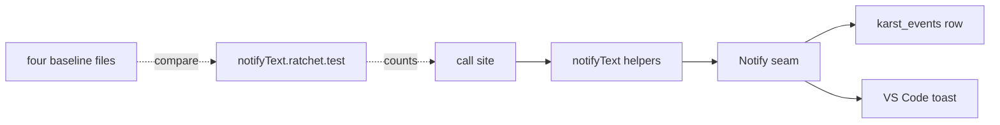

<!-- AGENT INSTRUCTIONS:
This file uses an agent-optimized block format. DO NOT read this file entirely.
1. TABLE OF CONTENTS: Run this to list all available keys:
  grep -F "## [@" docs/arch/notifications.md

2. EXTRACT A RULE: Run this to read a specific block (Example for ID 'arch:NTF-01'):
  awk "/^## \[@arch:NTF-01\]/,/END_DOC_BLOCK: \[@arch:NTF-01\]/" docs/arch/notifications.md
-->
# Notification text (`src/model/notifyText.ts`)

How the text of a toast is written. Related: `docs/arch/ids.md` (`arch:IDS-01`, ticket names), `docs/ui/STYLE-GUIDE.md` (`ui:SG-14`, copy tone), `docs/arch/store-and-schema.md` (the `karst_events` row of each toast).

## [@arch:NTF-00] Overview
covers: src/model/notifyText.ts, src/model/notifyText.ratchet.test.ts, src/extension/ops/notify.ts, src/extension/toastSeam.ts

### Purpose
Karst shows many toasts. One rule set gives them one voice: ASD-STE100 sentences, no internal words, one name for a ticket. A pure helper builds the shared parts, and a guard test counts the texts that still break the rule.

### Connections
- in: `@ui:SG-14` (sentence order), `@arch:IDS-01` (ticket names), `@arch:EVENTLOOP` (the recorder row is one sync insert)
- out: `@arch:IDS-01` (a toast uses `ticketLabel`)

### Flow

### Tradeoffs
| chosen | rejected | why |
|---|---|---|
| rule, helper and guard | one central message catalog | a catalog is too large for about 320 sites |
| four baseline files, one per rewrite area | one baseline file | the four rewrite tickets would conflict in one file |
| key and title after the `T<n>` | key and title without the `T<n>` | the key is never shown without the T-id (`@arch:IDS-01`) |

### Rules
`@arch:NTF-01` · `@arch:NTF-02` · `@arch:NTF-03` · `@arch:NTF-04` · `@arch:NTF-05` · `@arch:NTF-06` · `@arch:NTF-07` · `@arch:NTF-08` · `@arch:NTF-09`
END_DOC_BLOCK: [@arch:NTF-00]

## [@arch:NTF-01] Sentences: ASD-STE100, in the SG-14 order
A toast says what happened, then why (when known), then what to do. Each sentence has at most 25 words. A toast has at most 2 sentences.

- Good: `Created sub-task KAR-41.` (`src/extension/ops/lifecycleOps.ts`)
- Bad: `Karst: the thing could not be done, please try again later because of the state (see log).`
END_DOC_BLOCK: [@arch:NTF-01]

## [@arch:NTF-02] No `Karst:` prefix
No toast text starts with `Karst:` or `karst:`. VS Code already shows the source `Karst` on the toast.

- Good: `Open a workspace folder first.`
- Bad: `Karst: open a workspace folder first.`
END_DOC_BLOCK: [@arch:NTF-02]

## [@arch:NTF-03] A ticket is named with `ticketLabel`
covers: src/model/notifyText.ts#ticketLabel
A toast names a ticket as `ticketLabel(id, key, title)`: `T12 · KAR-12 "Fix login"`, or `T12 "Fix login"` without a key. The title is cut at 40 characters with an ellipsis. The text never starts with `Ticket T12:`. A call site that has only an id gets a `TicketLabeler` from its binding; `src/model` never reads the store.

- Good: `T12 · KAR-12 "Fix login": the review failed. Open the review log.`
- Bad: `Ticket T12: the review failed.`
END_DOC_BLOCK: [@arch:NTF-03]

## [@arch:NTF-04] No internal words
covers: src/model/notifyText.ts#reasonText, src/model/notifyText.ts#plural
A toast has no graph run or node run id, no pid, no `marker`, no `envelope`, no command id as a feature name, no lower-case stage slug (write `UAT`, `Review`), no raw stack or provider JSON, no `(s)` plural and no `Please`. `reasonText(err)` gives the first line of an error message (200 characters at most, `unknown error` when there is none). `plural(n, one, many)` gives the count and the right noun. Details go to the debug log.

- Good: `T12 "Fix login": the implementation is done. The ticket moves to UAT.`
- Bad: `Ticket T12: the implementation marker fired (graph run 9) — advancing to uat.`
END_DOC_BLOCK: [@arch:NTF-04]

## [@arch:NTF-05] Severity
`error`: an action failed and the person must act. `warn`: Karst continued in a degraded way, or the person may need to act. `info`: the result of an explicit action of the person. A routine background event (a stage advance, an autostart, a retry that worked) shows no toast: it uses `Notify.record(level, message, ticketId?)`, which writes the `karst_events` row only. A severity change keeps the await behavior of the call: `error` is awaited, `info` and `warn` are not.
END_DOC_BLOCK: [@arch:NTF-05]

## [@arch:NTF-06] Action buttons
A button label is an imperative verb and an object, in sentence case, with the primary action first. A label used in two places is one exported constant. Code compares the chosen label with that constant only.

- Good: `Open review log`
- Bad: `OK`, `Click here to open the Review Log`
END_DOC_BLOCK: [@arch:NTF-06]

## [@arch:NTF-07] One text, one function
A text used in more than one place is one function in `src/model/notifyText.ts`, not a copied template. `markerAdvancedText(label)` is the first one. The count helpers `plural(n, one, many)`, `logMatchText(count, current?)` — the total, or `3 of 12` once Prev/Next has moved the caret — and `logNewLinesText(count)` — the server logs view's Follow-off button — are the same rule for webview count text: a plain-HTML page receives the finished text from the host, and a React webview imports the helper. No webview holds its own plural ternary.
END_DOC_BLOCK: [@arch:NTF-07]

## [@arch:NTF-08] A text change updates its quotes
A text change updates in the same change every arch block that quotes the text, and every test or `scripts/` file that matches it. The prefix `Created sub-task` stays, because `scripts/uat-host/samples/ui-subtask.json` waits on it.
END_DOC_BLOCK: [@arch:NTF-08]

## [@arch:NTF-09] The guard and its baselines
covers: src/model/notifyText.ratchet.test.ts
`src/model/notifyText.ratchet.test.ts` parses `src/**/*.ts` (no tests) and checks the first argument of each toast call when it is a string or a template: `notify.`, `toast.` or `ask.` with `info`, `warn`, `error`, `errorActions` or `infoActions`, and `window.show(Information|Warning|Error)Message`. A violation starts with `Karst:` (any case) or `Ticket `, contains `(s)` or `Please`, or holds an `instanceof Error ? x.message : String(x)` expression. The count of each file must equal its line in the baseline files `src/model/notifyGuard/{extension,panels-hosts,ops-sandbox,ops-rest}.txt`; more or fewer fails. A rewrite ticket shrinks only its own file, then runs the test with `NOTIFY_GUARD_UPDATE=1`. Not guarded: `deps.warn`, `input.warn`, `host.warn`, `setStatusBarMessage`, progress titles, logger lines, command and terminal names.
END_DOC_BLOCK: [@arch:NTF-09]
