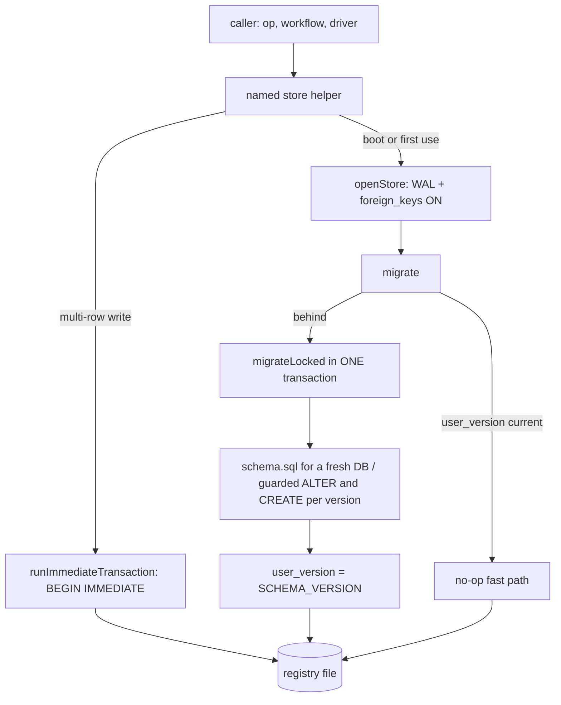

<!-- AGENT INSTRUCTIONS:
This file uses an agent-optimized block format. DO NOT read this file entirely.
1. TABLE OF CONTENTS: Run this to list all available keys:
  grep -F "## [@" docs/arch/store-and-schema.md

2. EXTRACT A RULE: Run this to read a specific block (Example for ID 'arch:SQLITE'):
  awk "/^## \[@arch:SQLITE\]/,/END_DOC_BLOCK: \[@arch:SQLITE\]/" docs/arch/store-and-schema.md
-->
# The store: SQLite, projects, and schema changes

The registry is shared by every IDE window, so every rule here is about scoping and about changing the schema without stranding a row. Related: `docs/arch/cli.md` (the CLI asserts the version but cannot migrate), `docs/arch/stages-and-gates.md` (the evidence tables), `docs/arch/system-map.md` (@arch:MAP-03, why `model/artifacts.ts` below is allowed to call live `store` reads).

## [@arch:ST-00] Overview
covers: src/store/**, src/cli/assertMigrated.ts#assertExactSchema, src/cli/assertMigrated.ts#assertMigratedSchema

### Purpose
The store is the one SQLite registry every IDE window shares: it owns the schema, the numbered migrations, and the transaction boundary every persisted fact (tickets, stages, evidence, runs, worktrees, planning drafts) is written through. This file governs how that registry is opened and migrated, how rows are scoped to a project, and the write boundary of each table. SQLite is the source of truth; `reconcileOnStart`/`deriveStageCurrent` re-derive the in-flight state on boot.

### Connections
- in: @arch:SINGLE-WRITER, @arch:EVIDENCE-WHEN — stage/agent-state and gate-evidence rules decide what may be written.
- in: @arch:BASE-PER, @arch:SPAWN-ENV — the base-ref and env-override semantics these columns carry.
- in: @arch:GH-03 — PR facts and merge shas arrive through `updatePrDetail`.
- out: @arch:CLI-05, @arch:CLI-08 — the CLI reads the same registry with `node:sqlite` and cannot migrate.
- out: @arch:DIAG-02 — reporting reads the run/token tables and never reaches back.
- out: @arch:MAILBOX — v77 keeps fix rows out of the shared message route.
- out: @arch:MAP-04 — live schema ER diagram and table relationships.

### Flow

### Tradeoffs
| Chosen | Rejected | Why |
|---|---|---|
| One global registry, every query project-scoped | A DB per window or per project | All windows share one file; `projects.slug` is identity, and an unscoped query is the recovery-only all-projects view. |
| `schema.sql` carries the full current schema; upgrades are guarded `ALTER`s | Replaying migration history on every fresh DB | A fresh DB is created current in one exec, and the same guards make a re-open a no-op. |
| One `BEGIN IMMEDIATE` around the whole migration | Per-step autocommit | A crash rolls back the migration instead of leaving some steps committed. |
| `runImmediateTransaction` over the driver's callable | Driver-specific transaction options | better-sqlite3 silently ignores options the `node:sqlite` adapters need. |
| UPSERT on `(ticket_id, path)` | Blind INSERT on re-spin | A checkout pruned from git while its row survived otherwise duplicated dashboard cards. |

### Fallbacks
| Trigger | Behaviour | Recovery |
|---|---|---|
| A second window opens mid-migration | Blocks on `busy_timeout`, re-reads the version, then no-ops | None needed |
| Crash mid-migration | The single transaction rolls back | Next open re-runs the idempotent steps |
| Early v64 `ticket_messages` lacks `woke_at`/AUTOINCREMENT | `repairTicketMessages` rebuilds the table, copying every id | Automatic inside `migrate` |
| Legacy `project_id IS NULL` rows | Adopted once per install, only when one project exists | `bindProject` at activation |
| An older build meets a newer registry | Graph verbs throw "requires exactly v<N>" | Update that window's extension |

### Rules
@arch:SQLITE · @arch:PROJECTS · @arch:GLOBAL · @arch:GRAPHRUN · @arch:SHELF · @arch:BASEBRANCH · @arch:ENVOVR · @arch:WORKTREES-ROW · @arch:V64 · @arch:PLANNING · @arch:RELATIONS · @arch:BULLETIN · @arch:V77 · @arch:V82 · @arch:SCHEMA-CHECK
END_DOC_BLOCK: [@arch:ST-00]

## [@arch:SQLITE] SQLite is source of truth
covers: src/recovery/reconcile.ts#reconcileOnStart, src/recovery/reconcile.ts#deriveStageCurrent

SQLite is source of truth; `reconcileOnStart`/`deriveStageCurrent` re-derive on boot.
`openStore` retries the WAL switch on SQLITE_BUSY (bounded, ~5 s) because the busy handler does not cover a journal-mode change.
END_DOC_BLOCK: [@arch:SQLITE]

## [@arch:PROJECTS] Projects scope the board across IDE windows
covers: src/project/bind.ts#bindProject, src/project/slug.ts#resolveProjectSlug

The DB lives in *global* storage — every window shares it — so every ticket query MUST be scoped or window A lists/drives window B's tickets. Identity is `projects.slug`, from manifest `id:` else a path-derived fallback (`project/slug.ts`); `bindProject` (`project/bind.ts`) registers it at activation. Pass `{ projectId }` to `listTickets`/`listArchivedTickets`/`getTicketByKey`/`createTicket`; unscoped is the deliberate all-projects view (recovery only). Ticket `key` is unique **per project**, not globally. Legacy `project_id IS NULL` rows are adopted once per install, guarded by a globalState flag AND "only one project exists".
END_DOC_BLOCK: [@arch:PROJECTS]

## [@arch:GLOBAL] Global storage is shared by every window
covers: src/agent/settings.ts#writeHookSettings, src/agent/settingsSweep.ts

Global storage is shared by every window: anything written there needs a per-window key. `writeHookSettings` names its file by the window's ephemeral hook port for exactly this reason (`agent/settingsSweep.ts` reaps old ones). Same trap in `globalState`: the remembered hook port lives in **`workspaceState`** — each window binds its own port, and a global key let the second window's EADDRINUSE fallback overwrite the first's, so the first could never reclaim the port its live sessions still post to.
END_DOC_BLOCK: [@arch:GLOBAL]

## [@arch:GRAPHRUN] Graph-run state reads and writes have one boundary
covers: src/store/graph/**

Every in-process write to `approach_graph_runs`, `approach_node_runs`, and
`approach_planner_runs` goes through `src/store/graph/` (`graphRuns.ts`,
`nodeRuns.ts`, `plannerRuns.ts`) — status transitions through
`transitions.ts`'s `casStatus`, column writes through the named helpers next to
them (`markGraphRunBlocked`, `setNodeRunFailure`,
`setPlannerRunSubmittedSnapshot`, …), and the ticket-delete cascade through
`deleteGraphRunData`. The graph runtime (`approaches/graph/**`),
`extension.ts`, and `store/tickets.ts` contain no raw SQL against the three
tables, so a new column or status is added to the store module and the schema,
never to a scattered call site (NDL-38).

Reads are centralized the same way (NDL-60): every raw read of the three tables
in the runtime, `extension.ts`, the Inside dashboard, and the workflow boundary
goes through a named read helper next to the full-row reads (`graphRunById`,
`nodeRunById`, `plannerRunById`) — `graphRunStatus`, `graphRunTicketId`,
`latestGraphRunForTicket`, `nodeRunsForGraphRun`,
`countNodeRunsForRevisionNode`, `nextVisitNumber`, `plannerRunCompileAttempt`,
`submittedPlannerRunForGraphRun`, … — and call sites narrow with
`Pick<GraphRunRow, …>` / `Pick<NodeRunRow, …>` / `Pick<PlannerRunRow, …>` rather
than declaring their own drifting row interfaces. A new column or status is
therefore added to the store module and the schema, never to a repo-wide grep.

Two deliberate, documented exceptions remain:

- **The `karst` CLI's authenticated reads and UPDATEs** (`src/cli/node.ts`,
  `src/cli/graph.ts`, `src/cli/stage.ts`) stay beside their parse path — they
  fold ticket/project scoping, generation identity, and the wrong-attempt check
  into one conditional statement, and keeping that in the CLI is the security
  property `docs/arch/cli.md` describes. The CLI opens its own `node:sqlite`
  handle and never imports the extension's `store/graph` module.
- **Reporting aggregates** (`src/diagnostics/storeEvidence.ts`,
  `src/store/metrics/cost.ts`, `src/store/tokenUsage.ts`,
  `src/store/interactiveUsageSamples.ts`) stay as read-only joins over the run
  tables: they aggregate cost/token/profile facts across `token_usage`,
  `process_runs`, and the run rows, and reporting observes and never reaches
  back (`docs/arch/diagnostics.md`). They read; they never write state.
END_DOC_BLOCK: [@arch:GRAPHRUN]

## [@arch:SHELF] The artifact shelf is a READ over existing evidence, never a new write surface
covers: src/model/artifacts.ts

`model/artifacts.ts` derives semantic artifacts (uat-report, review, ship-summary) from `stages`, `gate_runs`, `review_findings`, `uat_findings`, `process_runs`, `ship_runs`, and `prs` — the same evidence rows the inside views already render. Origin `core` is resolved from the immutable identity snapshot `process_runs.provider` (captured at launch, never rewritten), falling back to `tickets.session_provider` then `tickets.agent_provider` — never invented. The detail payload rides the same snapshot (no async `artifact.get` round trip); the only failure mode is a missing resource file, reported by the host opener exactly like `openStageLog` (extension.ts:4599). Staleness is whether impl/fix re-ran after the artifact — a stale artifact still renders its content, it just warns it no longer validates current code. `DashboardState.artifacts` is the single host-side derivation (state.ts); the webview's index/detail are local renders. `artifact-open-resource` carries artifact id + resource index — never a path — and the host re-derives before opening.
END_DOC_BLOCK: [@arch:SHELF]

## [@arch:BASEBRANCH] The per-ticket base-branch columns
covers: src/workflow/changeBaseRef.ts#changeBaseRef, src/store/worktrees.ts#takeForcePushLease

`tickets.base_refs` (schema v48) is a JSON map of manifest repository NAME → plain branch name, the PRE-spin override; after spin, `worktrees.base_ref` is the authority (`docs/arch/worktrees-and-servers.md`'s base-branch section). `worktrees.needs_force_push` (schema v49) is armed only when `changeBaseRef`'s rebase actually rewrote the branch, and is read and cleared by the same statement (`takeForcePushLease`) so one rewrite arms exactly one force push.
END_DOC_BLOCK: [@arch:BASEBRANCH]

## [@arch:ENVOVR] The per-ticket env overrides column
covers: src/store/ticketEnvOverrides.ts#setServiceEnvOverrides

`tickets.env_overrides` (schema v55) is a JSON map of scope → `{KEY: value}`, where a scope is a manifest repository NAME or `*` (every service). It is merged into a hot service's spawn env between the repository's `.env` and karst's resolved vars — see `docs/arch/worktrees-and-servers.md`'s spawn-env section for the layering and why the resolved vars still win. NULL is the canonical "nothing overridden"; writes are per SCOPE (`setServiceEnvOverrides`), scoped like `setDisabledGates` so an editor that loaded before another service was touched cannot revert it.
END_DOC_BLOCK: [@arch:ENVOVR]

## [@arch:WORKTREES-ROW] One worktrees row per (ticket, path)
covers: src/runtime/worktree.ts#createWorktree

`worktrees` carries a UNIQUE index on `(ticket_id, path)` (schema v61). The pair is the checkout's identity: `createWorktree` adopts the existing row when git still lists the checkout, but when the checkout was pruned from git while the row survived it took the create path and INSERTed a second row for the same path — once per re-spin, which rendered as duplicated dashboard worktree cards. Both inserts are now UPSERTs (the adopt path DO NOTHING; the freshly cut checkout refreshes `branch`/`base_ref`, keeping the original `created_at`), and the v61 migration collapses pre-existing duplicates, earliest row wins.
END_DOC_BLOCK: [@arch:WORKTREES-ROW]

## [@arch:V64] v64: sub-task autostart and parent–child mailbox schema
covers: src/store/ticketMessagesRepair.ts#repairTicketMessages

**Sub-task autostart columns** (tickets table):
- `autostart_pending` (INTEGER NOT NULL DEFAULT 0, indexed `idx_tickets_autostart`): tri-state (0 none, 1 queued, 2 starting); semantics in `docs/arch/stages-and-gates.md`, "Sub-task autostart".
- `autostart_claimed_at` (TEXT): set by `claimAutostart` (→ 2), cleared on release, scope pass, detach and archive; a 2 at scope whose claim is NULL or older than 10 min is re-queued to 1.

**Parent–child mailbox** (`ticket_messages`, new in v64, `TICKET_MESSAGES_DDL` in `store/ticketMessagesRepair.ts`):
- `id`: INTEGER PRIMARY KEY AUTOINCREMENT — ids are never reused, which the delivery sweep's in-memory watermarks and wake baseline depend on.
- `project_id`: the sender's/child's project (FK, ON DELETE CASCADE); NULL when the ticket is unscoped.
- `from_ticket_id`: the sending ticket; NULL = host event.
- `to_ticket_id`: the recipient — the sender's direct parent OR a direct child for a message; always the child's parent for an event.
- `kind`: `'message'` (agent-posted) or `'event'` (host-written), CHECK-constrained.
- `body`: prose for BOTH kinds, trimmed, ≤ 4096 (`MAX_MESSAGE_BODY`); events read e.g. `<key> landed (done)`, `<key> blocked at <stage>: <reason>`, `<key> autostart failed: …`. Untrusted for messages.
- `created_at`, `read_at` (NULL = unread; set only by `karst inbox`'s `markRead`).
- `woke_at`: the wake-claim timestamp — set once, atomically, by `claimWake` when a sweep takes a terminal wake decision (wake or skip) on an event row; NULL = undecided.

Indexes: `idx_ticket_messages_inbox (to_ticket_id, read_at)` for inbox reads; `idx_ticket_messages_wake (project_id, kind, woke_at, id)` for the delivery sweep.

**Repair** (`repairTicketMessages`): early (unreleased) v64 DBs carry `ticket_messages` without `woke_at` or AUTOINCREMENT. `migrate` runs the repair at the end of the v64 step and, on a DB already at 64, whenever `ticketMessagesNeedsRepair` is true (in an immediate transaction with foreign keys off): rename, recreate, copy every row with its id (`woke_at` kept if it existed, else NULL), drop the old table, ensure the indexes. A no-op when the table is absent or current. Nothing is derived from stage evidence.

**Cross-window risk (L1) — applies to EVERY version bump.** `openGraphWritableStore` calls `assertExactSchema` (`cli/assertMigrated.ts`, `user_version !== SCHEMA_VERSION` throws), so any bump makes the graph verbs of every OLDER build refuse this DB: `karst graph submit` and `karst node complete|block|replan` from a window still on the previous build (sharing the same global-storage registry) fail with "requires exactly v<N-1>" until that window's extension is updated. v64 did this to v63 windows; v65 (planning sessions) does it to v64 windows; v66 (`planning_proposals.updated_at`) does it to v65 windows; v67 (`planning_proposals.source_uuid`) does it to v66 windows; v72 (the project bulletin) does it to v71 windows; v73 (`planning_proposals.depends_on`) does it to v72 windows; v74 (`planning_proposals.depends_dropped`) does it to v73 windows. The non-graph verbs use `assertMigratedSchema`, which only refuses an OLDER registry.
END_DOC_BLOCK: [@arch:V64]

## [@arch:PLANNING] Planning sessions (v65)
covers: src/store/planningSessions.ts, src/store/planningProposals.ts, src/extension/ops/planningOutbox.ts

`planning_sessions` (`src/store/planningSessions.ts`) holds a read-only, stack-aware agent conversation that investigates before a ticket exists. It is project-scoped, is NOT a ticket, and has no stage: planning has no deterministic verdict, so it stays out of the stage graph. `status` is `active` | `filed` | `archived`. `planning_session_tickets(session_id, ticket_id)` records the drafts a session filed, and linking the first one moves `active` to `filed`; unarchiving returns to `filed` if any ticket is linked, else `active`. The title is normalized in ONE place, `createPlanningSession` (control chars and whitespace runs collapse to one space, capped at `PLANNING_TITLE_MAX` = 120), because it becomes a terminal tab name. There are no resume columns (agent session id, transcript path): resume is out of scope, and a reload re-adopts the still-running terminal instead (`planningOps.adopt`, matched by env, then the scratch cwd, then the `P<id>` tab name; the legacy `Karst plan #<id>:` form is still parsed so pre-upgrade terminals revive). The migration step is purely additive (`CREATE TABLE IF NOT EXISTS`) and backfills nothing.

`planning_proposals` (`src/store/planningProposals.ts`, v65 DDL) holds the draft tickets a planning session handed over. A planning agent never touches the DB: `karst draft propose` writes `<uuid>.json` into the session scratch `outbox/`, and the host's vscode-free scan (`src/extension/ops/planningOutbox.ts`) ingests it. The scan checks the outbox is a real directory at its expected realpath, takes only `<uuid>.json` names, claims each by atomic rename to `.claim-<windowId>-<name>` (ENOENT = another window won; a claim older than 5 minutes is re-claimed), reads it through `O_NOFOLLOW|O_NONBLOCK` with an fstat regular-file check and a `MAX_PROPOSAL_BYTES` (64 KiB) bounded read, decodes strict UTF-8, and validates with `validateProposal` plus repos ⊂ the live manifest. Each session holds at most 20 pending rows (the cap applies to NEW drafts only). A valid file becomes a `pending` row and a rejected one is unlinked with a warning naming the reason. `status` is `pending` | `accepted` | `discarded`; `ticket_id` is set on accept (`ON DELETE SET NULL`); deleting the session cascades. The host's accept path is `markProposalAccepted` (the user's own Save of the prefilled ticket form): one better-sqlite3 transaction records `source='planning'`, seeds the proposal summary as the ticket's `brief` when the ticket has none, links the ticket to the session, and marks the proposal accepted. A non-pending proposal is refused.

**Revising in place (v66).** A proposal JSON may carry an optional integer `id` (`planning/proposal.ts`). With one, the scan replaces that proposal's payload via `updateProposalPayload` (writes `payload_json`, `source_uuid` and `updated_at`) ONLY when the id names a still-pending proposal of the SAME session; otherwise it warns and writes nothing. `updated_at` (added in v66; a pre-v66 row is backfilled with its `created_at`) records the last mutation — insert, revise, accept or discard.

**Structured ordering (v72).** A proposal may carry `dependsOn`, an array of host proposal ids (the `#N` `draft propose` prints and `draft list` shows) stored in `planning_proposals.depends_on` (`TEXT NOT NULL DEFAULT '[]'`), NOT in `payload_json`; reads merge it back onto `payload` when non-empty. `validateProposal` caps it at 32, dedupes it and forbids the proposal's own id; the host ingest (`validateProposalDependsOn`) additionally requires every id to name a non-discarded proposal of the SAME session and rejects any edge that would close a cycle across the session's `depends_on` graph. The accept transaction (`markProposalAccepted`) materializes each dependency as a `blocked-by` row on the new ticket, source `agent`: an accepted target resolves to its ticket, a pending one stays a `target_proposal_id` link; rows on OTHER tickets that targeted this proposal convert, in the same transaction, to this new ticket, so accept order does not matter. Discarding a proposal deletes the rows that targeted it (warning each dependent ticket through its inbox) and prunes the id from every dependent's `depends_on` — pending AND accepted, so no card keeps advertising a discarded draft. A still-pending dependent also records the id in `planning_proposals.depends_dropped` (v73, `TEXT NOT NULL DEFAULT '[]'`), which the sidebar renders as a warning on its card (the edge was dropped, not lost silently); a revise clears it. Eligible rows are promoted to a pending provider write-back (v69's `writeback_state`).

**The session proposal index.** After ingest, update, accept and discard the host rewrites `<scratch>/proposals.json` (`planning/proposalIndex.ts`, atomic tmp + rename) as `[{id, uuid, title, status, updatedAt}]` for the session. `karst draft propose` polls it (bounded ~10 s) for the uuid of the file it wrote to learn the id the host assigned; `karst draft list` reads it with no store. `uuid` is the outbox file that last created or revised the proposal, persisted as `planning_proposals.source_uuid` (v67) so the host rebuilds the index from the store ALONE and never reads the agent-writable index back. The index is a convenience for addressing one's own drafts, not a trust boundary — the scratch dir is writable by a shell-capable agent, so reads are size-capped, `O_NOFOLLOW|O_NONBLOCK`, regular-file-only.
END_DOC_BLOCK: [@arch:PLANNING]

## [@arch:RELATIONS] Ticket relations (v69–v71)
covers: src/store/ticketRelations.ts

`ticket_relations` (`src/store/ticketRelations.ts`, DDL `TICKET_RELATIONS_DDL` in `migrations.ts`) persists inter-ticket dependency links. Only the two ORDERING kinds are stored — `blocked-by` and `parent`; `blocks`/`child` are derived on read as the inverse of a row on the other ticket. A target is named by `target_ticket_id` (an imported ticket), `target_ref` (a provider ref not yet imported), or `target_proposal_id` (#64's draft dependsOn); the CHECK requires at least one, and uniqueness is a separate expression index over the COALESCE'd targets (SQLite forbids expressions in a table-level UNIQUE). `target_ticket_id` is `ON DELETE SET NULL` and `target_ref` is kept alongside it, so a deleted blocker degrades to a bare ref rather than vanishing; a target row with neither a ref nor a proposal has nothing to degrade to, so `deleteTicket` drops it before the SET NULL could violate the CHECK. `origin_ticket_id` (v70) is the ticket whose brief AUTHORED a row: a `blocks`/`child` relation is materialized as a row on the OTHER ticket, so provenance is what lets an ingest replace exactly the rows IT authored — its own rows on this ticket and the inverse rows it put on other tickets — without deleting rows another ticket's own brief authored (a single `ticket_id`/`target_ticket_id` scope could not tell those apart). `ingestBriefRelations` therefore deletes `source='provider' AND origin_ticket_id = ?`, so a link the provider drops is removed from the other ticket rather than lingering until that ticket is itself refetched; agent/user rows are never touched. A pre-v70 row backfills its origin to its own `ticket_id`.

The store module is PURE: it never touches a provider. `isBlocked(store, ticketId)` is the single blocked gate (open = `stage_current IS NOT 'done'` NULL-safe AND `archived_at IS NULL`; an unresolved ref/proposal is blocking). `resolveDanglingRefs(store, ticketId)` resolves ref-only rows to a ticket once its `source_ref` — or its `source_ref_internal` alias (v71) — is bound and promotes eligible agent/user blocked-by rows to `pending`. Resolution is deliberately NOT project-scoped — a provider ref is unique to its workspace, and a dangling ref that points at an imported ticket must resolve even across the two projects a shared registry carries, or the blocker would stay stuck with no later path to re-link it (a same-project match still wins the tie). The ClickUp provider is what keeps the ref forms consistent: every ref karst persists is ClickUp's canonical id for the configuration — the custom id (`ABC-123`) when a `teamId` is configured AND the task has one, else the internal id — from all three bind paths (`createTicket`'s and `searchTickets`' results, and a fetch, which rebinds `source_ref` to the brief's `sourceRef` rather than the raw input so a legacy/alias ref converges on the canonical form) and from dependency refs. The form must match how `taskQuery` addresses tasks: custom ids are only resolvable via `custom_task_ids=true&team_id=`, so without a `teamId` a custom ref would be unaddressable and the internal id is used instead. With a `teamId` configured, dependency payloads name related tasks by their INTERNAL id while `source_ref` is the custom id, so `enrichRelations` rewrites each relation ref to the related task's `custom_id`; when the metadata lookup that rewrite needs fails (timeout, 4xx, malformed) the relation is KEPT with its internal ref — never dropped, or a transient failure would make the ingest erase a dependency the provider still reports — and the ticket's `source_ref_internal` alias (v71, set from the brief's `internalRef` on a fetch or create-bind) is what lets that internal ref still resolve. Rebinding a ticket to a DIFFERENT provider ref un-resolves edges that reached it through the abandoned ref (`unresolveStaleRelations`), so a stale target the ticket no longer represents degrades to a dangling ref instead of silently unblocking. Because a dangling ref-only row and a later resolved row are the SAME edge but differ in `target_ticket_id` (which the expression index treats as distinct), `addRelation` ADOPTS an equivalent existing row (resolving/backfilling it, keeping the stronger source) rather than inserting a duplicate, and `resolveDanglingRefs` is per-row: it merges into an existing resolved equivalent instead of colliding, backfills `target_ref` on rows resolved before the ref was known, and leaves a ref dangling (still blocking) when resolving it would close a blocked-by cycle. Network write-back runs from the ticket-form action layer's `onSourceRefBound` (called at both bind sites), never from the store or `updateTicketFields` — a ref CLEAR must not fire network work, and the store stays synchronous.
END_DOC_BLOCK: [@arch:RELATIONS]

## [@arch:BULLETIN] Project bulletin (v72)
covers: src/store/bulletinNotes.ts#recordTicketMerged, src/model/bulletinRelevance.ts

`bulletin_notes` (`src/store/bulletinNotes.ts`, DDL `BULLETIN_DDL`) is a pull-only, project-scoped board of notes a ticket may learn from. Two sources, distinguished by the trust of their prose: `source='host'` is a TRUSTED fact written by `recordTicketMerged` at the first merged-with-sha probe (ticket key, repo, merged diff paths); `source='agent'` is an UNTRUSTED learning the implementer posted with `karst notes post`. `merge_sha` is mandatory for a host row (`CHECK (source <> 'host' OR merge_sha IS NOT NULL)`) and NULL for every agent row; the unique index `(source, from_ticket_id, merge_sha)` makes the host write idempotent, and SQLite keeps NULLs distinct so two agent notes never collide. `repos`/`paths` are JSON string arrays, both nullable — NULL means "never stamped". An agent note's repos are stamped from the ticket's worktrees at post; its paths (and its repo union) are stamped by `recordTicketMerged` from the normalized merged diff (repo-relative, no `..`). `bulletin_reads (note_id, reader_ticket_id, read_at)` records what a ticket has seen; `karst notes` marks only the rows it printed. Relevance is the pure `model/bulletinRelevance.ts`: repos must intersect AND paths must overlap by prefix (a note with no stamped paths matches on repo alone). Ticket-context reader paths come from its own merged notes, falling back to parsed stored code pointers. The context index applies an additional source-aware rule: host merge titles require path overlap and other host merges collapse into one count; agent notes use ordinary relevance. Schema v79's `bulletin_context_shown` separately records a context index exposure, never a read: this lets a ticket context suppress repeats while preserving `karst notes` unread/read behavior. The `karst notes` delivery sweep (the host-written pointer) pushes only under the same context-index relevance plus a session-start cutoff: an agent note by `noteMatchesScope`, a host merge only when its paths overlap the reader's known paths (a reader with NULL paths gets no host push), nothing already in `bulletin_context_shown` or `bulletin_reads`, and nothing older than the recipient's CURRENT session — the latest SessionStart-confirmed `session_launch_intents` row, else its latest `implementation_runs.started_at`, else `tickets.created_at`, compared as sqlite UTC text. Planning sessions are pull-only (`@arch:CLI-12`): a planning terminal carries no `KARST_TICKET_ID` and `identifyTerminal` refuses it as a ticket, so the sweep never reaches one. The matching-rule rationale and the CLI surface are in `docs/arch/cli.md`; the merge probe that supplies the sha and the paths is in `docs/arch/github-and-merge.md`.

`prs.merge_sha` (v72) is the merge commit sha gh reported (`mergeCommit.oid`), written with COALESCE so a degraded probe never un-sets it — the same rule `merged_at` follows. `updatePrDetail` is the merge hook: inside one transaction it reads the OLD status/merge_sha, writes the row, and calls `recordTicketMerged` only on the first probe that lands the row on `merged` with a non-null sha. The store layer never runs git or gh — the sha and the changed paths come from the gh probe (`integrations/github.ts`).
END_DOC_BLOCK: [@arch:BULLETIN]

## [@arch:V77] Fix-brief delivery snapshots (v77)
covers: src/store/fixDeliveries.ts#upsertFixDelivery

`fix_deliveries` (`src/store/fixDeliveries.ts`, DDL `FIX_DELIVERIES_DDL`) stores the brief a fix round points a LIVE interactive agent at, so the brief is read through `karst fix-brief --ack` instead of being typed into the TUI. It is NOT `ticket_messages`: that table's 4096-char body cap, parent/child addressing and parent-wake logic (`pendingWakeEvents`/`classifyStageEvent`) must never see a fix row, and no `ticket_messages` row is written for a fix. `store/fixDeliveries.ts` is the ONLY writer. The user-facing number is the row `id` ("fix brief #id"); there is no separate round ordinal.

Two creation points, one writer `upsertFixDelivery`: the LIVE path (`deliverLiveFix`, `launch_id` = `SessionRecovery.currentLaunchId`) and the SEED path (`onLaunchPrepared`, `launch_id` = the prepared launch, written in ONE outer transaction with `recordFixLaunchIntent` so the intent and its snapshot commit or roll back together). A tracked round (`recovery_round_id`, partial UNIQUE with `ticket_id`) that already has a row is UPDATED in place and every claim/receipt resets — a new attempt is a new delivery; every other unread row of the ticket is superseded (`superseded_at`). An untracked or consumed round writes no seed row but still supersedes the ticket's unread rows. The stored body is the brief plus the done-marker built from LITERAL CLI tokens, so it is valid for any session generation and a re-arm never re-renders it; over `MAX_FIX_BODY` (64 KiB) the tail is replaced by a footer naming the live `fix-brief` command (`truncated=1`).

Every transition is a conditional UPDATE claim (`… WHERE col IS NULL`): `armed_at` (hook may point), `enqueued_at` (a typed line in flight), `pointed_at` (the pointer reached the agent), `repointed_at` (typed re-send), `pointer_failed_at` (unbuildable pointer, needs-you once), `read_at` + `delivered_via` (`pointer` from `--ack`, `seed` from `confirmFixLaunch` 'confirmed' in the same transaction). Two windows or a reload never double-act. `rearmFixDelivery` is a compare-and-swap on the old `launch_id` (NULL-safe). Delivery is `extension/ops/fixDeliveryOps.ts` (live path, eligibility) and `fixDeliverySweep.ts` (typed first send, re-arm, 60 s armed fallback, typed re-send at 5 min, needs-you at 15 min); see `@arch:MAILBOX` for the shared per-core route.
END_DOC_BLOCK: [@arch:V77]

## [@arch:V82] Usage-limit parks (v82)
covers: src/store/usageLimitParks.ts, src/store/stageBlocks.ts#parkGateStage, src/store/stages.ts#setStage

`usage_limit_parks` (`src/store/usageLimitParks.ts`, DDL `USAGE_LIMIT_PARKS_DDL`) records every AI op that stopped because the provider ACCOUNT is out of quota/allowance (K11, D158) — the durable half of the `blocked_kind = 'usage-limit'` park. It is NOT a verdict: nothing about the code was learned, so no attempt is consumed and no recovery round opens. Columns: `ticket_id`, `stage` (NULL for an op with no stage), `kind` (`'stage-block'` for review/UAT, `'op'` for fix/PR-description/alignment/classify, `'interactive'` reserved for D160), `lane` (`review`/`uat`), `target` (the repo whose call hit the limit), `session_id`, `stage_run_id`, `provider`, `model`, `detail` (the bounded `UsageLimitError` sentence), `kept_outcome` (JSON of sibling targets' outcomes, for D159's merge), `parked_at`, `resolved_at`, `resolution`.

Three writers, one per kind, and exactly one clear seam:
- `parkGateStage` (`store/stageBlocks.ts`) inserts a `stage-block` row INSIDE its transaction, from `ParkGateStageInput.park`, so the block, its evidence and the park commit atomically. Review/UAT reach it through `commitGateOutcome` (`workflow/gates/commit.ts`), which carries `park` on the blocked outcome.
- `recordUsageLimitOpPark` inserts an `op` row from a caught `UsageLimitError` at each non-stage call site (fix, PR description, alignment, classify); it returns null for any non-quota error, so a caller may call it unconditionally in a catch.
- `setStage` (`store/stages.ts`) is the ONE clear seam: when a stage's PRIOR `blocked_kind` was `usage-limit` and the patch sets `blockedKind` to anything else, it resolves the open row in the same savepoint (`@arch:SINGLE-WRITER`).

At most one OPEN row per `(ticket_id, COALESCE(stage,''), kind, COALESCE(lane,''), COALESCE(target,''), COALESCE(session_id,''))` — an expression PARTIAL UNIQUE INDEX `WHERE resolved_at IS NULL` (SQLite NULLs are distinct, hence the COALESCEs). `insertOpenPark` upserts on that key, so a re-park refreshes the open row instead of failing and one analysis' several passes collapse to one row. `resolveOpenParks`/`listOpenParks`/`listParks` read it back.

Resolution and one-shot re-run (D159):
- `claimUsageLimitPark` (`store/usageLimitParks.ts`) claims an open park row atomically in one transaction (`UPDATE … SET resolved_at=?, resolution=? WHERE id=? AND resolved_at IS NULL RETURNING *`), verifying `blocked_kind = 'usage-limit'` inside the transaction for stage blocks, and clearing the block. Concurrent callers receive `claimed: false` and notify 'already handled'.
- One-shot override re-run (`workflow/usageLimitRerun.ts`): re-runs only the parked lane/target with an ephemeral adapter and model, merges with sibling outcomes preserved in `kept_outcome`, and runs normal aggregation.
- Dismiss: for stage blocks, opens its own stage run via `openStageRun` and commits a failed verdict via `commitGateOutcome` with `RecoveryTrigger` kind `'usage-limit-dismissed'`, moving the ticket into fix.
END_DOC_BLOCK: [@arch:V82]

## [@arch:SCHEMA-CHECK] New schema column checklist
covers: src/store/schema.sql, src/store/migrations.ts#migrate, src/store/schemaVersion.ts#SCHEMA_VERSION

New schema column checklist: `schema.sql` (fresh DBs) + a guarded ALTER in `migrations.ts` + bump `SCHEMA_VERSION` + update db.integration.test.ts's version/table-count assertions. Migrations never backfill data they can't derive — defer that to the host (see project adoption). Guards read the CURRENT columns (`tableColumns`), so a fresh DB skips the step and a re-open is a no-op — that is what keeps v10's `service`→`repo` RENAME (the one non-additive step) idempotent.
END_DOC_BLOCK: [@arch:SCHEMA-CHECK]
