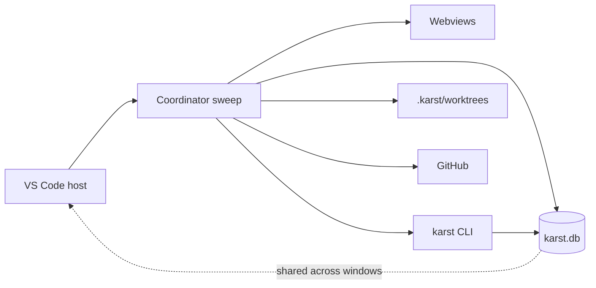

<!-- AGENT INSTRUCTIONS:
This file uses an agent-optimized block format. DO NOT read this file entirely.
1. TABLE OF CONTENTS: Run this to list all available keys:
  grep -F "## [@" docs/arch/system-map.md

2. EXTRACT A RULE: Run this to read a specific block (Example for ID 'arch:MAP-03'):
  awk "/^## \[@arch:MAP-03\]/,/END_DOC_BLOCK: \[@arch:MAP-03\]/" docs/arch/system-map.md
-->
# System map

The generated half of this file is the import graph dependency-cruiser already
enforces. `MAP-00` is the hand-written orientation; `MAP-01`/`MAP-02` are
regenerated by `npm run -s docs:graph`; `MAP-04` is the live schema ER from
`npm run -s docs:schema`. `MAP-03` is the rule set itself.

## [@arch:MAP-00] Overview
covers: scripts/arch*.mjs, scripts/archSchema.ts, scripts/arch-layers.json, .dependency-cruiser.cjs

### Purpose
Orientation for the `src/` dependency graph: the layers, their value import
edges, the type-only edges that carry no runtime coupling, and the live SQLite
schema. `MAP-03` is the enforceable version of the old
`model-store-workflow-layering.md` prose.

### Connections
- in: @arch:SQLITE (store), @arch:STAGEMACH (stage graph), @arch:AC-01 (agent cores), @arch:ENTRIES (worktrees), @arch:CLI-01 (CLI), @arch:GH-01 (GitHub), @arch:PROFILE (manifest/settings), @arch:APP-01 (approaches), @arch:DIAG-01 (diagnostics), @arch:DBG-01 (debug logging), @arch:METRICS (prompt metrics), @arch:IDS-01 (ids), @arch:ABI-01 (native addon), @arch:UATHOST-01 (UAT host), @arch:ADR-01 (impl exit condition)
- out: @arch:MAP-01, @arch:MAP-02, @arch:MAP-03, @arch:MAP-04

### Flow

<!-- GENERATED:end -->
END_DOC_BLOCK: [@arch:MAP-00]

## [@arch:MAP-01] Value import graph

One subgraph per layer in `scripts/arch-layers.json`; an edge is a value import
(`import`, not `import type`) between top-level `src` entries. Regenerated by
`npm run -s docs:graph`; `--check` fails when this region is stale.

<!-- GENERATED:start id=MAP-01 src=scripts/archGraph.mjs -->
flowchart LR
  subgraph agentic
    agent["agent"]
    agents["agents"]
    approaches["approaches"]
    context["context"]
    hooks["hooks"]
    planning["planning"]
  end
  subgraph core
    buildInfo_ts["buildInfo.ts"]
    logging["logging"]
    manifest["manifest"]
    model["model"]
    runtimeAssetsRoot_ts["runtimeAssetsRoot.ts"]
    store["store"]
    template["template"]
    workflow["workflow"]
  end
  subgraph entry
    commands["commands"]
    extension["extension"]
    extension_ts["extension.ts"]
    init["init"]
    setup["setup"]
  end
  subgraph exec
    artifacts["artifacts"]
    attachments["attachments"]
    cli["cli"]
    diagnostics["diagnostics"]
    doctor["doctor"]
    integrations["integrations"]
    project["project"]
    recovery["recovery"]
    resolver["resolver"]
    runtime["runtime"]
    uatHost["uatHost"]
  end
  subgraph view
    ui["ui"]
  end
<!-- GENERATED:end id=MAP-01 -->
END_DOC_BLOCK: [@arch:MAP-01]

## [@arch:MAP-02] Type-only import edges

`import type` is erased at compile time, so these edges are dependency
information without runtime coupling. `files` counts the distinct source files
that contribute at least one type-only edge from `from` to `to`. Regenerated by
`npm run -s docs:graph`; `--check` fails when this region is stale.

<!-- GENERATED:start id=MAP-02 src=scripts/archGraph.mjs -->
| from | to | files |
|---|---|---:|
<!-- GENERATED:end id=MAP-02 -->
END_DOC_BLOCK: [@arch:MAP-02]

## [@arch:MAP-03] Layer rules (enforced)

The `model`/`store`/`workflow` naming suggests a strict one-directional stack.
The actual invariant is narrower: `model` is **side-effect-free**, not
import-free. It may import types from anywhere and pure helpers/constants from
`store` or `workflow`; what it must not do is call a function that reads or
writes a live `Store`. `store` may share pure serialization helpers with
`model`, but never reaches up into the stage graph. The core stack never
value-imports a webview or the extension entry points, and it reaches agent
code only through the named agent-seam modules; agent/domain code never
value-imports a webview.

`.dependency-cruiser.cjs` is the enforcement; `npx depcruise src --config
.dependency-cruiser.cjs` runs in CI. A violation is fixed, or its edge is named
in an explicit `pathNot` exception with a comment — a rule is never disabled.

| rule | from | forbidden | accepted exception |
|---|---|---|---|
| `model-store-value-reads` | `src/model/**` | value import of `src/store/**` | `model/artifacts.ts`, `model/inside/graphLedger.ts`, `model/inside/ship.ts` (they derive views from the same evidence rows the store already reads) |
| `store-model-pure-helpers` | `src/store/**` | value import of a model module that holds a `Store` | pure helpers only: `blockerNotify`, `bulletinRelevance`, `entityId`, `followUp`, `messageText`, `prChecks`, `prComments`, `prReview`, `time`, `types` |
| `store-no-workflow-value` | `src/store/**` | value import of `src/workflow/**` | none |
| `model-workflow-pure` | `src/model/**` | value import of workflow beyond pure lookups | `workflow/graph.ts`, `workflow/fixAttempts.ts` |
| `core-no-ui-value` | core stack | value import of `src/ui/**` | none |
| `core-no-entry-value` | core stack | value import of `src/extension*`, `setup`, `commands`, `init` | none |
| `core-agent-seam` | core stack | value import of agent/domain code | the named agent-seam modules in `.dependency-cruiser.cjs` (the invocation/derivation sites) |
| `agent-no-ui-value` | agent/domain | value import of `src/ui/**` | none |

`MAP-01` and `MAP-02` are the evidence for those rules; there is no edge-count
threshold. A type-only edge on the diagram would be a false runtime dependency,
and a value edge that is not drawn is a missed rule.
END_DOC_BLOCK: [@arch:MAP-03]

## [@arch:MAP-04] Live schema ER

Generated by applying `src/store/migrations.ts` to an in-memory database, then
reading `sqlite_master` and `PRAGMA foreign_key_list`. Only tables and declared
foreign keys are drawn. Regenerated by `npm run -s docs:schema`; `--check`
fails when stale.

The driver is better-sqlite3 when its addon is built for this Node, and
node:sqlite otherwise (the CLI's `karst test reset` way: the same schema.sql,
then the version stamp). A fresh schema.sql IS the complete schema, so the
catalog is the same either way.

CI rebuilds better-sqlite3 for the Node ABI (`npm run rebuild:node`); it never
launches the extension host, so the Electron ABI need not be restored
(@arch:ABI-01).

```mermaid
erDiagram
  approach_artifact_instances
  approach_graph_revisions
  approach_graph_runs
  approach_graph_tokens
  approach_graph_workspaces
  approach_node_deferrals
  approach_node_overrides
  approach_node_runs
  approach_planner_runs
  approach_resource_leases
  baseline_decisions
  baseline_refs
  bulletin_context_shown
  bulletin_notes
  bulletin_reads
  fix_deliveries
  gate_runs
  implementation_runs
  implementation_segments
  interactive_usage_samples
  merge_checks
  phase_marks
  planning_proposals
  planning_session_tickets
  planning_sessions
  port_allocations
  pr_feedback
  process_runs
  projects
  prs
  recovery_rounds
  review_findings
  servers
  session_launch_intents
  ship_commits
  ship_operation_intents
  ship_repo_steps
  ship_runs
  stage_runs
  stages
  test_hooks
  test_logs
  ticket_attachments
  ticket_messages
  ticket_relations
  tickets
  token_usage
  uat_findings
  uat_gate_passes
  usage_limit_parks
  worktree_archives
  worktrees
  approach_graph_runs ||--o{ approach_artifact_instances : graph_run_id
  approach_graph_runs ||--o{ approach_graph_revisions : graph_run_id
  tickets ||--o{ approach_graph_runs : ticket_id
  approach_graph_revisions ||--o{ approach_graph_tokens : revision_id
  approach_graph_runs ||--o{ approach_graph_workspaces : graph_run_id
  approach_node_runs ||--o{ approach_graph_workspaces : node_run_id
  approach_graph_revisions ||--o{ approach_node_deferrals : revision_id
  approach_graph_runs ||--o{ approach_node_deferrals : graph_run_id
  approach_graph_runs ||--o{ approach_node_overrides : graph_run_id
  approach_graph_revisions ||--o{ approach_node_runs : revision_id
  approach_graph_runs ||--o{ approach_node_runs : graph_run_id
  process_runs ||--o{ approach_node_runs : process_run_id
  approach_graph_runs ||--o{ approach_planner_runs : graph_run_id
  process_runs ||--o{ approach_planner_runs : process_run_id
  approach_graph_runs ||--o{ approach_resource_leases : graph_run_id
  approach_node_runs ||--o{ approach_resource_leases : owner_node_run_id
  tickets ||--o{ baseline_decisions : ticket_id
  bulletin_notes ||--o{ bulletin_context_shown : note_id
  tickets ||--o{ bulletin_context_shown : reader_ticket_id
  projects ||--o{ bulletin_notes : project_id
  tickets ||--o{ bulletin_notes : from_ticket_id
  bulletin_notes ||--o{ bulletin_reads : note_id
  tickets ||--o{ bulletin_reads : reader_ticket_id
  projects ||--o{ fix_deliveries : project_id
  recovery_rounds ||--o{ fix_deliveries : recovery_round_id
  tickets ||--o{ fix_deliveries : ticket_id
  process_runs ||--o{ implementation_runs : process_run_id
  tickets ||--o{ implementation_runs : ticket_id
  implementation_runs ||--o{ implementation_segments : implementation_run_id
  session_launch_intents ||--o{ implementation_segments : launch_intent_id
  implementation_segments ||--o{ interactive_usage_samples : implementation_segment_id
  process_runs ||--o{ interactive_usage_samples : process_run_id
  implementation_runs ||--o{ phase_marks : implementation_run_id
  implementation_segments ||--o{ phase_marks : implementation_segment_id
  planning_sessions ||--o{ planning_proposals : session_id
  tickets ||--o{ planning_proposals : ticket_id
  planning_sessions ||--o{ planning_session_tickets : session_id
  tickets ||--o{ planning_session_tickets : ticket_id
  projects ||--o{ planning_sessions : project_id
  recovery_rounds ||--o{ pr_feedback : recovery_round_id
  stage_runs ||--o{ process_runs : stage_run_id
  tickets ||--o{ process_runs : ticket_id
  process_runs ||--o{ recovery_rounds : fix_process_run_id
  process_runs ||--o{ recovery_rounds : source_process_run_id
  stage_runs ||--o{ recovery_rounds : review_revalidation_stage_run_id
  stage_runs ||--o{ recovery_rounds : source_stage_run_id
  stage_runs ||--o{ recovery_rounds : uat_revalidation_stage_run_id
  tickets ||--o{ recovery_rounds : ticket_id
  implementation_runs ||--o{ session_launch_intents : implementation_run_id
  process_runs ||--o{ session_launch_intents : process_run_id
  recovery_rounds ||--o{ session_launch_intents : recovery_round_id
  tickets ||--o{ session_launch_intents : ticket_id
  ship_runs ||--o{ ship_commits : ship_run_id
  ship_runs ||--o{ ship_operation_intents : ship_run_id
  process_runs ||--o{ ship_repo_steps : process_run_id
  ship_operation_intents ||--o{ ship_repo_steps : operation_intent_id
  ship_runs ||--o{ ship_repo_steps : ship_run_id
  tickets ||--o{ ship_runs : ticket_id
  projects ||--o{ ticket_messages : project_id
  tickets ||--o{ ticket_messages : from_ticket_id
  tickets ||--o{ ticket_messages : to_ticket_id
  planning_proposals ||--o{ ticket_relations : target_proposal_id
  tickets ||--o{ ticket_relations : origin_ticket_id
  tickets ||--o{ ticket_relations : target_ticket_id
  tickets ||--o{ ticket_relations : ticket_id
  approach_node_runs ||--o{ token_usage : approach_node_run_id
  approach_planner_runs ||--o{ token_usage : approach_planner_run_id
  implementation_segments ||--o{ token_usage : implementation_segment_id
  interactive_usage_samples ||--o{ token_usage : interactive_usage_sample_id
  process_runs ||--o{ uat_findings : process_run_id
  tickets ||--o{ uat_findings : ticket_id
  tickets ||--o{ uat_gate_passes : ticket_id
  stage_runs ||--o{ usage_limit_parks : stage_run_id
  tickets ||--o{ usage_limit_parks : ticket_id
```

<!-- GENERATED:start id=MAP-04 src=scripts/archSchema.ts -->

<!-- GENERATED:end id=MAP-04 -->
END_DOC_BLOCK: [@arch:MAP-04]
