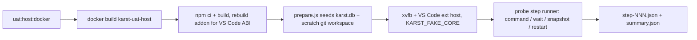

<!-- AGENT INSTRUCTIONS:
This file uses an agent-optimized block format. DO NOT read this file entirely.
1. TABLE OF CONTENTS: Run this to list all available keys:
  grep -F "## [@" docs/arch/uat-host.md

2. EXTRACT A RULE: Run this to read a specific block (Example for ID 'arch:UATHOST-01'):
  awk "/^## \[@arch:UATHOST-01\]/,/END_DOC_BLOCK: \[@arch:UATHOST-01\]/" docs/arch/uat-host.md
-->
# UAT host harness (`scripts/uat-host/`, `docker/uat-host/`, `src/uatHost/`)

Related: `docs/arch/ABI.md` (`arch:ABI-01`, `ABI-03`).

## [@arch:UATHOST-00] Overview
covers: src/uatHost/*.ts, src/uatHost/probe/*.ts, scripts/uat-host/*, docker/uat-host/Dockerfile, src/agent/launchStub.ts, src/agent/registry.ts#resolveAdapter, src/uatHost/probe/vscodeProbe.ts#installProbeRecorder, src/uatHost/probe/steps.ts#parseSteps, src/uatHost/seed.ts#seedStore

### Purpose
Boots the real built extension in a real VS Code under xvfb inside Docker, with a fake agent core and a seeded store, so a UAT agent can drive it from a JSON step script and read deterministic evidence. No LLM call, no touch of a real Cursor/Code profile.

### Connections
- in: @arch:ABI-01, @arch:ABI-03 — the container builds its own better-sqlite3 for the downloaded VS Code's Electron ABI (derived, ABI-02 verified-only rebuild).
- in: @arch:AC-08 — `KARST_FAKE_CORE` swaps the adapter at the registry seam; launch mode keeps the real `buildInteractiveCommand`.
- out: @arch:DBG-03 — launch records never store env values.
- out: @arch:EVIDENCE-STATE — probe snapshots read the live store, not run history.

### Flow

### Tradeoffs
| Chosen | Rejected | Why |
|---|---|---|
| Real VS Code under xvfb in Docker | Mocked `vscode` module | Catches activation, webview and command wiring that vitest fakes cannot |
| Fixture data written through store APIs | Raw SQL inserts | Schema rules hold; no drift from the store |
| ABI read from the downloaded binary | Hardcoded ABI | A VS Code version bump changes the Electron ABI |
| Steps as validated JSON data | Free-form scripts | Unknown step types are refused; runs are replayable |

### Fallbacks
| Trigger | Behaviour | Recovery |
|---|---|---|
| Store open fails in `activate()` | Activation returns normally | Runner also requires a registered `karst.*` command and the seeded ticket count |
| `KARST_UAT_STUB_AGENT` unset in launch mode | Real adapter is used | Set the stub path |
| Step times out (10s default, 60s cap) | Run stops, exit nonzero, evidence path printed | Fix the step; rerun |
| Host wedges | `UAT_PROBE_HARD_TIMEOUT_MS` (300s) SIGKILLs the process group | Rerun |
| `--script`/`--out` escape the checkout | `run.mjs` exits 2 | Use paths inside the checkout |

### Rules
@arch:UATHOST-01 · @arch:UATHOST-02
END_DOC_BLOCK: [@arch:UATHOST-00]

## [@arch:UATHOST-01] UAT host harness boots the real extension host in Docker with a fake core
covers: scripts/uat-host/docker.mjs, scripts/uat-host/run.mjs, src/agent/registry.ts#resolveAdapter, src/uatHost/seed.ts#seedStore

`npm run uat:host:docker -- --fixture <empty|ticket-mid-stage|blocked|launch-draft>` (or `--fixture-file <fixture.json>`, see UATHOST-02) builds `karst-uat-host:local`, runs it `--rm --init`, and inside it: `npm ci` and build into a container-private `node_modules` volume (ABI-01/ABI-03), downloads the pinned VS Code (`UAT_VSCODE_VERSION`, default 1.126.0, cached in the `karst-uat-vscode` volume), rebuilds better-sqlite3 for that binary's Electron ABI, seeds `karst.db` and a scratch git workspace by running `dist/uat-host/prepare.js` under the VS Code binary (`ELECTRON_RUN_AS_NODE=1`, so the addon ABI matches), then launches VS Code under xvfb with a temp user-data dir, a temp extensions dir and `scripts/uat-host/settings.json`. `KARST_FAKE_CORE=1` makes `resolveAdapter` return `FakeAdapter` for every provider: no LLM call. `KARST_FAKE_CORE=launch` (`run.mjs --launch-mode`, optionally `--provider <core>` to seed that `agentProvider`) keeps the REAL adapter's `buildInteractiveCommand` and swaps only the executable for `node dist/uat-host/stubAgent.js <provider> <envKeys> -- <real argv>` (`src/agent/launchStub.ts`); `runHeadless` stays fake. Use the `launch-draft` fixture: its ticket has a repo selected, so `karst.openSession` scopes it and launches (the other fixtures have no worktree to launch in). Launch mode also puts no-op `claude`/`codex`/`agy`/`opencode` shims first on `PATH` (with `VSCODE_CLI=1` so VS Code keeps that `PATH`), because the dependency gate probes `<cli> --version` before any session opens. It needs `KARST_UAT_STUB_AGENT` (the stub path) and falls back to the real adapter without it. The stub appends `{provider, argv, envKeys, cwd, spill?}` to `$KARST_UAT_LAUNCH_DIR/launches.ndjson`: argv entries over 512 bytes are stored as `{len, sha256, head}`, env values are never recorded (DBG-03), and a kickoff spill pointer is followed to record the file's length and sha256. `activate()` returns normally when the store open fails, so the in-host runner also requires a registered `karst.*` command and the seeded ticket count. Never point the harness at a real Cursor/Code profile.

- **ABI is derived, never hardcoded.** The container entrypoint runs `run.mjs --print-vscode` (downloads and prints the VS Code binary path), exports it as `KARST_TARGET_APP_BINARY`, then runs `rebuild:electron`, which reads the ABI from that binary. VS Code 1.126.0 ships Electron 42.2.0 (ABI 146), not the Electron 39 / ABI 140 of the F5 host; a hardcoded number would be wrong after any version bump.
- **No concurrent runs against one checkout.** All runs share the `karst-uat-vscode` volume and bind-mount the checkout (so `dist/`). Run one at a time.
- **Architecture.** The container runs the host's arch: arm64 on Apple silicon. x64 (CI) is untested.
- **Running the boot test.** It is opt-in (needs docker and `UAT_HOST_DOCKER=1`; the default `integration` job skips it): `UAT_HOST_DOCKER=1 npx vitest run --config vitest.integration.config.ts src/uatHost/boot.integration.test.ts`.
- **Fake core is honored in production builds.** `KARST_FAKE_CORE=1` is read by `resolveAdapter` in every build, not only the harness; it logs one `console.warn` per process when active.
- **File ownership.** The container runs as root; the entrypoint chowns the bind-mounted checkout back to `HOST_UID:HOST_GID` (passed by `docker.mjs`) on exit, skipping `node_modules` and skipping when the uid is 0.
- **Teardown.** `docker.mjs` force-removes the named container on exit and on SIGINT/SIGTERM/SIGHUP.

END_DOC_BLOCK: [@arch:UATHOST-01]

## [@arch:UATHOST-02] The probe runs a JSON step script in the host and dumps evidence per step
covers: src/uatHost/probe/vscodeProbe.ts#installProbeRecorder, src/uatHost/probe/steps.ts#parseSteps, src/uatHost/fixtureFile.ts#parseFixtureFile

`npm run uat:host:docker -- --fixture <name> --script <steps.json> --out <dir>` adds the probe to a harness run. Only a given `--script` sets `KARST_UAT_PROBE=1`; without that flag `installProbeRecorder` returns undefined, nothing patches `vscode.window`, and `karst.uatProbe.run` is never registered (it is not in `package.json` either). Pins: `src/uatHost/probe/gating.test.ts`.

- **Steps are data.** `steps.ts` validates `command` (VS Code command + args), `wait` (exactly one of `ticketStage`, `notification`, `log`, `webviewMessage`, `launch: {provider?}`) and `snapshot` and `restart`; unknown types are refused. Timeouts default to 10s and clamp to 60s.
- **Evidence.** After each step `<out>/step-NNN.json` holds `{step, result, snapshot}`; `<out>/summary.json` lists per-step `pass|fail|timeout` with the step index. The snapshot is tickets and stages from the store (no ids or timestamps), the sidebar's last posted message, open webview panels with their last posted message, notifications shown, and a 40-line log tail with timestamps and the workspace hash stripped, and `launches` (the stub's records, workspace hash stripped, empty outside launch mode). A sample is `scripts/uat-host/samples/launch.json`. Same fixture and script give byte-identical JSON. The sidebar webview only appears once VS Code resolves it (it is not resolved while hidden). Writes are async (`fs/promises`) and a wait that is not about tickets does not read the store, so the probe does not block the host's event loop.
- **Fixture from data.** `--fixture-file <path.json>` replaces `--fixture` (exactly one of the two) and must stay inside the checkout, same containment check as `--script`. `fixtureFile.ts` validates it like steps: `tickets[]` of `{key, title, stageCurrent, stages?, archived?, worktree?, rows?}`, with `stages[]` of `{stageKey, attempt?, status, blockedKind?, blockedReason?}` and `rows` limited to `stage_runs`, `process_runs`, `gate_runs` and `recovery_rounds` (a `stageRun` index links a process or gate row to a `stage_runs` entry of the same ticket), plus an optional top-level `provider` written into the scratch manifest's `agentProvider`. Unknown keys, tables and columns are refused, keys must be unique. `seed.ts` writes through the store APIs (`openStageRun`, `openProcessRun`, `recordGateRun`, `openRecoveryRound`, `archiveTicket`), never raw SQL, so the schema's own rules hold. A `worktree: true` ticket gets a worktree row only; no checkout is created. A sample modelled on a stranded `uat` stage (running, no run rows for the attempt) is `scripts/uat-host/samples/stranded-uat.fixture.json`.
- **`restart` step.** `{"type":"restart"}` runs the extension's `deactivate()`, drains `context.subscriptions`, then `activate()` again in the same host, so boot sweeps (`reconcileOnStart`) run against the seeded state. The recorder is installed once and reused, and the probe reads the live store after the restart. Same timeout rule as `command`.
- **Never hangs.** Per-step timeout, a 120s script total, and a `UAT_PROBE_HARD_TIMEOUT_MS` (default 300s) backstop in `run.mjs`. The backstop runs the tests in a detached child (its own process group) and SIGKILLs the group, so a wedged VS Code host is reaped instead of left running. The run stops at the first non-pass step and exits nonzero, printing `uat-probe: step <i> (<type>) PASS|FAIL|TIMEOUT` and the evidence path. `--out` is relative to the checkout when run through Docker. A sample is `scripts/uat-host/samples/smoke.json`.
- **`--script` and `--out` must stay inside the checkout.** `run.mjs` resolves both against the checkout root and refuses (exit 2) anything that escapes it — lexically or through a symlink chain (containment is checked on the real path, following every link, so a link inside the checkout pointing out of it is refused too). The Docker harness bind-mounts only the repo root, so a path outside it is discarded with the container and leaves nothing to cite (`args.mjs`, `scripts/uat-host/args.test.mjs`). This is the check the UAT-tester's own instructions warn about.

END_DOC_BLOCK: [@arch:UATHOST-02]

## [@arch:UATHOST-03] Eval mode runs a real core on an external task repo
covers: scripts/uat-host/evalMode.mjs, scripts/uat-host/evalDocker.mjs, scripts/uat-host/evalProxy.mjs, src/uatHost/seed.ts#seedStore, src/uatHost/fixtures.ts#taskManifestText

Opt-in: `npm run uat:host:docker -- --eval <claude|codex> --eval-task <dir> [--eval-env NAME]... [--eval-auth-dir <dir>] --fixture-file <f.json> --eval-result <file>`. Fake-core runs and the stock fixtures are untouched.

- **Real core.** `--eval` leaves `KARST_FAKE_CORE` empty (`resolveAdapter` fakes only on `1`). `evalTestsEnv` puts `/opt/karst-eval/bin` (the pinned CLI installs of `docker/uat-host/Dockerfile.eval`, versions are build ARGs) first on `PATH` with `VSCODE_CLI=1`. A host binary is never mounted (macOS arm64 vs Linux).
- **Task workspace.** `--eval-task` is mounted at `/task`. It must be OUTSIDE the checkout: this is the one named, explicit extension of the UATHOST-02 containment rule. The task repo, its `git worktree add` and dependency install are the caller's job (no Docker socket, so no karst sandbox and no `sandbox.setup`).
- **Fixture.** A ticket may carry `description` (the brief) and `repo: {repoPath, baseRef, worktreePath}`, which replace the old `/fixture/repo` + `main` constants for `worktree: true` (the constants remain the default). A top-level `taskRepo: {name, repoPath, baseRef, gates}` makes `prepare.js` write a scratch `karst.yml` for that repo with ONLY the declared gates (`test`, `typecheck`; argv, no shell). Unknown keys are refused.
- **Credentials (DBG-03).** Only env-var NAMES are accepted (`-e NAME`; a value on the command line is refused) or a read-only auth-dir mount at `/auth` (copied into the core's config dir at start, so writes stay in the container). Nothing is baked into the image. `preflightEval` fails fast (exit 3) naming the missing CLI or auth, and `--eval-result` records `{core, version, authVia: {envNames, authDir}, network}`: names, never values.
- **Network.** The build (`npm ci`, VS Code download) runs with full network. Then `eval-lockdown.sh` (sourced via `UAT_PRE_HOST_HOOK`, needs `--cap-add NET_ADMIN`) rejects all egress except loopback and uid 65534, which runs `evalProxy.mjs`, a CONNECT-only hostname-allowlist proxy (package registries + the core's API host; github.com and other git hosts denied). Both IPv4 and IPv6 rules must install, and the host is then launched through `setpriv --no-new-privs --bounding-set=-net_admin,-net_raw,-setuid,-setgid` so the root agent can neither flush them nor switch to the proxy's uid. A proxy that does not come up aborts the run. `HTTPS_PROXY` is exported to the host. If the iptables rule cannot be installed, the run continues and `network.json` records `knownLeak`, which the result carries. Git-URL dependencies therefore fail (D291 skip rule).
- **Not verified end to end.** Unit tests cover the pure parts and the proxy; the Docker image build and the lockdown script were not run in CI (no Docker in the authoring environment).

END_DOC_BLOCK: [@arch:UATHOST-03]
