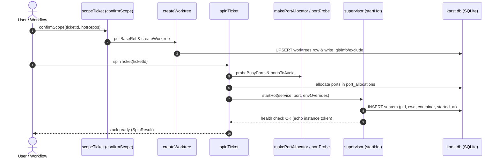

<!-- AGENT INSTRUCTIONS:
This file uses an agent-optimized block format. DO NOT read this file entirely.
1. TABLE OF CONTENTS: Run this to list all available keys:
  grep -F "## [@" docs/arch/worktrees-and-servers.md

2. EXTRACT A RULE: Run this to read a specific block (Example for ID 'arch:ENTRIES'):
  awk "/^## \[@arch:ENTRIES\]/,/END_DOC_BLOCK: \[@arch:ENTRIES\]/" docs/arch/worktrees-and-servers.md
-->
# Worktrees, branch names, and the servers inside them

How a ticket's worktree is cut and named, and how the processes running inside it are tracked and reaped. Related: `docs/arch/manifest-and-settings.md` (the conventions block that feeds the renderers), `docs/arch/github-and-merge.md` (what the branch becomes).

## [@arch:WT-00] Overview
covers: src/runtime/worktree*.ts, src/store/worktree*.ts, src/runtime/supervisor.ts, src/runtime/startService.ts, src/runtime/portProbe.ts, src/extension/ops/worktreeSpecs.ts

### Purpose
How a ticket's worktree is cut, named, and cleaned up, and how the servers and containers running inside it are allocated ports, tracked, and safely reaped. Worktrees isolate branch edits per ticket, while the SQLite registry and process attribution ensure no orphaned processes or leaked ports outlive their ticket.

### Connections
- in: @arch:REPO, @arch:SERVICES — repository declarations, service maps, and conventions feed worktree layout and service definitions.
- in: @arch:ST-00, @arch:WORKTREES-ROW — SQLite registry owns worktree rows, port allocations, and server tracking.
- in: @arch:STAGEMACH, @arch:UAT-SERVICES — stage lifecycle triggers worktree creation, spins services for test/impl, and cleans up on completion.
- out: @arch:BASEBRANCH, @arch:ENVOVR — worktree rows and ticket env overrides feed rebase and process environment layering.
- out: @arch:GH-01, @arch:SHIP-EXCLUDE — branch conventions, unstageable generated paths, and force-with-lease push safety feed ship and PR creation.
- out: @arch:MAP-01 — runtime process supervisor and worktree operations participate in the core architecture layers.

### Flow

### Tradeoffs
| Chosen | Rejected | Why |
|---|---|---|
| One worktree per distinct repoPath per ticket | One worktree per manifest repository entry | Monorepo entries share one repoPath; separate worktrees would collide on the branch and checkout. |
| Stored branch in `worktrees` row is authoritative | Re-rendering branch name from updated manifest conventions | Renaming a convention must not desynchronize an existing git checkout or break in-flight branches. |
| Rebase with `--onto <new> <branch-point>` | Plain `git rebase` or upstreaming `origin/<old>` | Avoids replaying historical commits from the old base into the ticket's PR. |
| Process group kill with attribution verification | Blind `kill` by recorded PID | OS reissues PIDs; attribution checks cwd and start time so unrelated processes are never killed. |
| Container name as lifecycle handle | Managing containers only via client CLI process | Container processes run attached; killing the client does not terminate the container itself. |

### Fallbacks
| Trigger | Behaviour | Recovery |
|---|---|---|
| Remote unreachable during `pullBaseRef` | Logs warning (`onPullFailed`), falls back to local base ref | Spin proceeds without latest remote commits |
| Branch collision on `origin` from archived ticket | Suffixes branch with `-t<id>` before creation | Fast-forward push succeeds without branch collision |
| Conflict during base branch rebase | Aborts rebase (`git rebase --abort`) and leaves worktree clean | Refuses rebase; user resolves conflicts or keeps existing base |
| Occupied port during spin | `portsToAvoid` excludes occupied ports from allocation range | Allocator picks next free port or reclaims owned hot dev server |
| Worktree deleted outside karst | `reapStaleServers` detects missing cwd on startup/activation | Clears stale rows and reaps attributed orphaned processes |

### Rules
@arch:ENTRIES · @arch:SERVICES-WT · @arch:RENDERERS · @arch:PLACEHOLDER · @arch:BRANCH-NAME · @arch:BASE-PULL · @arch:BASE-PER · @arch:SPAWN-ENV · @arch:WT-REMOVE · @arch:CONTAINER · @arch:PORTS · @arch:ORPHANS · @arch:ROOT-GEN
END_DOC_BLOCK: [@arch:WT-00]

## [@arch:ENTRIES] Repository ENTRIES may share a `repoPath`
covers: src/runtime/slug.ts#worktreeSlug, src/runtime/ticketBranch.ts#distinctRepoPaths, src/workflow/stages/scope.ts#confirmScope

Repository ENTRIES may share a `repoPath` — that's a monorepo with several runnable processes. The worktree slug is per-TICKET, not per-repository (`worktreeSlug`, key-or-id + title), so entries sharing a repoPath intentionally resolve to one worktree — that is the designed outcome, not a collision. `spin.ts` (`worktreeByRepo`), `preflight.ts` (both the repo-check loop and the target-check loop), and `scope.ts`'s `confirmScope` all dedup their worktree-creation loops by `repoPath` for exactly this reason — restore these dedups if you touch that code; do not reintroduce a reject-on-shared-repoPath check in `manifest/validate/graph.ts`. Port allocation and the `servers` table are keyed by repository NAME, not repoPath.
END_DOC_BLOCK: [@arch:ENTRIES]

## [@arch:SERVICES-WT] Services of one repository share ONE worktree, each runs from its `cwd`
covers: src/runtime/startService.ts#startResolvedService, src/resolver/allocator.ts#makePortAllocator

A repository's `services:` map (see `docs/arch/manifest-and-settings.md`) yields several units that all resolve to the same repo, so they share the ticket's single worktree. The unit's `cwd` is joined to the worktree root to get its spawn directory. The `cwd` rules (relative, no `..`, no absolute) are enforced at load, not here, so the spawn path can trust it. Ports are allocated per unit: each service's `portRange` (or the global one) bounds its own allocation, and siblings never receive the same port. Log files stay under `<cwd>/.karst/logs/`, so the root-level rule below still holds.
END_DOC_BLOCK: [@arch:SERVICES-WT]

## [@arch:RENDERERS] Git conventions have TWO renderers, and the split is deliberate
covers: src/workflow/artifactConventions.ts#validateArtifactTemplate, src/runtime/branchName.ts#renderBranchName, src/workflow/conventionContext.ts#resolveRepoConventions

`workflow/artifactConventions.ts` validates commit/PR templates (strict, never sanitizes — a bad token must fail loudly); `runtime/branchName.ts` renders the worktree branch and SANITIZES, because the value goes to `git worktree add` and must be a legal ref. Branch vocabulary excludes `{repo}`/`{scope}` on purpose: entries sharing a `repoPath` resolve to ONE worktree, so a repo-dependent branch has no single answer. It must include `{slug}`/`{key}`/`{id}` or two tickets collide on one branch. `{type}`/`{scope}` resolve ONCE in `workflow/conventionContext.ts` so scope-time (branch) and ship-time (commit/PR) can't disagree. Branch is still constructed in exactly one place (`worktreePaths`) — thread a rendered branch in, never re-derive one.

Per-repo layering: a repository may override `commitMessage`/`pullRequestTitle`/`pullRequestDescription` under `repositories.<name>.conventions`, and each key falls back INDEPENDENTLY to the global `conventions.<key>`, then to the built-in default (the ticket title, or the generated PR body) — the same layering as a repository's `scope:`. `workflow/conventionContext.ts`'s `resolveRepoConventions(manifest, repoName)` is the ONE place that layers them; ship calls it per worktree (`ship.ts`, inside the repo loop), so two repos on one ticket can open different titles. Per-repo `branchName` and `defaultType` do NOT exist and the schema REFUSES each with a message (they are legal GLOBAL keys, so silently ignoring them would be a trap): one ticket is one branch across every repo (see `@arch:BRANCH-NAME`), and `{type}` is chosen once for the ticket. A block carrying only UNMODELED keys is kept (the validator returns `{}`), so `write.ts` can preserve those keys — the same contract the global block keeps. When two entries share one `repoPath` they are one worktree and one PR, so `resolveRepoName`'s first-declared-wins rule decides which entry's conventions apply.
END_DOC_BLOCK: [@arch:RENDERERS]

## [@arch:PLACEHOLDER] Three renderers, ONE placeholder grammar
covers: src/template/token.ts#parseTemplateTokens, src/template/transforms.ts#TRANSFORMS, src/template/transforms.ts#applyTransforms

`src/template/token.ts` cuts `{variable|t1|t2}` and `src/template/transforms.ts` owns the registry; the label, artifact and branch renderers each keep their own VARIABLE vocabulary but must never re-implement the cut, or one template would mean two things. Validation is configuration-time (manifest load, naming the placeholder), application is render-time and NEVER throws — `applyTransforms` skips an unknown transform rather than blowing up a label repaint. New transform → add to `TRANSFORMS`, mirror it into `settings/webview.html` (`TRANSFORM_NAMES`/`TRANSFORM_ARITY`/`applyOneTransform`), and the differential test in `webview.test.ts` pins the two together. Order of operations in `branchName.ts` is load-bearing: transforms run on the RAW value, git-ref sanitization after, so `{key|slice:-4}` is the same four characters on every surface.
END_DOC_BLOCK: [@arch:PLACEHOLDER]

## [@arch:BRANCH-NAME] A branch name is rendered once, at worktree creation; the `worktrees` row is authoritative forever after
covers: src/runtime/ticketBranch.ts#resolveWorktreeBranch, src/runtime/branchName.ts#suffixBranchForCollision, src/runtime/worktree.ts#createWorktree

Changing `conventions.branchName` renames nothing: `createWorktree` adopts by PATH and returns the STORED branch, `preflightSpin` treats a registered worktree at the ticket's path as resumable even on the old branch, and `archive.ts` derives its archive slug from `basename(path)` (never by stripping a `karst/` prefix — a templated branch carries its own slashes) and restores onto `row.branch`.

One exception, still at creation: when the rendered branch already exists on `origin` and no live ticket's `worktrees` row owns it (a stale branch a since-archived ticket pushed), `ticketBranch.resolveWorktreeBranch` appends `-t<id>` (`branchName.suffixBranchForCollision`) before the row is written — so the push cannot be rejected non-fast-forward (`T640`). A resumed ticket's live branch is left untouched, and an `ls-remote` failure keeps the rendered name.
END_DOC_BLOCK: [@arch:BRANCH-NAME]

## [@arch:BASE-PULL] The base is pulled before a worktree is cut, and that is a switch — ON by default, honored as set
covers: src/runtime/pullBase.ts#pullBaseRef, src/workflow/stages/scope.ts#confirmScope

`confirmScope` is async for exactly this: `pullBaseRef` (`runtime/pullBase.ts`) goes through the injected async `GitRunner`, never a sync spawn, because it hits a remote from the extension host. Two attempts, in order: `git fetch origin <base>:<base>` (fast-forwards the LOCAL branch with no checkout — refused when `<base>` is checked out, which is the common case), then `git fetch origin <base>` + branch from `origin/<base>`. `createWorktree`'s `startPoint` carries that ref; `base_ref` still records the PLAIN branch name, because `mergeCheck` and the diff views re-derive `origin/<base>` themselves and would otherwise ask git about `origin/origin/develop`. Every failure returns a legal start point plus a reason: an unreachable remote reports (`onPullFailed` → a warning) and never blocks ticket creation. The switch is page-local (`submit` only — `save` launches nothing) and defaults ON at every layer that reads it, so an absent or non-boolean value is never read as "skip the pull".
END_DOC_BLOCK: [@arch:BASE-PULL]

## [@arch:BASE-PER] The base branch is per TICKET and per REPOSITORY, and the worktree row is the authority
covers: src/workflow/baseRef.ts#resolveTicketBaseRef, src/workflow/changeBaseRef.ts#changeBaseRef, src/runtime/rebaseWorktree.ts#rebaseWorktreeOntoBase

`workflow/baseRef.ts` is the only place a base branch is decided, and its order is load-bearing: `worktrees.base_ref` first (the branch was ALREADY cut from it, so it is the only answer matching what git did — a later manifest edit must not silently retarget an open PR), then the ticket's pre-spin override (`tickets.base_refs`, keyed by manifest repository NAME), then the manifest default. `confirmScope`/`spin.ts` read `resolvePlannedBaseRef` (no worktree exists yet); `gates/targets.ts` reads `resolveTicketBaseRef` directly, and `stages/ship.ts` carries the resolved `worktree.baseRef` through its own merge-check and PR-provenance paths. Because a gate must never die over a base-branch lookup, `resolveTicketBaseRef` reads the ticket through a non-throwing helper (`getTicket` throws on a missing row; a bare-cwd run, a fixture, or a mid-run archive must still resolve — with no override — rather than fail the gate). Entries sharing a `repoPath` share ONE worktree and therefore one branch point, so a per-ticket override is validated by `assertSharedRepoBaseOverrides` exactly as the manifest's own defaults are by `assertSharedRepoBaselineBranches`.

Changing the base of a SPUN ticket goes through `workflow/changeBaseRef.ts`, and its order is also the contract: the branch moves first (`runtime/rebaseWorktree.ts`), and `worktrees.base_ref` is written only once git agrees — a stored base git never reached would make every later diff, gate target, and PR describe a merge that was never attempted. The rebase is `git rebase --onto <newRef> <merge-base HEAD <oldRef>>`, not a plain `git rebase <new>` and not `--onto <new> origin/<old>`: `--onto` is the whole point (a plain rebase would replay the old base's history into the ticket's PR), and the upstream is the BRANCH POINT rather than a remote-tracking ref, because a stale `origin/<old>` as upstream reintroduces exactly the duplication `--onto` exists to avoid. Each side of the rebase is resolved BEST-EFFORT (`git fetch` first, then `origin/<branch>`, then the local branch itself) since an offline clone that already has the branch is a legal base. A dirty tree (tracked files only — build output is not a reason to refuse) and a base that resolves nowhere are REFUSALS that change nothing; a conflict is classified by git STATE (`REBASE_HEAD`), never by matching prose, and is `--abort`ed so no tree is left mid-rebase — an abort that itself fails is reported, never swallowed, because that is the worst outcome there is. After the write, the stale `merge_checks` row is deleted — it describes a merge against a base this ticket no longer targets — and an open PR is re-targeted with `gh pr edit --base`, whose refusal is reported, never thrown. A rebase REWRITES the branch, so `worktrees.needs_force_push` is armed and ship's next push carries `--force-with-lease=<ref>:<expected sha>` — an exact compare-and-swap, never a bare `--force` — and the lease is consumed (cleared) by the same statement that reads it (`takeForcePushLease`), so one rewrite arms exactly one force push.
END_DOC_BLOCK: [@arch:BASE-PER]

## [@arch:SPAWN-ENV] A spawn env has three layers, and the ticket's overrides are the middle one
covers: src/runtime/env.ts#buildSpawnEnv, src/runtime/env.ts#shadowedOverrideKeys, src/store/ticketEnvOverrides.ts#envOverridesForService, src/store/ticketEnvOverrides.ts#setServiceEnvOverrides

`buildSpawnEnv` (`runtime/env.ts`) composes a hot service's env in a fixed order: the repository's own `.env` on disk, then the TICKET's env overrides, then the resolved port/peer vars. The middle layer is the per-ticket feature: a key the origin `.env` already declares is overridden, one it does not is added — and the file on disk is only ever READ, so the same repository spins for another ticket exactly as before. Nothing writes a `.env`.

The resolved vars stay last on purpose. They are karst's own wiring (the allocated PORT, the peer addresses a dependency was bound to), and a ticket that overrode one would break the health gate that starts the service. `shadowedOverrideKeys` names exactly the keys that lost that way so the loss is reportable, never silent — `spinTicket` writes them to a `[runtime]` debug line.

The values live in `tickets.env_overrides` (schema v55, `store/ticketEnvOverrides.ts`): JSON scope → `{KEY: value}`, where a scope is a manifest repository NAME or `*` for every service, flattened per service by `envOverridesForService` (the service's own scope wins over `*`). Keys are validated as POSIX env identifiers at the write, and a corrupted column degrades to "nothing overridden". `spinTicket` reads the map ONCE per run, so every service of one spin sees the same overrides. Baseline services are deliberately untouched: a baseline is a shared singleton, and one ticket's flag must not reach another ticket through it. The dashboard's servers panel edits them (the gear → a `.env`-shaped textarea per scope, saved through `env-overrides-save`); they apply at the next spin, which is what a restart already is.
END_DOC_BLOCK: [@arch:SPAWN-ENV]

## [@arch:WT-REMOVE] A worktree is never removed out from under the servers running inside it
covers: src/runtime/worktree.ts#removeWorktree, src/runtime/worktreeServers.ts#stopServersUnder, src/runtime/worktreeServers.ts#reapStaleServers, src/runtime/serverIdentity.ts#attributeServer, src/runtime/pathScope.ts#isPathUnder

Hot services are spawned `detached` (`startHot`) — their own session, no controlling tty — so once their tree is gone nothing can reach them: they reparent to init, keep their port bound and their RSS held, and answer 404 from a directory that no longer exists, while their registry row leaves with the ticket so the waste is invisible. `removeWorktree` is the single choke point for removal — archive, bulk archive, spin teardown and permanent ticket delete (`runtime/deleteTicket.ts`, per `worktrees` row, BEFORE its row transaction) all go through it — so `stopServersUnder` (`runtime/worktreeServers.ts`) runs there FIRST, while both the pid and the path are still known. Matching is by PATH, never by `servers.repo`: that is a repository NAME and several entries may share one worktree, so the name cannot answer which tree a process serves. That is what `servers.cwd` (v21) is for; it is NULL for pre-v21 rows and NULL means UNKNOWN — never reaped on a guess. Containment is `isPathUnder` (`runtime/pathScope.ts`, which also owns `canonicalPath` so `worktree.ts` → `worktreeServers.ts` is not a cycle) and it compares on a separator, because slug disambiguation makes `…/abc-2` a real sibling of `…/abc` and a bare `startsWith` would kill another ticket's server. `reapStaleServers` on activation is the net for removals karst did not perform (a hand-run `git worktree remove`, the IDE's git extension) and for processes leaked by older builds; it is GLOBAL like `reconcileOnStart`'s server pass, because a server serving a deleted tree is wrong in whichever window owns it. **A recorded pid is a recollection, never a handle, and every kill is ATTRIBUTED first** (`runtime/serverIdentity.ts`): `killTree` signals the process GROUP, so acting on a pid the OS has reissued takes down an unrelated process tree. Evidence — the live process's own cwd where the OS will say (Linux `/proc/<pid>/cwd`, macOS `lsof`), CORROBORATED by the live process's own START TIME via `ps -o lstart=` whenever both the live and the recorded timestamps are usable, because a cwd belongs to a PROCESS while the pid can be reissued to another process launched from the SAME worktree, so a cwd match alone is not proof that the live process is the recorded server; a disagreement is `foreign`. Where no cwd probe is available or comparable, the start-time rule stands alone — chosen over a boot-time-only check specifically because "started sometime after the last boot" cannot tell our server apart from an unrelated process that reused its pid LATER IN THE SAME BOOT; matching the exact second, within `START_TIME_TOLERANCE_MS`, closes that. Both sides of the cwd comparison are CANONICALIZED (`pathScope.ts`'s `canonicalPath`) before comparing. `startHot` captures `started_at` the moment the pid is obtained, NOT at the INSERT (which happens after the health check passes). `dead`/`foreign`/`unknown` all CLEAR the row and signal nothing; only `attributable` kills, and even then `killTree`'s return value is checked (`'killed' | 'denied' | 'unknown'`) — ESRCH ("already gone") and EPERM ("still running, refused") are NOT the same outcome, and a denied kill leaves the row untouched (still `running`, truthfully). Absence of a directory is likewise not proof it was deleted — an unmounted volume takes the parent with it, so `directoryGone` requires the PARENT to still stand (or the OS's `(deleted)` answer). `reapStaleServers` (the global activation sweep) excludes baseline servers (`ticket_id IS NULL`) — a shared singleton keyed to the repository checkout, not a removable worktree. Every reap is REPORTED (`describeReap`, and `removeWorktree`/`ArchiveResult.reapedServers`/`BulkSummary.reapedServers` carry them out to whoever owns a channel), and `outcome` states what actually happened — `killed`, `row-cleared`, `kill-failed` — never the intent, because unreported waste is the whole failure mode and a failed kill is a live orphan.
END_DOC_BLOCK: [@arch:WT-REMOVE]

## [@arch:CONTAINER] A container is not its client, so the NAME is the handle
covers: src/runtime/serviceLaunch.ts#serviceLaunch, src/runtime/dockerCommand.ts#renderDockerRun, src/runtime/dockerContainer.ts#removeContainer

A `docker:` service is not a second runtime. `runtime/serviceLaunch.ts` is the ONE place a `ServiceDef` becomes argv — spin and baseline both read it, so neither can start a container the other cannot reap — and for an image it renders `docker run` through `runtime/dockerCommand.ts` into the same `{command, args}` `startHot` spawns for everything else. Everything downstream (port reclaim, the health gate, `.karst/logs/<name>.log`, the `servers` row, `cwd` attribution, `killTree`) is unchanged, which is the point.

The container runs ATTACHED — `docker run`, never `-d`. Detached, the client exits instantly, karst records a pid that is already gone, and the container is left with nothing pointing at it. Attached, the client is a normal child in its own process group and its stdout IS the container's log, so the existing server-log path fills with no second reader.

But killing that client does NOT stop the container: it keeps its port bound and its memory held. So the container NAME (`karst-<t<id>|baseline>-<service>`, deterministic, recorded in `servers.container` at v54) is the handle every stop and reap path acts on — `stopServer`, `stopServersUnder`, `reapStaleServers` — via `runtime/dockerContainer.ts`. Fire-and-forget `spawn` (detached, unref'd, `error` listened for), because those paths are synchronous on the extension host where `spawnSync` is banned; `docker rm -f` on a container that is already gone is a no-op, which is what makes fire-and-forget honest. **The removal happens on EVERY outcome, including `row-cleared`** — a pid the OS may have reissued is exactly when attribution refuses to signal, and exactly when the name is still valid. `startHot` also clears a leftover container of the same name BEFORE spawning (awaited): docker refuses a second container under a taken name, so a crashed run would otherwise block every retry with an error the log does not explain. A start that never passes health removes it too, in the same catch that kills the tree: no `servers` row exists yet, so that container is one nothing downstream could ever name. A `~/…` volume source is expanded HERE (`dockerCommand.ts`), because docker runs no shell and would take the tilde literally.

Health for a container defaults to `tcp://<host>:<port>` rather than `/health` (`runtime/health.ts` probes the port for a `tcp://` target): the images people run this way are databases, caches and brokers, and an HTTP default could only time out and kill a container that came up perfectly. A declared `health:` template still wins for either kind. A `tcp://` probe carries no response headers, so `healthIdentity` cannot be asserted against a container — an open port is the whole verdict there.
END_DOC_BLOCK: [@arch:CONTAINER]

## [@arch:PORTS] A port is allocated only if nothing karst cannot reclaim is on it, and readiness can be made to prove IDENTITY
covers: src/runtime/portProbe.ts#portsToAvoid, src/runtime/health.ts#waitForHealth, src/runtime/health.ts#HealthForeignInstanceError, src/resolver/allocator.ts#makePortAllocator

`port_allocations` answers what karst handed out, never what is BOUND, so a leaked server (or anything started outside karst) held a port the allocator called free and the spin that drew it died of EADDRINUSE inside the child — surfacing only as a health check that never passed. `runtime/portProbe.ts` probes every window the allocator may draw from (`allocationRanges`: the manifest range plus each hot service's own override) and `portsToAvoid` seeds `makePortAllocator`'s used-set with the occupied ports karst could NOT reclaim. The distinction is the design: a dev server of a hot repository stays ALLOCATABLE, because `startHot` attributes and kills it and the service starts on that same port — steering around it instead would leave the leak holding a port of the range for as long as it lives. Strangers, baseline servers, and unidentifiable listeners are steered around, via the same `decideReclaim` rule that will run at spawn. Every part of it is best-effort — bounded concurrency, an overall budget, every failure read as "allocatable" — because a probe that cannot answer must never be the reason a spin does not start.

A health gate that fails says what the PORT showed, not only what karst watched: `startHot` reads "nothing is listening" versus "pid N listens but never answered" BEFORE the kill (afterwards the port is free because karst freed it) and adds it to the log tail. And a start is ABANDONED — failed at once, not at the deadline — once the launcher has exited, its process group is empty, and nothing is listening: each alone is legal (a daemonising launcher exits 0, a slow build has not bound yet), so all three are required after a 2s grace.

Reachability is not identity. Without `service.healthIdentity`, ANY 2xx on the port passes — including one from another worktree's service that holds it, which is a wrong PASS: the stack comes up green wired to another branch's process, and `dependsOn` then binds the peers to it too. With the flag, `startHot` mints one token per START (never per service or ticket — a restart must not be satisfiable by the process the previous run left on the port), passes it as `KARST_INSTANCE_TOKEN` in the spawn env, and `waitForHealth` accepts only a response echoing it in `X-Karst-Instance`. A DIFFERENT token fails immediately (`HealthForeignInstanceError` — waiting cannot make another process go away); an ABSENT one keeps polling, because a service still booting has not read the env var yet and a bare 200 must never be read as ours.

The same probe/allocator pair backs a dashboard row Start whose target has NO `port_allocations` row — a spin rollback wiped it, or the service was added after the spin. Rather than refuse, `startTicketService` draws ONLY the missing slots, records them, starts the target, then restarts every RUNNING hot unit that transitively dependsOn it, in `startOrder`, so each dependent's env carries the new peer URL. A recorded port never moves, and a stopped dependent keeps its recorded port for its next start. The recorded path — every port present — never probes, never moves a port, and never restarts a dependent.
END_DOC_BLOCK: [@arch:PORTS]

## [@arch:ORPHANS] An orphaned process holding a karst port is reaped from the process, not from a row
covers: src/runtime/orphanPorts.ts#reapOrphanedPorts, src/runtime/orphanPorts.ts#describeOrphanReap

`stopServersUnder` and `reapStaleServers` both work from a `servers` row, so neither can see a process whose row left with its ticket (archived, deleted, or written before `servers.cwd` existed): reparented to init, holding a port of karst's own range, serving a worktree nobody will spin again — two such had held theirs for 13 hours and two days, and a leaked port is gone from the range for good (100 ports is 50 concurrent worktrees). `runtime/orphanPorts.ts` (`reapOrphanedPorts`, run once per activation from `extension.ts`) asks who listens on karst's ranges and where that process runs, and signals only a pid whose LIVE cwd is inside a `.karst/worktrees/` directory of a declared repository — a path only karst creates. A cwd the OS will not report, a listener anywhere else, and a pid a running row still claims are all left strictly alone. One signal per pid however many ports it holds; reported per port through `describeOrphanReap`, and a refused kill says the orphan is still running rather than reading as a stop that happened. Linking a child's lifetime to the extension host (`PR_SET_PDEATHSIG`) is NOT reachable from Node's `spawn` without a native addon — the sweep is the mechanism, which is why it must stay on the activation path.
END_DOC_BLOCK: [@arch:ORPHANS]

## [@arch:ROOT-GEN] Nothing karst generates goes at the root of a working tree
covers: src/runtime/serverLog.ts#serverLogPath, src/runtime/karstExcludes.ts#KARST_EXCLUDE_RULES, src/agent/materializedCleanup.ts#OWNED_PREFIXES, src/agent/materializedCleanup.ts#cleanupOwnedPaths

It is the one directory whose untracked files a human — or an agent running `git add -A` — sees and commits. Server logs go through `runtime/serverLog.ts` (`<cwd>/.karst/logs/<name>.log`), inside the `/.karst/` that `ensureKarstExcluded` already writes to `.git/info/exclude`, so the file is unstageable by construction. **Every OTHER path karst writes into a worktree is unstageable the same way**, via `runtime/karstExcludes.ts` (`KARST_EXCLUDE_RULES`) — the adapter-materialized approach dirs (`.karst-plugin/`, `.agents/plugins/`, `.agents/skills/karst-*/`, `.codex/karst/`) were left visible, and since ship's `commitAllIfDirty` is a plain `git add -A`, they became a commit, a push, and a PR whose whole diff was karst's own scaffolding. `hasChangesFrom` cannot catch that — by the time it runs the scaffolding IS a diff from the base. `cleanupOwnedPaths` is only the tidy-up: it fires on session CLOSE, and ship usually runs while the session is still open. `ensureKarstExcluded` is additive (appends only the MISSING rules) and runs on the adopt path too, so a worktree cut by an older karst gains rules added since. Ignore rules never touch tracked files, which is what keeps this safe for a repo that checks in its own tree at those paths. `OWNED_PREFIXES` (`agent/materializedCleanup.ts`) stays deliberately NARROWER — every deletable path must be excluded, never the reverse, since `/.karst/` is excluded but holds the worktrees themselves; `karstExcludes.test.ts` pins that one direction.
END_DOC_BLOCK: [@arch:ROOT-GEN]
